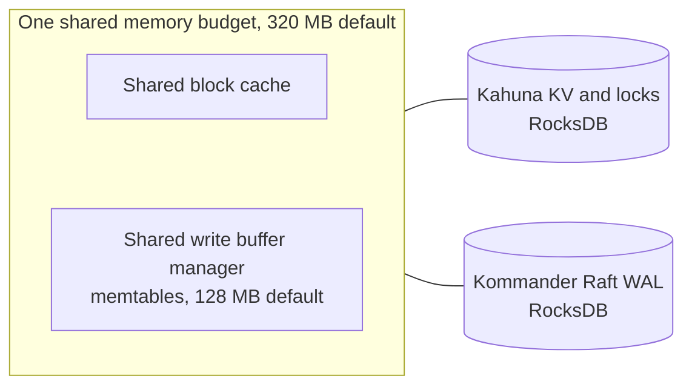
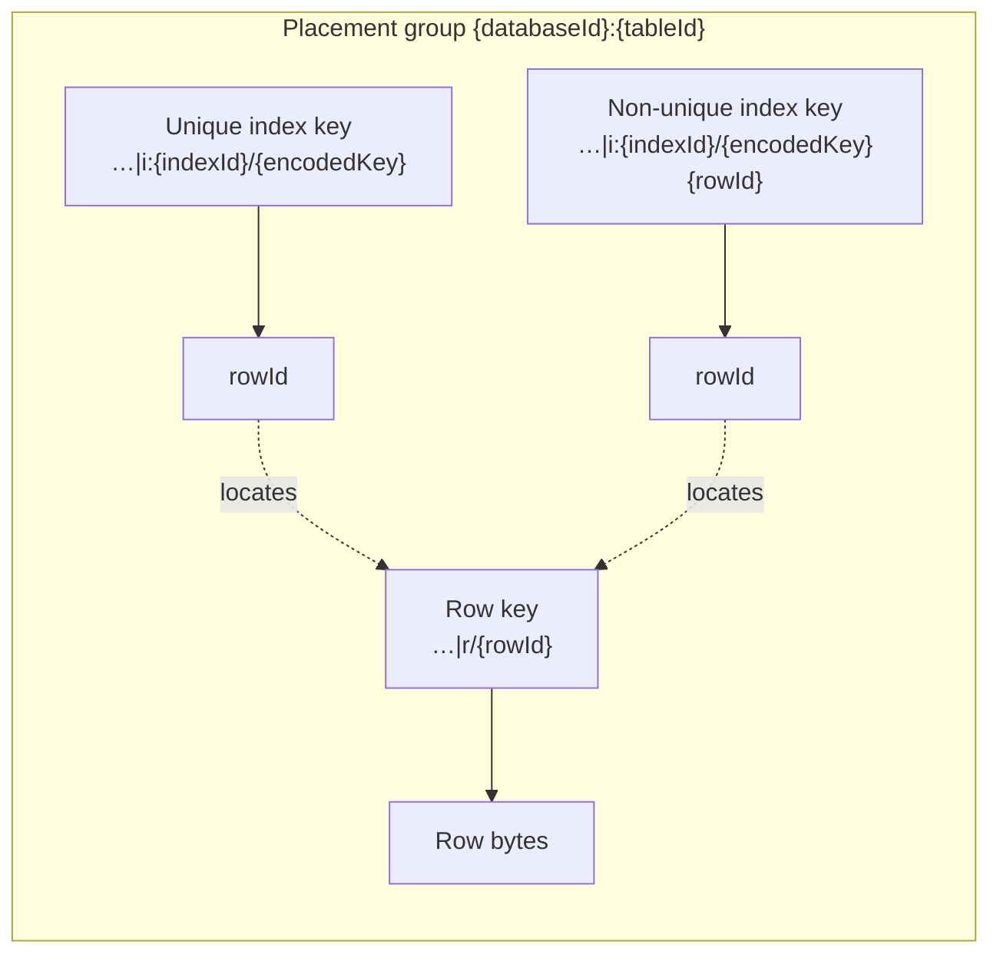

# Storage

CamusDB stores relational data on a distributed key/value layer provided by
[Kahuna](/docs/concepts#kahuna), the transactional key/value store embedded in
each node. CamusDB maps tables, rows, indexes, schema metadata, locks, and
transaction state to persistent key/value entries.

You do not need this page to use CamusDB. Read it when you want to know how a
table becomes key/value entries. That helps you understand index costs, row
sizes, and the ranges in [`SHOW RANGES`](/docs/show-ranges).

Users keep working with SQL, while the storage layout is one that the
distributed KV layer can route, replicate, lock, and commit.

For the user-facing row format controls for large `STRING`, `BYTES`/`BLOB`, and
`ARRAY` values, see [Large Values](/docs/storage-layout). That page covers
TOAST-style compression, out-of-line storage, and `ALTER TABLE ... REWRITE
STORAGE`.

## The storage stack

The SQL engine decides which rows and indexes a statement touches, and the
CamusDB KV mapping encodes them as key/value entries. Kahuna stores those
entries with transactions and locks, [Kommander](/docs/concepts#kommander)
replicates them through the
[Raft](/docs/concepts#raft) log in cluster mode, and
[RocksDB](/docs/concepts#rocksdb), or another configured backend, writes them to disk. See
[Architecture: storage components](/docs/architecture#storage-components) for
what each component does. For the recovery path, see
[WAL And Recovery](/docs/wal-recovery).

## RocksDB backend {#the-rocksdb-backend}

RocksDB is the default backend for both the key/value state and the Raft log,
in standalone and cluster mode. SQLite is an optional embedded backend for both.
[Solarium](https://solariumdb.github.io/) is a managed alternative for either layer. The in-memory backend is
for development and tests only.

RocksDB is an embedded ordered key/value database built as a log-structured
merge-tree (LSM-tree). Each write goes to a durable log file and to an
in-memory buffer called a memtable. RocksDB later flushes the memtable to sorted
files on disk, called SST files, and background compaction merges those files
over time so reads stay efficient.

These are the relevant storage settings:

```yaml
kahuna:
  storage: rocksdb
  wal_storage: rocksdb
  wal_sync_writes: true
  rocksdb_shared_memory: true
  rocksdb_shared_memory_budget_mb: 320
  rocksdb_shared_memtable_budget_mb: 128
```

`storage` selects the backend for the materialized KV state. `wal_storage`
selects the backend for the Raft write-ahead log.

`wal_sync_writes: true` keeps acknowledged durable WAL writes on the safer path.
Use `false` only for benchmarks or tests where you are not evaluating durability
across a crash.

## Solarium backend

Use [Solarium](https://solariumdb.github.io/) by selecting `solarium` for `kahuna.storage`,
`kahuna.wal_storage`, or both when you
want managed storage without a native RocksDB dependency. CamusDB includes the
engine integration. Its cache and memtables consume managed heap, unlike
RocksDB's native allocations, so heap and cache budgets must be sized together.

The two engines cannot read each other's files. Moving data between them
requires a [logical dump and reimport](/docs/logical-dump-and-reimport).
PITR bootstrap still requires RocksDB for both layers. See
[Solarium configuration](/docs/configuration#solarium-storage-engine) for
I/O environments, shared budgets, compaction pacing, and startup warnings.

## Shared RocksDB memory

When RocksDB serves both the materialized KV backend and the WAL backend, the
CamusDB process holds two separate embedded RocksDB databases:

- Kahuna's KV and locks backend, which holds SQL rows, indexes, metadata, locks,
  and transaction state.
- Kommander's Raft WAL backend, which holds the consensus log entries.

The two databases stay separate on disk. That protects the Raft log from the
data store's lifecycle, and lets WAL recovery, checkpoints, compaction, and data
files be managed independently.

Left alone, two RocksDB databases would allocate two separate memory budgets.
Two structures dominate RocksDB memory:

- The block cache, which holds data blocks that RocksDB read from SST files.
- The memtables.

CamusDB's RocksDB baselines enable shared memory by default. Kahuna creates one
shared block cache and one shared write buffer manager, and passes both to the
two RocksDB databases:

```yaml
kahuna:
  rocksdb_shared_memory: true
  rocksdb_shared_memory_budget_mb: 320
  rocksdb_shared_memtable_budget_mb: 128
```

The total budget bounds the shared block cache, and CamusDB charges the
memtable sub-budget inside that same budget. So one process-level memory target
governs reads and writes for both RocksDB databases, instead of two independent
budgets.



Operational notes:

- Sharing is active only when `storage` and `wal_storage` are both
  `rocksdb`.
- The setting does nothing if either backend is `sqlite` or `memory`.
- Unset shared-cache and memtable budgets are computed from available memory
  and the memory profile. The fixed examples above are explicit settings;
  see [cache sizing](/docs/configuration#cache-defaults-proportional-to-memory).
- The memtable sub-budget must not exceed the total shared budget.
- Set `rocksdb_shared_memory: false` to go back to independent memory
  resources for each RocksDB database.
- The feature changes no persisted data format, SQL behavior, transaction
  behavior, WAL semantics, or recovery ordering.

Use a larger total budget for nodes with a hot read working set or heavy write
bursts. If the memtable sub-budget is too small for the workload, RocksDB can
flush more often. If it is too large, the deployment saves less memory.

## Databases in the shared key space

See [Databases](/docs/databases) for creating, renaming, dropping, and
recovering a database. At the storage level, every database in a process shares
one Kahuna node. Creating a database creates no separate storage engine, RocksDB
instance, WAL, or directory: its database id isolates it inside the shared
[key space](/docs/concepts#key-space).

Opening a database is a metadata operation. CamusDB resolves the name through
the registry, loads the schema metadata from the shared KV store, registers the
callbacks that apply later DDL changes after their Raft commit, and opens each
table lazily, when a statement first touches it. At startup this happens only
after [WAL recovery](/docs/wal-recovery#the-recovery-path) finishes. Dropping a
database does not rewrite the Raft schema log, which only accepts new entries.

## Key layout

CamusDB stores rows, indexes, schema metadata, statistics, and registry
records as key/value entries in the shared
[Kahuna](https://kahunakv.github.io/) key space.

Every user data key starts with the opaque database id, so two databases can use
the same table names without sharing storage keys.

A new table gets a short base62 table id from a persistent monotonic sequence in
the shared system key space. The id contains none of the KV key separators (`/`,
`:`, and `~`), and CamusDB never reuses it after the table is dropped. It is
usually much shorter than the previous 24-character ObjectId-style table id. An
existing database can still hold older 24-hex-character table ids. Both formats
coexist safely, because CamusDB treats the id as an opaque key segment.

| Object | Key shape | Value |
| --- | --- | --- |
| Database registry entry | `_system/dbregistry/db:{databaseName}` | The database id, the normalized name, and the creation time. |
| Database id sequence | `_system/dbregistry/seq` | The monotonic sequence that allocates database ids. |
| Table id sequence | `_system/tableseq` | The monotonic sequence that allocates new short base62 table ids. |
| System metadata | `{databaseId}/meta/system` | The database's internal metadata. |
| Schema version | `{databaseId}/meta/version` | The schema version that CamusDB applied. |
| Table schema | `{databaseId}/meta/table:{tableId}` | The serialized schema of one table. |
| Table schema history | `{databaseId}/meta/history:{tableId}:{version}` | An earlier schema version of the table, used to decode older rows. |
| DDL coordinator state | `{databaseId}/meta/coordinator:{tableId}~{element}` | The state of a multi-step schema change, such as an index backfill. |
| Table statistics | `{databaseId}:stats:{tableId}` | The table's persisted planner statistics. |
| Row | `{databaseId}:{tableId}\|r/{rowId}` | The serialized row bytes. |
| Unique index entry | `{databaseId}:{tableId}\|i:{indexId}/{encodedKey}` | The row id as UTF-8 text. |
| Non-unique index entry | `{databaseId}:{tableId}\|i:{indexId}/{encodedKey}{rowId}` | The row id as UTF-8 text. |
| Large value | `{databaseId}:{tableId}\|v/{rowId}{ordinal}` | The bytes of one variable-length cell stored out of line. `{ordinal}` is four hex digits. |

A transaction can also use a routing key, `{databaseId}:{tableId}|tx/{transactionId}`,
to place its coordinator on the [partition](/docs/concepts#partition) that holds
the table. CamusDB never stores that key, and a transaction does not always use
one.

The slash and `|` positions are intentional. Row keys share the bucket
`{databaseId}:{tableId}|r`, index keys share `{databaseId}:{tableId}|i:{indexId}`,
and large values share `{databaseId}:{tableId}|v`. The part before the first `|`
is the placement group. Under
[hash routing](/docs/concepts#hash-and-key-range-routing), the default, a
table's rows, large values, and indexes share that group, so they stay on the
same partition.



This key shape is part of the storage revision. Move data across storage
revisions with a [logical dump and reimport](/docs/logical-dump-and-reimport).

All metadata keys use the single bucket `{databaseId}/meta`, so CamusDB can
load and purge a database's metadata as one coherent group.

A non-unique index key holds the row id directly after the encoded key. Because
the row id has a fixed 24-character form, CamusDB can split it off again, and
index keys stay sortable.

Each index uses a stable id in the storage key space and keeps the index name
the schema shows as metadata. Tables and columns also have stable ids.

CamusDB allocates a new base62 table id before it commits the schema change, so
every node applies the same identity for that table. Renaming a table, column,
or index needs no rewrite of existing row or index data.

## Row values

CamusDB stores each row as one compact binary value. The row payload holds:

1. The schema version.
2. The row's object id.
3. One encoded value per column, in schema order.

The schema version lets CamusDB deserialize older row payloads using the
table's schema history.

CamusDB compiles the row layout of each visible schema version, so scans and
point reads decode only the values the query needs instead of rebuilding the
whole row through a generic path. The storage format stays the same, while CPU
and allocation costs drop for read-heavy queries, index lookups, updates, and
backfills.

CamusDB encodes a column value by its type:

| Column type | Stored representation |
| --- | --- |
| `OID` | A 12-byte object id. |
| `UUID` | A 16-byte UUID. |
| `INT64` | An 8-byte signed integer. |
| `NUMERIC` | An exact fixed-point decimal value with the fixed `NUMERIC` precision and scale. |
| `FLOAT64` | An 8-byte double. |
| `FLOAT32` | A 4-byte single-precision value, exposed through the common numeric value path. |
| `STRING` | A length-prefixed UTF-16 string. |
| `BOOL` | One boolean marker byte. |
| `DATE` | UTC ticks, truncated to midnight. |
| `DATETIME` | UTC ticks. |
| `BYTES` | A length-prefixed byte payload. |
| `ARRAY(T)` | The element type, followed by the ordered encoded element values. |
| `NULL` | One null marker byte. |

## Index encoding

Index keys must sort in the same order as the SQL values they encode. CamusDB
uses an order-preserving encoder for composite index values:

- `NULL` sorts before any present value.
- `INT64` inverts the sign bit and stores the result as fixed-width hexadecimal
  text.
- A `NUMERIC` value uses an order-preserving decimal encoding, so exact decimal
  values can participate in primary keys and secondary indexes without going
  through a floating-point representation.
- `FLOAT64` and `FLOAT32` apply an order-preserving transform to their IEEE-754
  bits.
- `BOOL` stores `0` or `1`.
- `DATE` and `DATETIME` sort by their UTC tick value.
- `UUID` stores its 128-bit value in an order-preserving fixed-width encoding.
- `BYTES` uses an order-preserving byte encoding.
- `STRING` and `OID` values use a terminator and escaping, so prefixes sort
  correctly.

So CamusDB can scan index keys in the KV layer's lexicographic order and get
results in the SQL order of the indexed columns.

Every scalar column type can be indexed. An `ARRAY(T)` column is stored in the
row, but you cannot use it in a primary key or a secondary index.

For UUID identifiers, prefer a `UUID` column over `STRING`. A `UUID` column
stores 16 bytes in the row and uses compact fixed-width index keys. A UUID saved
as text carries the larger string form through memory, disk, and index entries.

## Writes and locks

The write path uses persistent KV entries and a server-owned transaction
coordinator:

1. Start a transaction.
2. Acquire an exclusive lock on each row, index, and metadata key the
   transaction will write.
3. Write or delete the affected keys.
4. Register the confirmed writes and locks with Kahuna's transaction
   coordinator.
5. Commit the transaction handle through the
   [Kahuna](https://kahunakv.github.io/) transaction API, or roll it back.

A write across partitions uses [two-phase commit](/docs/concepts#two-phase-commit).
CamusDB uses Serializable transactions by default, which add reads of committed
row versions ([MVCC](/docs/concepts#mvcc)), conflict detection, and
[write intents](/docs/concepts#write-intent): the provisional values a
transaction stages until its atomic commit.

## Scans

A full table scan reads the row bucket prefix:

```text
{databaseId}:{tableId}|r
```

An index scan reads the index bucket prefix:

```text
{databaseId}:{tableId}|i:{indexId}
```

Row ids and encoded index keys both preserve sort order, so CamusDB can stream
rows and index entries from KV storage in a deterministic order. It then applies
filters, projection, sorting, limits, and aggregation.

## Standalone mode and cluster mode

Standalone mode creates one embedded Kahuna node for the CamusDB process,
shared by every database. This is the simplest setup for tutorials and local
development.

Cluster mode also creates one shared storage node per process, and connects it
to the other nodes through static discovery. CamusDB divides the data across
Raft partitions, and each partition elects its own
[leader](/docs/concepts#leader) through Kommander.

See [Cluster Mode](/docs/cluster) for startup commands and configuration.
