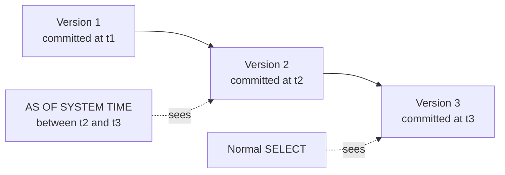

# Time-travel reads

`AS OF SYSTEM TIME` reads your data as it was at a past moment. The query is a
regular read-only `SELECT` that reads a past committed snapshot in place of the
latest one.

You can use it after a change to see the earlier state. For example, you can
investigate an incident, or find the values that an accidental update
overwrote. By default, you can read up to one hour back.

## Quick example

```camussql
SELECT *
FROM leaderboard AS OF SYSTEM TIME '-10s';

SELECT *
FROM accounts AS OF SYSTEM TIME '2026-07-19T20:00:00Z'
WHERE id = 9910;
```

The first query reads `leaderboard` as it was ten seconds ago. The second reads
`accounts` at an absolute UTC timestamp.

### Read a row as it was before an update

Create an account and record the current time:

```camussql
CREATE TABLE accounts (
  id INT64 PRIMARY KEY,
  owner STRING NOT NULL,
  balance INT64 NOT NULL
);

INSERT INTO accounts (id, owner, balance) VALUES (9910, 'alice', 500);

SELECT now() AS before_update;
```

```text
┌──────────────────────────────┐
│ before_update                │
├──────────────────────────────┤
│ 2026-11-18T21:48:25.8985000Z │
└──────────────────────────────┘
1 rows in set (00:00:00.0034120)
```

Change the balance. A normal read returns the new value:

```camussql
UPDATE accounts SET balance = 0 WHERE id = 9910;

SELECT * FROM accounts WHERE id = 9910;
```

```text
┌──────┬───────┬─────────┐
│ id   │ owner │ balance │
├──────┼───────┼─────────┤
│ 9910 │ alice │ 0       │
└──────┴───────┴─────────┘
1 rows in set (00:00:00.0039723)
```

Read the row at the recorded time. Use the value that your `SELECT now()`
returned:

```camussql
SELECT *
FROM accounts AS OF SYSTEM TIME '2026-11-18T21:48:25.8985000Z'
WHERE id = 9910;
```

```text
┌──────┬───────┬─────────┐
│ id   │ owner │ balance │
├──────┼───────┼─────────┤
│ 9910 │ alice │ 500     │
└──────┴───────┴─────────┘
1 rows in set (00:00:00.0060748)
```

The historical read returns the balance that the update overwrote.

## Syntax

Write `AS OF SYSTEM TIME` after the `FROM` clause and before the other clauses:

```camussql
SELECT score
FROM leaderboard AS OF SYSTEM TIME '-1m'
WHERE score > 5
ORDER BY score DESC
LIMIT 10;
```

In a query with a join, write the clause after the last joined table:

```camussql
SELECT c.name, o.total
FROM customers c
JOIN orders o ON o.customer_id = c.id
AS OF SYSTEM TIME '-5m'
WHERE o.total > 100;
```

The clause applies to the full statement. Subqueries and CTEs read the same
snapshot as the outer query.

Write the clause once, on the outer query. A clause in a subquery or a CTE body
returns `CADB0409`. In a set operation such as `UNION`, a clause on an operand
returns the same error. To read a set operation at a past time, put it in a
derived table.

```camussql
SELECT *
FROM (
  SELECT id FROM orders
  UNION
  SELECT order_id FROM refunds
) AS ids AS OF SYSTEM TIME '-10m';
```

## Timestamp values

The clause takes one of the following values:

| Form | Example | Meaning |
| --- | --- | --- |
| Relative offset | `'-10s'`, `'-500ms'`, `'-2m'`, `'-1h'`, `'-1d'` | That far into the past, from the start of the statement. The units are `ms`, `s`, `m`, `h`, and `d`. |
| Absolute timestamp | `'2026-07-19 20:00:00+00:00'`, `'2026-07-19T20:00:00Z'` | That moment. If the value doesn't include a time zone, it's read as UTC. |
| Epoch milliseconds | `1721420000000` | That Unix time, in milliseconds. |
| Parameter | `@ts` | A bound string, integer (epoch milliseconds), or datetime value. |

A relative offset must be negative.

## Consistency

CamusDB stores several committed versions of each row, called
[revisions](/docs/concepts#mvcc). For each row, a historical read sees the
latest revision that committed at or before the requested time. A write that
committed after that time isn't visible to the historical read.



This means that the statement sees one consistent snapshot. A historical read
doesn't take locks, and it doesn't block writes.

Commit times come from the cluster clock. For more information, see
[Distributed transactions and HLC](/docs/distributed-transactions).

## Copy historical data

`INSERT INTO ... SELECT` and `CREATE TABLE ... AS SELECT` can read their source
at a past time. Put the clause on the outer source query. A clause in a subquery
of either statement returns `CADB0409`, as it does in a subquery of an ordinary
`INSERT`, `UPDATE`, or `DELETE`.

```camussql
CREATE TABLE orders_before_incident AS
SELECT customer, total
FROM orders AS OF SYSTEM TIME '-2h';

INSERT INTO orders (id, customer, total)
SELECT gen_id(), customer, total
FROM orders AS OF SYSTEM TIME '-2h'
WHERE customer = 'acme';
```

The source reads the past snapshot, and the rows are written to the current
state of the database. You can use this to restore rows after an accidental
update or delete. You don't need a backup. These statements can also run in an
explicit transaction.

For more information, including the warning for a copy that inserts zero rows,
see [Copying query results](/docs/insert-select-and-ctas).

To restore a dropped table or database, use
[Recover dropped objects](/docs/recover-dropped-objects).

## Restrictions

- A historical `SELECT` must run in autocommit mode. In an explicit
  transaction, it returns `CADB0409`. The transaction is then rolled back.
  However, a copy with `INSERT INTO ... SELECT` is allowed.
- For writes, the clause is supported on the outer source query of
  `INSERT ... SELECT` and `CREATE TABLE ... AS SELECT`. Placing it in a
  subquery of a write returns `CADB0409`.
- The time must be in the past and after the Unix epoch.

## How far back you can read

Old revisions are removed in the background. A historical read can use only the
revisions that are left. Two `config.yml` keys under `kahuna:` control how long
revisions are kept:

| Key | Default | Meaning |
| --- | --- | --- |
| `persistent_revision_retention_age_seconds` | The value of `pitr_window_seconds` (`3600`) | Revisions older than this age can be removed. `0` turns off age-based removal. |
| `persistent_revision_retention_count` | `0` | The maximum number of revisions for each row. `0` means no limit. |

To read further back, increase the retention age. A value lower than
`pitr_window_seconds` stops the startup. More history uses more disk. With age
retention turned off, the history of a busy table grows for as long as the table
exists.

A row that hasn't changed for longer than the retention age is readable anywhere
in the window. The latest revision before the window is kept.

If a read needs revisions that were removed, it returns
`CADB0847 SnapshotTooOld`. It doesn't return a partial result. Note that a
read older than the retention age can succeed if the old revisions weren't
removed yet. A retry at the same time will fail again. Read at a newer time.

## Truncated tables

A historical read of a table that was truncated after the requested time
returns `CADB0537` `SnapshotPrecedesContentsGeneration`. To read the old rows,
recover them with `RELINK` and read the recovered table. For more information,
see [TRUNCATE TABLE](/docs/truncate-table#time-travel).

## Errors

| Error | Cause | What to do |
| --- | --- | --- |
| `CADB0409 InvalidAsOfSystemTime` | A malformed value such as `'-10x'`, a positive offset such as `'+10s'`, a future time, a time at or before the epoch, an unbound parameter, or a clause in an explicit transaction. | Fix the value, or run the read in autocommit mode. |
| `CADB0847 SnapshotTooOld` | The revisions for that time were removed. | Read at a newer time, or increase the retention for future reads. |
| `CADB0537 SnapshotPrecedesContentsGeneration` | The table was truncated after that time. | Recover the old rows with `RELINK`. |

For more information, see [Error codes](/docs/error-codes).
