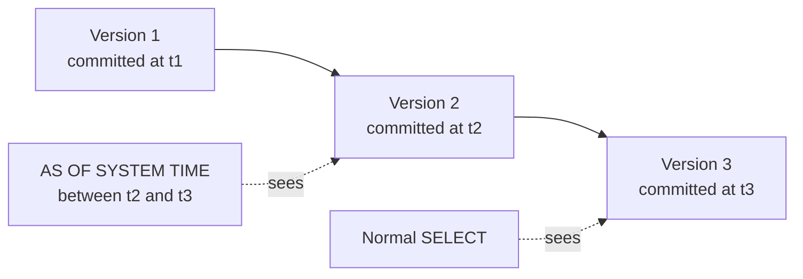

# Time-travel reads

`AS OF SYSTEM TIME` reads your data as it was at a past moment. The query is an
ordinary read-only `SELECT`; CamusDB simply pins it to a historical committed
snapshot instead of the latest one.

You usually reach for it after a change, to see the earlier state: diagnosing an
incident, checking the data behind a report, or working out what an accidental
write overwrote.

## Quick example

```camussql
SELECT *
FROM leaderboard AS OF SYSTEM TIME '-10s';

SELECT *
FROM accounts AS OF SYSTEM TIME '2026-07-19T20:00:00Z'
WHERE id = 9910;
```

The first query reads `leaderboard` as it was ten seconds ago. The second reads
`accounts` at an absolute UTC timestamp.

## Syntax

Write `AS OF SYSTEM TIME` after the `FROM` source and before any `WHERE`,
`GROUP BY`, `ORDER BY`, `LIMIT`, or `OFFSET`:

```camussql
SELECT *
FROM accounts AS OF SYSTEM TIME '-10s'
WHERE id = 9910;

SELECT score
FROM leaderboard AS OF SYSTEM TIME '-1m'
WHERE score > 5
ORDER BY score DESC
LIMIT 10;
```

In a query with a join, the clause still applies to the whole statement. Write
it after the joined `FROM` source:

```camussql
SELECT c.name, o.total
FROM customers c
JOIN orders o ON o.customer_id = c.id
AS OF SYSTEM TIME '-5m'
WHERE o.total > 100;
```

Every table, join, and subquery in the statement sees the same historical
snapshot.

Compressed or out-of-line large values are read at the same timestamp as their
row. `ALTER TABLE ... REWRITE STORAGE` writes new row versions and never
modifies old ones, so a historical read before the rewrite returns the old
physical form with the same logical value. See [Large Values](/docs/storage-layout).

## Timestamp values

`AS OF SYSTEM TIME` accepts a string, an integer in epoch milliseconds, or a
bound parameter.

| Form | Example | Meaning |
| --- | --- | --- |
| Relative offset string | `'-10s'`, `'-500ms'`, `'-2m'`, `'-1h'`, `'-1d'` | Reads that far into the past, measured from the start of the query. |
| Absolute timestamp string | `'2026-07-19 20:00:00+00:00'`, `'2026-07-19T20:00:00Z'` | Reads at that instant in UTC. |
| Epoch milliseconds integer | `1721420000000` | Reads at that Unix epoch millisecond. |
| Parameter | `@ts` | Uses a bound string, epoch milliseconds integer, or datetime value. |

Strings can use single or double quotes:

```camussql
SELECT * FROM accounts AS OF SYSTEM TIME "-10s";
```

Relative offsets support `ms`, `s`, `m`, `h`, and `d`, and must point into the
past. Use a negative value, such as `'-10s'`.

CamusDB treats a timestamp string without an explicit time zone as UTC.

## Consistency guarantees

CamusDB keeps several committed versions of each row, called
[revisions](/docs/concepts#mvcc). A time-travel read sees, for each key, the
highest committed revision at or before the resolved timestamp. A write that
committed after that timestamp is invisible to the historical query, though a
normal `SELECT` sees it.



The snapshot is fixed for the whole statement:

- Every side of a join reads at the same timestamp.
- Subqueries read at the same historical timestamp as the outer query.
- Filtering, grouping, ordering, and pagination all run over the historical
  result.
- The historical read blocks no writers.

So you get a consistent view of the database at one logical point in time,
without restoring a backup or pausing current traffic.

## Common uses

- Inspect the data just before an accidental update or delete.
- Compare a current report with the same query from minutes or hours earlier.
- Debug production behavior by asking what a query would have returned at the
  time of an incident.
- Audit whether a later write changed a business-critical row.
- Rebuild an application-level view from a known historical point.

To recover a dropped object, use
[Recover Dropped Objects](/docs/recover-dropped-objects). A time-travel read
inspects historical row state, while relinking a dropped database or table
restores the whole object, as long as it is still inside the recovery window.

## Copy historical data

`AS OF SYSTEM TIME` can also be the source of an `INSERT INTO ... SELECT` or a
`CREATE TABLE ... AS SELECT`:

```camussql
CREATE TABLE orders_before_incident AS
SELECT customer, total
FROM orders AS OF SYSTEM TIME '-2h';

INSERT INTO orders (id, customer, total)
SELECT gen_id(), customer, total
FROM orders AS OF SYSTEM TIME '-2h'
WHERE customer = 'acme';
```

The source reads the historical snapshot, and the destination writes into the
database's current state. This lets you rebuild rows after an accidental update
or delete without restoring a backup.

See [Copying Query Results](/docs/insert-select-and-ctas) for CTAS, transaction
and locking behavior, and the zero-rows warning.

## Restrictions

A standalone `AS OF SYSTEM TIME` read is read-only by design:

- CamusDB supports it for read-only `SELECT` statements in autocommit mode.
- CamusDB rejects a standalone historical `SELECT` inside an explicit
  multi-statement transaction.
- `INSERT INTO ... SELECT` and `CREATE TABLE ... AS SELECT` may use a
  historical `SELECT` as the source. The writes still target the database's
  current state.
- CamusDB rejects the clause when the read has already moved into a
  transaction's snapshot.
- You cannot use the clause directly with `UPDATE`, `DELETE`, or
  `INSERT ... VALUES`.
- The clause accepts only past instants. CamusDB rejects future times, and
  times at or before the Unix epoch.

A historical read can only go as far back as the storage's retained history.
Two settings control how much history CamusDB keeps:

- `kahuna.persistent_revision_retention_age_seconds` sets how long old
  revisions survive. When you set neither retention key, it defaults to
  `kahuna.pitr_window_seconds` (3,600 seconds by default). `0` turns off
  age-based pruning.
- `kahuna.persistent_revision_retention_count` caps the revisions kept per key.
  The default, `0`, turns off count-based pruning.

If the requested timestamp is older than the retained revisions, there is no
separate "snapshot too old" error. The query can return an empty result,
because no retained revision is visible at that timestamp.

## Truncated tables

A historical read of a table that was truncated after the requested snapshot
fails with `CADB0537` `SnapshotPrecedesContentsGeneration`, instead of returning
a misleading empty result. Recover the old rows with `RELINK` and read the
recovered table. See [TRUNCATE TABLE](/docs/truncate-table#time-travel) for the
exact rules.

## Storage model

CamusDB stores committed versions in [Kahuna](/docs/concepts#kahuna), its
built-in key/value storage layer, which keeps several versions of each key. Each
committed version carries a timestamp from the
[hybrid logical clock](/docs/concepts#hlc) (HLC), the cluster-wide clock that
orders commits.

An autocommit `SELECT` pins a snapshot when the statement starts.
`AS OF SYSTEM TIME` supplies a past timestamp instead, and the statement runs
on a read-only snapshot pinned to it.

For more background on HLC timestamps and transaction snapshots, see
[Distributed Transactions And HLC](/docs/distributed-transactions).

## Errors

An invalid time-travel request returns `CADB0409 InvalidAsOfSystemTime`. A
snapshot older than a truncated table's current contents returns `CADB0537
SnapshotPrecedesContentsGeneration`.

Common causes:

- A malformed duration string, such as `'-10x'`.
- A positive relative offset, such as `'+10s'`.
- An absolute timestamp in the future.
- A zero or negative epoch milliseconds value.
- A missing or incompatible parameter value.
- Using the clause inside an explicit transaction.

See [Error Codes](/docs/error-codes) for retry guidance.
