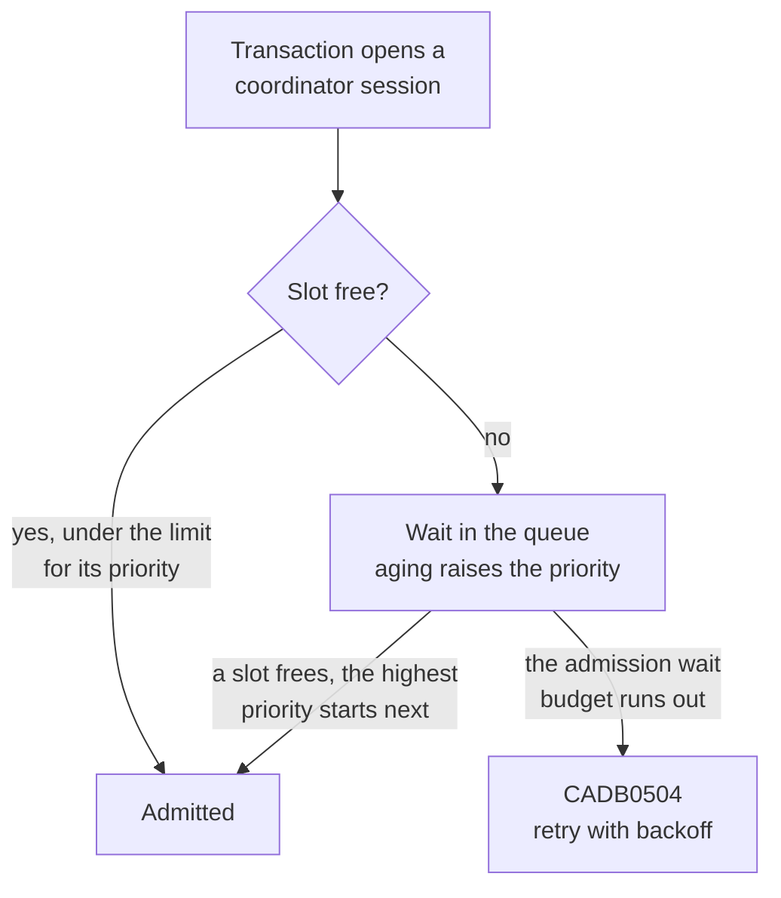

# Transaction priority

Transaction priority lets important work start first when a node is
overloaded. For example, checkout transactions can start before a bulk cleanup
job.

The feature is off by default. It has an effect only after you set a limit on
concurrent coordinator sessions (a coordinator session tracks one transaction
until it ends). This limit is the admission gate. When the node is at the
limit, a new transaction waits in a queue before it starts. The priority of each
transaction is always recorded, but no transaction waits until you set
`kahuna.max_concurrent_sessions`. Read [Turn the gate on](#turn-the-gate-on)
before you set it.

## What priority changes

Priority decides which queued transaction starts next when the node is at its
limit. This means that:

- Priority changes the start time of a transaction. After it starts, a
  transaction competes for resources and locks like all other transactions.
- Priority doesn't change lock conflicts. A `Background` transaction with an
  exclusive lock blocks a `Critical` transaction. Isolation and
  [two-phase commit](/docs/concepts#two-phase-commit) don't change.
- Priority applies per node. Each node orders the work that it receives. There
  is no cluster-wide order.

To reduce the resources that background work uses, use a rate limit. For more
information, see
[Limit background work with rate limits](#limit-background-work-with-rate-limits).

## Priority levels

| Priority | Use for |
|---|---|
| `Background` | Bulk work that can wait. It yields to all other work. |
| `Low` | Work below regular traffic that needs reasonable latency. |
| `Normal` | The default. |
| `High` | Latency-critical work that must start before regular traffic. |
| `Critical` | Work that must not wait. |

Don't tag regular application traffic as `Critical`. If all work is critical,
the order has no effect. `Critical` can also use the reserved slots, and too
much `Critical` work uses up the reserve.

## Set a priority

In SQL, `SET TRANSACTION PRIORITY` must come first in the transaction, before
any data statement:

```camussql
BEGIN;
SET TRANSACTION PRIORITY BACKGROUND;
DELETE FROM events WHERE created_at < '2026-01-01';
COMMIT;
```

The values are `BACKGROUND`, `LOW`, `NORMAL`, `HIGH`, and `CRITICAL`, in any
case. You can combine the statement with `SET TRANSACTION LOCKING` and
`SET TRANSACTION ISOLATION LEVEL`, in any order, before the first data
statement. After a data statement, `SET TRANSACTION PRIORITY` returns
`CADB0400`.

A client that uses the [HTTP API](/docs/http-api#explicit-transactions) or the
[gRPC API](/docs/grpc-api#transactions) directly can also set a priority on
each request.

The server default is `default_transaction_priority` in `config.yml`:

```yml
default_transaction_priority: normal   # background | low | normal | high | critical
```

You can also change the default on a running cluster. The new value applies on
all nodes to transactions that begin after the change:

```camussql
SET CLUSTER SETTING default_transaction_priority = low;
```

The order of precedence is `SET TRANSACTION PRIORITY`, then the field of the
request, then `default_transaction_priority`.

## Turn the gate on

The gate settings are under `kahuna:` in `config.yml`. They're read at startup,
and a change needs a restart. `SET CLUSTER SETTING` doesn't accept `kahuna.*`
keys.

```yml
kahuna:
  max_concurrent_sessions: 64             # 0 (default) = no gate
  transaction_priority_reserved_slots: 2  # slots that only High and Critical can use
  transaction_priority_aging_threshold: 1000
  transaction_priority_max_queued: 4096
```

### Set the session limit

A coordinator session opens for each transaction, including the internal
transactions of CamusDB, such as catalog writes and index backfill. This means
that `max_concurrent_sessions` limits all concurrent engine work on the node.

A limit below your regular concurrency makes a healthy node queue work, and adds
latency for no benefit. You should set the limit at or above the concurrency
that you observe when the node is healthy. The gate is for surplus load.

### Reserve slots for internal work

Internal work uses the same limit. When you set a limit, you should set
`transaction_priority_reserved_slots` to 1 or more. With no reserve, a flood of
user traffic can delay a schema checkpoint.

A reserve of 1 or 2 is usually enough. The reserved slots aren't available to
regular traffic, and a large reserve slows down your usual workload. If the
reserve is equal to or greater than the limit, the node doesn't start.

### Aging limits starvation

The effective priority of a waiting transaction goes up one level for each
`transaction_priority_aging_threshold` milliseconds of waiting. This means that
low-priority work can't wait forever.

With the default threshold of 1,000 ms, a `Background` transaction reaches
`High` after about three seconds. `Background` yields for seconds, and it
doesn't wait until the node is idle.

To make background work wait longer, set the threshold to tens of seconds. The
threshold applies to all transactions. A higher value also increases the
longest wait of a regular transaction. A value of `0` turns off aging, and a
transaction can then wait without limit.

### Admission wait budget

If a transaction isn't admitted within the admission wait budget, it returns
the retryable error `CADB0504`. The transaction didn't start, and a retry is safe.
However, the node is overloaded at this point. You should retry with backoff.



```yml
transaction_admission_wait_ms: 0          # 0 = use the node's budget

kahuna:
  default_admission_wait_ms: 5000         # the budget when the caller doesn't set one
  max_admission_wait_ms: 30000            # the maximum budget that a caller can set
```

The admission budget is separate from the transaction lifetime.
`max_serializable_transaction_lifetime_ms` (one hour by default) limits how long
an admitted transaction can run. The admission budget limits how long a
transaction waits to start.

You should keep the budget short, in seconds. A longer budget doesn't increase
throughput. It makes a fast retryable error into a slow one, and each waiting
transaction uses a place in the queue (`transaction_priority_max_queued`).

## Limit background work with rate limits

Priority decides which work starts first. It doesn't reduce the resources that
a transaction uses after it starts. For that, use these settings. They work also
when the gate is off:

- `auto_analyze_max_rows_per_second` (default `50000`) limits the row rate of
  the background statistics scan.
- `auto_analyze_load_pause_threshold` (default `16`) pauses a background
  analyze when the number of running foreground transactions is above the
  threshold. This is checked during the scan.

The auto-analyze scan doesn't go through the gate, because it reads committed
data without a transaction. Only the short write that publishes the statistics
goes through the gate. An autocommit `SELECT` at read committed doesn't open a
session either, and it doesn't wait at the gate.

## Internal priorities

| Work | Priority | Reason |
|---|---|---|
| User statements | `Normal` | The default. |
| Index backfill | `Background` | Bulk work in batches. Each batch goes through the gate again. |
| Statistics flush and analyze publish | `Background` | A delay makes the optimizer statistics older. |
| Row-level TTL sweeps | `Background` | Deletes of expired rows can wait. |
| Schema checkpoint | `High` | A stalled checkpoint blocks DDL in the cluster. |
| Database registry lookup after a cache miss | `High` | It is part of a user request that was already admitted. |

No internal work uses `Critical`.

## Observability

The node shows admission gauges under `kahuna.tx_admission.*`, for each
priority:

- `in_flight`
- `queued`
- `max_queue_depth`
- `admitted`
- `aged_promotions`
- `abandoned_while_waiting`
- `rejected_queue_full`

Watch `queued` first. A value of zero means that the limit doesn't affect any
work. A value above zero for `High` or `Critical` for a long time means that the
limit is too low for the load, or that the node needs a reserve.
