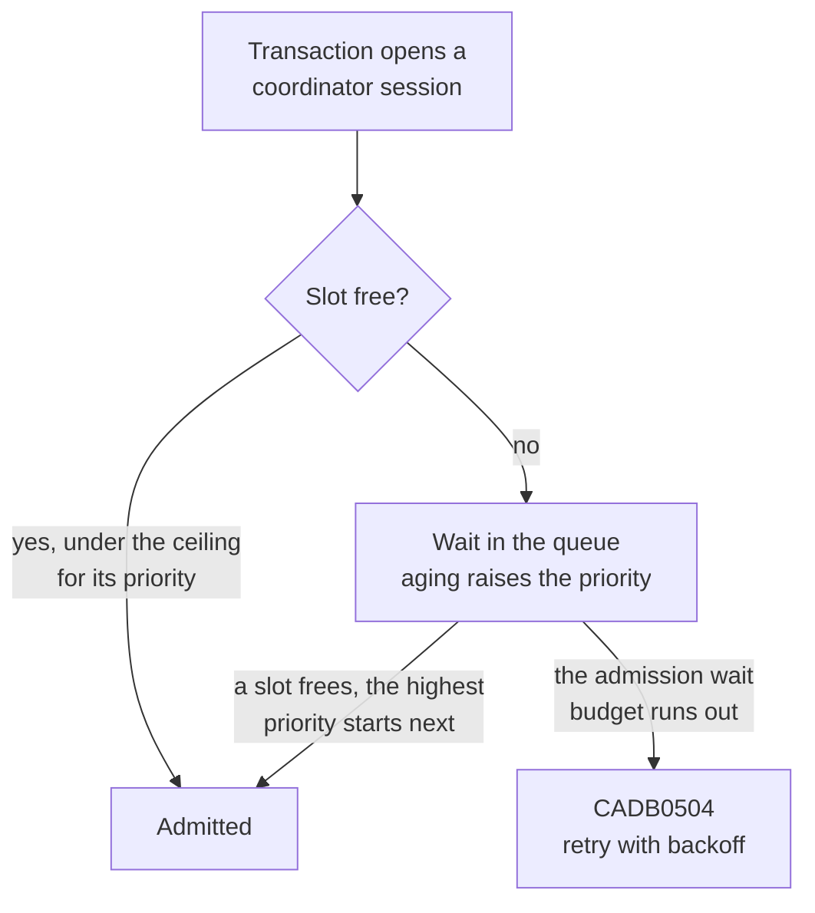

# Transaction priority

CamusDB can give each transaction a relative importance, so that when a node is
saturated, the work that matters to you starts before the work that does not.

The feature is off by default and does nothing until you configure a ceiling on
concurrent coordinator sessions. A coordinator session is the server-side
record that tracks one transaction until it ends. That ceiling is the admission
gate: when the node is at the ceiling, a new transaction waits in a queue before
it starts. CamusDB records each transaction's priority from the first release,
and you can observe it, but it defers no transaction until an operator sets
`kahuna.max_concurrent_sessions`. Read [Turn the gate on](#turn-the-gate-on)
before you set it.

## What it does and does not do

Priority decides which queued transaction starts next when the node is at its
configured ceiling. Nothing more.

Each of these consequences tends to surprise people:

- It orders starts, not execution. An admitted transaction competes for CPU,
  I/O, and locks like any other. CamusDB preempts nothing, throttles nothing,
  and deschedules nothing. For a long statement, priority decides one instant
  and nothing after it.
- It does not affect lock conflicts. A `Background` transaction holding an
  exclusive lock blocks a `Critical` transaction just as hard as a `Normal` one
  does. Priority does not touch isolation,
  [two-phase commit](/docs/concepts#two-phase-commit), or commit semantics.
- It applies per node. Each node orders only the work it receives; there is no
  cluster-wide fairness.

If your goal is to reduce what background work consumes, priority is the wrong
control, because it only decides who starts first under contention. Use a rate
limit instead. See
[What makes background work cheap](#what-makes-background-work-cheap).

## The scale

| Priority | Use for |
|---|---|
| `Background` | Bulk work you can defer. It yields to everything. |
| `Low` | Below ordinary traffic, but still latency-relevant. |
| `Normal` | The default, for everything that does not ask for another value. |
| `High` | Latency-critical work that must start before ordinary traffic. |
| `Critical` | Work that CamusDB must not defer. |

Do not tag ordinary application traffic as `Critical`. If everything is
critical, the order carries no information. `Critical` can also claim reserved
capacity, so overusing it destroys the reserve that makes it useful.

## Set a priority

In SQL, the statement must come first in the transaction, before any data
statement:

```camussql
BEGIN;
SET TRANSACTION PRIORITY BACKGROUND;
DELETE FROM events WHERE created_at < '2026-01-01';
COMMIT;
```

The accepted values are `BACKGROUND`, `LOW`, `NORMAL`, `HIGH`, and `CRITICAL`,
in any case. You can combine the statement with `SET TRANSACTION LOCKING` and
`SET TRANSACTION ISOLATION LEVEL` in any order, as long as all of them come
before the first data statement.

CamusDB consumes the priority when the coordinator session opens, so you cannot
change it after the transaction's first statement. CamusDB rejects a later
`SET TRANSACTION PRIORITY` rather than silently ignoring it.

Over HTTP, use the `priority` field, available on `/start-transaction` and on
the `execute-sql-*` endpoints:

```json
{ "databaseName": "mydb", "priority": "background" }
```

CamusDB rejects an unknown value with `InvalidInput`, the same way it treats
`locking` and `isolationLevel`.

Over gRPC, use the `priority` field on `SqlRequest`, `StartTxnRequest`, and the
row-level CRUD requests. An unset field means the server default, never
`Background`.

The server default is `default_transaction_priority` in `config.yml`:

```yml
default_transaction_priority: normal   # background | low | normal | high | critical
```

You can also change it while the cluster runs. The new value applies on every
node to transactions that begin after the change:

```camussql
SET CLUSTER SETTING default_transaction_priority = low;
```

Precedence, from highest to lowest: `SET TRANSACTION PRIORITY`, the
per-request field, `default_transaction_priority`, then `Normal`.

## Turn the gate on

Take care with this part. All of these settings live under `kahuna:` in
`config.yml` and are read at startup, so changing them requires a node
restart. `SET CLUSTER SETTING` rejects every `kahuna.*` key.

```yml
kahuna:
  max_concurrent_sessions: 64             # 0 (default) = no gate at all
  transaction_priority_reserved_slots: 2  # slots only High/Critical may use
  transaction_priority_aging_threshold: 1000
  transaction_priority_max_queued: 4096
```

### max_concurrent_sessions caps work, not connections

CamusDB opens a coordinator session for every transaction, including its own
catalog writes, schema checkpoints, and index backfill. So this setting bounds
the total concurrent engine work on the node.

A ceiling below your normal concurrency turns a healthy node into one that
queues, adding latency for no benefit. Set the value at or above the
concurrency you observe when the node is healthy. The setting exists to shed
and order surplus load.

Some clients of [Kahuna](/docs/concepts#kahuna) (the transactional storage
layer that CamusDB embeds) hold one session per user session and can use this
setting to bound connections. That does not apply to CamusDB.

### You almost always need a reserve

Engine-internal work shares the same ceiling, so set
`transaction_priority_reserved_slots` to 1 or more whenever you set a ceiling.
Without a reserve, a flood of user traffic can queue a schema checkpoint or a
registry lookup behind it.

A reserve of 1 or 2 is usually enough. CamusDB subtracts the reserve from the
slots that ordinary traffic may use, so a large reserve throttles your common
case. CamusDB rejects, at startup, a reserve at or above the ceiling.

### Aging bounds starvation, and erodes separation quickly

A waiter's effective priority rises one level for every
`transaction_priority_aging_threshold` of wait time, so low-priority work cannot
starve forever.

With the default threshold of 1,000 ms, a `Background` transaction reaches
`High` after about three seconds of waiting. `Background` is a soft yield
measured in seconds, not a class that runs only when the node is idle.

To make background work genuinely patient, raise the threshold to tens of
seconds. The threshold is one global rate, so a higher value also lengthens the
worst-case wait of an ordinary transaction that is genuinely starved. A value
of `0` disables aging and permits unlimited starvation.

### How long a transaction waits at the door

A transaction that CamusDB cannot admit waits in the queue for the admission
wait budget, then fails with the retryable code `CADB0504`. CamusDB started
nothing, so retrying is always safe. The node is shedding load at this point,
so retry with backoff.



```yml
transaction_admission_wait_ms: 0          # 0 = leave the node's own budget in force

kahuna:
  default_admission_wait_ms: 5000         # node-side default when a caller asks for nothing
  max_admission_wait_ms: 30000            # hard clamp on any caller-supplied budget
```

This budget is intentionally separate from the transaction lifetime.
`max_serializable_transaction_lifetime_ms` (one hour by default) bounds the life
of an admitted transaction, and is also the reaper window for abandoned
sessions. The budget above bounds how long a not-yet-admitted transaction
waits.

A transaction that needs to run for an hour is not willing to wait an hour to
start. A long wait at the door would also make a saturated node hold requests
open instead of shedding that load.

Keep the budget short, in seconds. A longer budget does not increase
throughput; it only turns a prompt retryable refusal into a slow one. Each
queued transaction also occupies a slot that `transaction_priority_max_queued`
could otherwise give to another transaction.

## What makes background work cheap

Priority decides who starts first. It does not reduce what an admitted
transaction consumes. For that, CamusDB uses rate limits and load-aware
backoff, and both work while the gate is off:

- `auto_analyze_max_rows_per_second` caps the row rate of the background
  statistics scan.
- `auto_analyze_load_pause_threshold` pauses or cancels a background analyze
  when in-flight foreground transactions exceed a threshold. CamusDB rechecks
  the threshold during the scan, not only at the start.

The auto-analyze scan itself never passes through the admission gate. It reads
committed data without opening a transaction and holds no coordinator session,
so no ceiling applies to it. Only the short write that publishes its statistics
passes through the gate.

The same is true of any read-committed autocommit `SELECT`: it holds no
session, and CamusDB never defers it.

## What CamusDB tags internally

| Work | Priority | Reason |
|---|---|---|
| User statements | `Normal` | The default. |
| Index backfill | `Background` | Deferrable bulk work done in batches. It is the best fit for the gate, because each batch goes through admission again. |
| Statistics flush and analyze publish | `Background` | Maintenance work. Deferring a flush only costs optimizer statistics freshness. |
| Schema checkpoint persist | `High` | A stalled checkpoint blocks DDL across the cluster, and a deadline already bounds its commit. |
| Database registry cache-miss lookup | `High` | It runs under a user request that CamusDB already admitted. Queueing it would stall work that the gate already let in. |

CamusDB tags nothing as `Critical`.

## Observability

The Kahuna node exposes admission gauges under `kahuna.tx_admission.*`, each
tagged by priority: `in_flight`, `queued`, `max_queue_depth`, `admitted`,
`aged_promotions`, `abandoned_while_waiting`, and `rejected_queue_full`.

Watch `queued` first. Zero means the gate is transparent and your ceiling does
not bind. A sustained value above zero at `High` or `Critical` means either the
ceiling is too low for the offered load, or the configuration needs a reserve.
