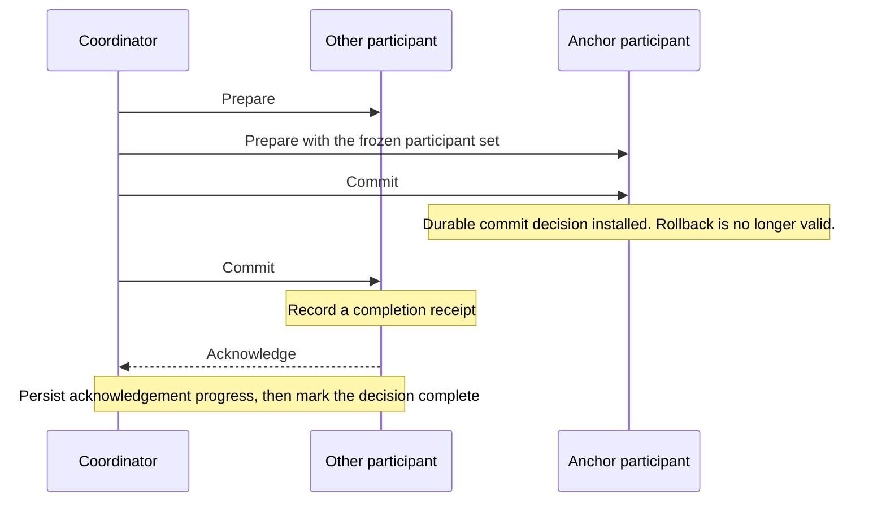

# Transaction internals

This page describes how CamusDB uses Kahuna and Kommander to run transactional
SQL work. It covers the implementation behind the guarantees in
[Transactions And Isolation](/docs/serializable-transactions).

## The layers

CamusDB does not implement storage, [MVCC](/docs/concepts#mvcc)
(multi-version concurrency control, where a write adds a new version instead of
overwriting), or replication from scratch. The data path has three layers:

- CamusDB parses SQL, plans statements, holds the catalog, maps row and index
  keys, and pins the schema.
- [Kahuna](/docs/concepts#kahuna) provides the transactional KV store, MVCC
  versions, locks, [write intents](/docs/concepts#write-intent) (uncommitted
  provisional writes), transaction coordination, and
  [two-phase commit](/docs/concepts#two-phase-commit).
- [Kommander](/docs/concepts#kommander) provides [Raft](/docs/concepts#raft)
  replication and ordered, durable commits across nodes.

So CamusDB's isolation mostly comes down to one question: how CamusDB maps each
SQL operation onto a Kahuna transaction.

## The KV key model

CamusDB encodes each row and index entry as a deterministic key:

- A primary row is `{databaseId}:{tableId}|r/{rowId}`.
- A unique index entry is `{databaseId}:{tableId}|i:{indexId}/{value}`.
- A non-unique index entry is
  `{databaseId}:{tableId}|i:{indexId}/{value}{rowId}`.
- Schema metadata is `{databaseId}/meta/...`.

Database ids and table ids are stable storage identities. Because row and index
keys use these ids, you can rename a SQL object without rewriting every row.

In a row or index [key space](/docs/concepts#key-space) (all the keys that
share one prefix), the part of each key before the first `|` is the placement
group. Under [hash routing](/docs/concepts#hash-and-key-range-routing), Kahuna
hashes that group, so a table's rows and all of its indexes live on the same
[partition](/docs/concepts#partition).

That layout matters for:

1. Routing to a partition.
2. Where write intents are placed.
3. The scope of range locks.
4. Maintaining rows and indexes inside one transaction.
5. Schema version validation at commit.

## Coordinator-owned transactions

CamusDB represents every read-write transaction with a Kahuna transaction
handle, which holds:

- `TransactionId`, a [hybrid logical clock](/docs/concepts#hlc) (HLC)
  timestamp that Kahuna allocates.
- `CoordinatorKey`, a stable routing key. It points at the coordinator session
  on the server: the record that tracks the transaction until it ends.

CamusDB passes the handle along for the whole life of the transaction. The
Kahuna coordinator owns the transaction's authoritative working set: the
modified keys, the held locks, the read observations (where enabled), and the
two-phase commit state.

Each transactional operation registers its confirmed effect with the
coordinator by sending the transaction id, the coordinator key, and its own
operation id.

Registering the same operation twice is harmless. When a retry reuses the
operation id, Kahuna can replay the cached completion, so it does not apply the
operation twice.

A batch retry can send a different subset of the pending work. CamusDB then
uses a new operation id, because that attempt represents different work.

The operation id also covers a lost acknowledgement. A participant (a partition
that holds part of the transaction's work) can apply a write and then lose the
response before the coordinator records the completion. A retry with the same
operation id lets the participant replay the cached response and completion
payload, so the coordinator can still fold the effect and the participant does
not apply the write again.

Finalizing is also safe to repeat. Commit, rollback, and abandoned session
cleanup share one finalize slot per session, so two concurrent callers see the
same attempt. A retryable `MustRetry` result does not reopen the session for new
data operations.

## What folds into the working set

The coordinator folds every successful transactional operation into the working
set it owns on the server:

| Operation | What the coordinator records |
| --- | --- |
| A write or delete | The modified key, plus its implicit point lock |
| An explicit point lock | The held point lock's descriptor |
| A range lock | The held range lock's descriptor, with its bounds and mode |
| A read of the latest committed value, while read folding is enabled | Whether the key exists, and its base revision |
| A registered scan | Read observations for the rows the scan returned |

Commit and rollback finalize from this accumulated server-side state. CamusDB
sends no list of modified keys or locks at the end of the transaction, and the
client builds neither list.

## Transaction lifecycle

A read-write transaction goes from `BEGIN` through registration, schema pin
validation, read validation, and two-phase commit, and ends by releasing its
locks. [How a commit works](/docs/distributed-transactions#how-a-commit-works)
describes each step and shows the flow.

A rollback uses the same handle. Because the coordinator already owns the
working set, the rollback can undo the transaction's registered state without a
list of keys from the client.

## Serializable read-only transactions

A serializable read-only transaction uses one pinned HLC snapshot timestamp, so
every statement in it reads the same MVCC view. It takes no write locks and
produces no writes.

A client can resume such a transaction across requests by using its transaction
id. The server keeps enough state to identify the snapshot, and to finalize the
empty transaction when the client commits or rolls back.

Read-only snapshot transactions are the preferred path for multi-statement
reports and other stable reads that need no writes.

## Read Committed statement snapshots

An explicit pessimistic Read Committed transaction opens a `KvReadView` for
each ordinary SELECT. `SelectStatementExecutor` fixes its timestamp when the statement
starts and closes the view when its cursor ends. Kahuna's `StatementSnapshot`
read mode uses that view across scans, joins, index fetches, and large values,
while preserving the transaction's own writes.

These reads leave no read pins and acquire no scan range locks. The locate
scan and subqueries of an `UPDATE` or `DELETE`, and the source of
`INSERT ... SELECT`, also get a statement snapshot for their read phase.
`StatementSnapshotScope` ends before applying mutations. Write paths use
`LatestReadView` instead: uniqueness checks, foreign-key checks, and
lock-then-read updates must observe latest committed values. Optimistic or
read-validating transactions retain their existing read observations and do
not take the statement-snapshot path.

## The zero-identity fast path

Some read paths use a transaction identity of zero without starting a full
Kahuna transaction or registering coordinator operations. Ordinary autocommit `SELECT`
uses this identity with a pinned read timestamp under either isolation
default. Latest-value internal reads can use it without a timestamp.

CamusDB uses this path only when no server-side working set is needed. Commit
and rollback do nothing for this synthetic transaction.

## Locking modes

Kahuna supports two locking strategies for transactions. CamusDB defaults to
pessimistic locking.

### Pessimistic locking

A pessimistic transaction acquires a lock before any conflicting work
continues. In this mode:

- A write acquires an exclusive point lock before it modifies a key.
- A write under contention blocks, retries, or aborts, as Kahuna's conflict
  rules decide.
- CamusDB usually resolves a conflict when it acquires the lock.
- A serializable scan is protected by a point lock or a range lock, depending on
  the shape of the read.

This is the default mode for ordinary SQL transactions. To select it
explicitly, use `SET TRANSACTION LOCKING PESSIMISTIC`, the `locking` field of an
HTTP or gRPC request, or `default_transaction_locking: pessimistic`.

### Optimistic locking

An optimistic transaction skips explicit exclusive write locks during normal
execution and validates at commit instead. In this mode:

- A write still registers the modified key and an implicit point lock.
- A read folds its observation while read validation is active.
- CamusDB detects write-write conflicts during the prepare step.
- CamusDB detects read-write conflicts by validating the registered read
  observations.

Optimistic validation uses the rows that the transaction actually observed.

Read Committed with optimistic locking takes no locks. It does not protect
against a new row that another transaction inserts and that an earlier predicate
would have matched.

Serializable with optimistic locking is a hybrid. Writes are optimistic, but
reads and scans still take the shared point or range locks that their predicates
need to protect against phantoms.

To use optimistic locking, use `SET TRANSACTION LOCKING OPTIMISTIC`, the
`locking` field of an HTTP or gRPC request, or
`default_transaction_locking: optimistic`. Kahuna pins the locking mode when the
coordinator session opens, so in an explicit transaction SQL can apply the mode
only before the first data statement.

## Read folding and validation

Folding a read lets the coordinator check at commit that the rows the
transaction read are still compatible.

CamusDB folds reads only when the transaction needs read validation:

- Optimistic transactions fold their reads.
- Transactions that request tracked read validation fold their reads.
- Reads of a pinned historical snapshot are not folded.
- Zero-identity reads are not folded.

While read folding is active, point reads, batch row fetches, table scans, index
scans, and branch merge scans must all pass the coordinator key. Otherwise the
coordinator would not know which committed revisions the transaction depended
on.

## Range locks

A serializable read shaped like a scan uses a range lock to protect its
predicate. The coordinator owns range locks:

- Acquiring a range lock registers it with the transaction coordinator.
- The coordinator renews live range locks on each tick of its collection
  interval.
- The final commit or rollback releases the locks.
- The transaction lifetime and the session timeout bound an abandoned session.

`range_lock_expires_ms` is the initial TTL that CamusDB requests when it
acquires a range lock. Startup validation requires a value at least twice
Kahuna's effective collection interval. The default is `150000` milliseconds,
and Kahuna's default collection interval is `60000` milliseconds.

## Point read locks

A serializable read-write transaction can also protect point reads, such as a
lookup by row id or a lookup on a unique index:

- Shared point locks allow concurrent readers.
- A writer that conflicts with an active read lock waits, retries, or aborts.
- If the same transaction later writes the key, CamusDB can promote the lock to
  the write protection that the commit needs.

## Lock escalation

A serializable read-write transaction can escalate many point locks in the same
bucket into one shared lock over the whole bucket. A bucket is the key space
that holds one table's rows or one index's entries. The default threshold is
`50`.

As a result:

- Small reads keep precise point locks.
- Large reads avoid unbounded lock bookkeeping.
- Later reads in the same bucket are already covered.
- The transaction can protect more of the table or index than the exact rows it
  read.

## Commit decision durability {#the-durability-of-a-commit-decision}

Every SQL write is persistent. For every SQL transaction that writes, Kahuna
writes the commit decision to durable storage before it returns the result, so
recovery can finish the transaction's participants after the coordinator is
lost.

The `default_decision_durability` setting accepts `best_effort` (the default)
and `durable`. A SQL transaction takes the durable decision path with either
value. `durable` adds one check: Kahuna refuses a transaction that modified an
in-memory (ephemeral) key, because that key cannot survive a crash.

For a durable decision, Kahuna anchors the decision to the first confirmed
persistent key that the transaction modified. The anchor decides where the
decision's internal metadata is placed. It is not a SQL row that users see.

A durable commit runs in this order:

1. Prepare each participant other than the anchor.
2. Prepare the anchor participant with the transaction's frozen participant
   set.
3. Commit the anchor first. This installs the durable commit decision.
4. Commit the remaining participants.
5. Persist acknowledgement progress, and mark the decision complete once every
   participant acknowledges.



Once CamusDB installs the anchor's commit decision, rollback is no longer a
valid outcome. If the coordinator then loses its
[leadership](/docs/concepts#leader) (another node takes over as leader), the
process stops, or the commit response is lost, recovery must keep driving the
participants until the committed decision completes.

Each persistent participant records a completion receipt when it commits. The
receipt lets recovery tell "this participant already committed" apart from
"this participant still needs work", even after the original write intent is
gone.

Recovery operations are safe to repeat, so the request path and the recovery
actor can race without duplicating the committed effect.

This boundary is intentional. A durable commit decision protects the
transaction once the decision exists. It does not make the active coordinator
session durable from `BEGIN`, and it does not make every prepared participant
durable from `BEGIN`.

## MVCC and the HLC

Kahuna stores committed versions and in-flight write intents. Readers see
committed versions and skip dirty data. Writers coordinate through locks and
write intents.

Each read-write transaction starts with an HLC transaction id. At commit, Kahuna
uses a fresh commit timestamp that is at least as new as both the transaction's
start timestamp and the values the transaction modified or depended on.

This gives CamusDB a logical order of transactions across nodes. Clients never
assign timestamps.

## Transaction lifetime and abandoned transactions {#the-lifetime-and-an-abandoned-transaction}

A serializable read-write transaction has a wall-clock lifetime cap. The
default is `3600000` milliseconds (one hour).

CamusDB checks the cap when it acquires a range lock and at commit. If the
transaction has passed the cap, CamusDB raises `TransactionLifetimeExceeded`,
and the application must retry the whole transaction from `BEGIN`.

CamusDB also passes this value to Kahuna as the coordinator session timeout.
That bounds the server-side cleanup of an abandoned session, even when a client
opens a transaction and then disappears without committing or rolling back.

CamusDB also tracks explicit client transactions with its own reaper for
abandoned transactions. The reaper rolls back a transaction that stays idle long
enough without a statement from the client. Kahuna's session timeout remains
the final cleanup backstop.

## Related settings

These are the public transaction and locking settings:

```yaml
default_isolation_level: serializable
default_transaction_locking: pessimistic
range_lock_expires_ms: 150000
max_serializable_transaction_lifetime_ms: 3600000
lock_escalation_threshold: 50
lock_wait_deadline_ms: 500
key_range_sharding: false
default_read_validation: none
default_decision_durability: best_effort
```

What each one does:

- `default_isolation_level` accepts `serializable` and `read_committed`.
- `default_transaction_locking` accepts `pessimistic` and `optimistic`.
- `range_lock_expires_ms` is a range lock's initial TTL. A value of `0` or
  below disables expiry. A positive value must be at least twice Kahuna's
  effective collection interval.
- `max_serializable_transaction_lifetime_ms` bounds the life of a serializable
  read-write transaction and also sets Kahuna's session timeout. A value of `0`
  or below disables CamusDB's lifetime cap.
- `lock_escalation_threshold` decides when many point read locks in one bucket
  become one lock over that bucket.
- `lock_wait_deadline_ms` caps a single wait for a lock before CamusDB reports a
  conflict.
- `key_range_sharding` opts table row spaces and eligible secondary indexes
  into Kahuna's key-range routing.
- `default_read_validation` accepts `none` and `track_and_validate`. With
  `track_and_validate`, pessimistic transactions also validate their read set at
  commit. Optimistic transactions always validate their reads, whatever this
  value is.
- `default_decision_durability` accepts `best_effort` and `durable`. See
  [Commit decision durability](#the-durability-of-a-commit-decision).

`default_read_validation` and `default_decision_durability` change at runtime
with `SET CLUSTER SETTING` and apply to every node. A new value affects
transactions that begin after the change.

## Behavior in a cluster

Cluster mode keeps the same SQL transaction model but distributes the
mechanics:

- Each partition has its own Raft leader.
- CamusDB routes each write to the owning partition's leader.
- A write across several partitions uses two-phase commit across the
  participants' leaders.
- HLC timestamps order transactions across the cluster.
- Optional key-range routing gives scans more precise range lock bounds.

Serializable behavior is not a single-node feature. The transaction test suite
covers read skew, phantoms, write skew, and lost updates on both a single node
and a cluster.

## Interaction with schema changes

A transaction pins the schema version of each table it touches. At commit,
CamusDB checks that:

1. The table's identity is still valid.
2. The pinned schema version is still compatible with the transaction.

This check stops a DML statement from committing against a table definition
that a DDL statement dropped, replaced, or made incompatible.

## Code map

If you want to contribute, start in these areas:

- `CamusDB.Core/Transactions/`
- `CamusDB.Core/Storage/Kv/KvTableStore.cs`
- `CamusDB.Core/Commands/Executor/Controllers/Queries/`
- `CamusDB.Core/Commands/Executor/QueryExecutor.cs`
- Kahuna's transaction and storage code, behind `IKahuna`
