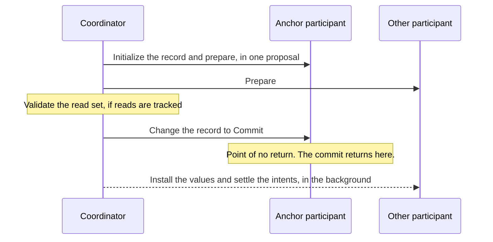

# Transaction internals

This page describes how CamusDB uses Kahuna and Kommander to execute
transactional SQL. It explains the implementation behind the guarantees in
[Transactions and isolation](/docs/serializable-transactions).

## CamusDB, Kahuna, and Kommander layers

CamusDB builds on two libraries for storage, [MVCC](/docs/concepts#mvcc)
(multi-version concurrency control, where a write adds a new version of a row),
and replication. The data path has three layers:

- CamusDB parses and plans SQL, maps rows and index entries to keys, and pins
  the schema.
- [Kahuna](/docs/concepts#kahuna) is the transactional key/value store. It
  provides the MVCC versions, the locks,
  [write intents](/docs/concepts#write-intent) (uncommitted provisional
  writes), transaction coordination, and
  [two-phase commit](/docs/concepts#two-phase-commit).
- [Kommander](/docs/concepts#kommander) provides [Raft](/docs/concepts#raft)
  replication, with ordered and durable commits across nodes.

This means that the isolation of CamusDB depends mostly on how each SQL
operation maps onto a Kahuna transaction.

## The KV key model

Each row and index entry has a deterministic key:

- A primary row is `{databaseId}:{tableId}|r/{rowId}`.
- A unique index entry is `{databaseId}:{tableId}|i:{indexId}/{value}`.
- A non-unique index entry is
  `{databaseId}:{tableId}|i:{indexId}/{value}{rowId}`.
- Schema metadata is `{databaseId}/meta/...`.

Database ids and table ids are stable storage identities. This means that a
rename doesn't rewrite rows or index entries.

In a row or index [key space](/docs/concepts#key-space) (all the keys that share
one prefix), the part of each key before the first `|` is the placement group.
With [hash routing](/docs/concepts#hash-and-key-range-routing), Kahuna hashes
that group. Then the rows and the indexes of a table are on the same
[partition](/docs/concepts#partition). The layout decides the following:

1. The partition that a key routes to.
2. The partition of each write intent.
3. The scope of range locks.
4. The row and index writes that one transaction maintains.
5. The schema version that the commit validates.

## Coordinator-owned transactions

Each read-write transaction has a Kahuna transaction handle with two parts:

- `TransactionId`, a [hybrid logical clock](/docs/concepts#hlc) (HLC)
  timestamp that Kahuna allocates.
- `CoordinatorKey`, a stable routing key to the coordinator session: the record
  on the server that tracks the transaction until it ends.

The Kahuna coordinator owns the working set of the transaction: the modified
keys, the locks, the read observations if they are tracked, and the two-phase
commit state. Each transactional operation registers its confirmed effect with
the coordinator. Each registration has the
transaction handle and an operation id.

The operation id makes a registration safe to repeat. A participant (a
partition with part of the work of the transaction) can apply a write and lose
the response. A retry with the same operation id replays the cached
response. This means that the coordinator records the effect, and the write
isn't applied twice. A batch retry that sends a different subset of the work
uses a new operation id.

A finalize is also safe to repeat. All the finalize requests of a session share one finalize slot,
also the cleanup of an abandoned session. Two concurrent callers see the same
attempt. A retryable `MustRetry` result doesn't reopen the
session for new data operations.

## What folds into the working set

The coordinator folds each successful operation into the working set:

| Operation | What the coordinator records |
| --- | --- |
| A write or delete | The modified key, and its implicit point lock. |
| An explicit point lock | The descriptor of the point lock. |
| A range lock | The descriptor of the range lock, with its bounds and mode. |
| A read of the latest committed value, with read tracking | Whether the key exists, and its base revision. |
| A registered scan | Read observations for the rows that the scan returned. |

Commit and rollback finalize from this state on the server. CamusDB doesn't send
a list of keys or locks at the end of the transaction. A rollback uses the same
handle, and it undoes the registered state.

For the steps of a commit, see
[How a commit works](/docs/distributed-transactions#how-a-commit-works).

## Serializable read-only transactions

A serializable read-only transaction reads at one pinned HLC snapshot timestamp.
All its statements read the same MVCC view, across partitions. It takes no locks
and doesn't write. This is also true with key-range sharding. This means that a
snapshot read doesn't wait for a writer, and a writer doesn't wait for it.

A client can continue such a transaction across requests with its transaction
id. The server stores the snapshot timestamp, and it finalizes the empty
transaction at commit or rollback. You should use read-only snapshot
transactions for reports and other multi-statement reads.

## Read Committed statement snapshots

In an explicit pessimistic Read Committed transaction, each `SELECT` opens a
read view at a timestamp that is fixed when the statement starts. The view is used for all the reads of the statement,
including joins and index fetches. The statement also sees the earlier writes of its transaction.

These reads leave no read pins, and they take no scan range locks. The read
phase of an `UPDATE` or `DELETE`, and the source of `INSERT ... SELECT`, use a
statement snapshot too. The snapshot ends before the writes. Writes and their checks read the latest
committed values, for example a uniqueness check or a foreign-key check. Optimistic and read-validating
transactions record read observations, and they don't use statement snapshots.

## The zero-identity fast path

Some reads use a transaction identity of zero. They don't start a Kahuna
transaction, and they don't register operations. An autocommit `SELECT` uses
this identity with a pinned read timestamp, at both isolation levels. Internal reads of the latest value can also use it. Commit and
rollback don't do any work for this identity.

## Locking modes

Kahuna supports two locking modes. The default is pessimistic locking.

### Pessimistic locking

A pessimistic transaction takes a lock before conflicting work continues:

- A write takes an exclusive point lock before it changes a key.
- Under contention, the conflict rules of Kahuna decide whether a write waits
  or aborts.
- A conflict is usually detected when the lock is requested.
- A serializable read is protected by a point lock or a range lock, as the shape
  of the read decides.

To select it explicitly, use `SET TRANSACTION LOCKING PESSIMISTIC`, the
`locking` field of an HTTP or gRPC request, or
`default_transaction_locking: pessimistic`.

### Optimistic locking

An optimistic transaction doesn't take exclusive write locks while it executes.
It validates at commit:

- A write registers the modified key and an implicit point lock.
- A read records an observation of each key that it touched.
- Write-write conflicts are detected in the prepare step.
- Read-write conflicts are detected when the read observations are validated.

An observation is the revision of the row. This means that a committed write to
any column of a row that the transaction read invalidates it. A scan records
each row that it visited, also rows that its `WHERE` clause rejected. An
optimistic transaction that scans a table under constant writes can then fail
to commit, at both isolation levels.

Read Committed with optimistic locking takes no locks. It doesn't protect
against a new row that matches an earlier predicate.

Serializable with optimistic locking is a hybrid. Writes are optimistic, and
single-key reads are validated by default, but scans take range locks.
[`serializable_optimistic_point_locks`](/docs/serializable-transactions#pessimistic-and-optimistic-locking)
set to `true` restores shared point locks.

To use optimistic locking, use `SET TRANSACTION LOCKING OPTIMISTIC`, the
`locking` field of an HTTP or gRPC request, or
`default_transaction_locking: optimistic`. The mode is fixed when the
coordinator session opens. In an explicit transaction, `SET TRANSACTION LOCKING`
must be the first statement, and later it returns `CADB0400`.

## Read tracking and validation

When the coordinator tracks the reads of a transaction, it can check at commit
that the rows that the transaction read didn't change. Reads are tracked in
these cases:

- Optimistic transactions.
- Transactions that ask for read validation.

Reads of a pinned historical snapshot aren't tracked, and zero-identity reads
aren't tracked. While tracking is on, all read paths must pass the coordinator
key, for example point reads and index scans. Otherwise, the coordinator doesn't
know which committed revisions the transaction depends on.

## Range locks

A serializable scan in a read-write transaction takes a range lock to protect
its predicate. The coordinator owns range locks:

- A new range lock is registered with the coordinator.
- The coordinator renews live range locks at each tick of its collection
  interval.
- The commit or rollback releases the locks.
- The transaction lifetime and the session timeout limit an abandoned session.

`range_lock_expires_ms` is the initial TTL of a range lock (default `150000`).
At startup, a positive value must be at least twice the collection interval of
Kahuna (default `60000`), and the server doesn't start otherwise.

## Point read locks

A serializable read-write transaction can protect point reads, such as a lookup
by row id or on a unique index:

- Shared point locks allow concurrent readers.
- A writer that conflicts with a read lock waits or aborts.
- If the transaction later writes the key, the lock can be promoted to the write
  protection that the commit needs.

## Lock escalation

A serializable read-write transaction can replace many point locks in one
bucket with one shared lock on the bucket. A bucket is the key space of the rows
of one table, or of the entries of one index. The threshold is
`lock_escalation_threshold` (default `1000`).

The row locks of a scan page are requested as a batch, with one escalation
decision for the page. This means that:

- Small reads keep precise point locks.
- Large reads don't need unlimited lock bookkeeping.
- Later reads in the same bucket are already covered.
- The transaction can protect more of the table or index than the rows it read.

## Commit decision durability {#the-durability-of-a-commit-decision}

All SQL writes are persistent. For each transaction that writes a persistent
key, Kahuna writes a canonical decision record before it returns the result.
This means that recovery can finish the transaction after a coordinator is lost.

`default_decision_durability` can be `best_effort` (the default) or `durable`. For SQL data, the two give the same guarantee. They differ on
in-memory (ephemeral) keys: `durable` returns an error for a transaction that
changed one. CamusDB doesn't write ephemeral keys.

The decision record is on the partition of an anchor key: the first confirmed
persistent key that the transaction changed. The anchor isn't a row that users
see. A commit has these steps:

1. On the anchor partition, one replicated proposal initializes the record and
   prepares the intents of that partition. The other participants
   prepare at the same time.
2. If the transaction tracks reads, the read set is validated.
3. The record changes from undecided to commit, or to abort. This is the point
   of no return, and the commit returns its result here.
4. The committed values are installed, and the intents are settled, on a
   background task. A reader that finds a pending intent resolves it from the
   record.



If the coordinator is lost before the decision, the transaction is presumed
aborted. After the decision, a rollback isn't valid. Recovery finishes the
participants from the record. Each participant writes a completion receipt when
it commits. With the receipt, recovery can tell a participant that already
committed from one that needs work. Recovery operations are safe to repeat.

When all participants are on the anchor partition, the steps before the decision
become one replicated proposal.

The decision record protects the transaction after it exists. It doesn't make
the coordinator session durable from `BEGIN`.

## MVCC and the HLC

Kahuna stores committed versions and write intents in progress. Readers see
committed versions, and they skip uncommitted data. Writers coordinate through
locks and write intents.

Each read-write transaction starts with an HLC transaction id. At commit, Kahuna
gives it a commit timestamp. The commit timestamp is above the timestamps of
the values that the transaction wrote, and of the reads that it registered with
the coordinator. Clients don't assign timestamps. For the ordering guarantees,
see [Commit timestamp](/docs/grpc-api#commit-timestamp).

## Transaction lifetime and abandoned transactions {#the-lifetime-and-an-abandoned-transaction}

A serializable read-write transaction has a lifetime limit,
`max_serializable_transaction_lifetime_ms` (default one hour). The limit is
checked when the transaction takes a range lock, and at commit. After the limit, the transaction returns
`CADB0505 TransactionLifetimeExceeded`. The application must retry it from
`BEGIN`.

The same value is the timeout of the Kahuna coordinator session. This limits
the cleanup of an abandoned session on the server, for example when a client
opens a transaction and disappears.

CamusDB also rolls back an explicit transaction that is idle for
`transaction_idle_timeout_ms`. See
[Transaction limits](/docs/transaction-limits#idle-timeout). The session timeout
of Kahuna is the last cleanup.

## Related settings

```yaml
default_isolation_level: serializable
default_transaction_locking: pessimistic
range_lock_expires_ms: 150000
max_serializable_transaction_lifetime_ms: 3600000
lock_escalation_threshold: 1000
lock_wait_deadline_ms: 500
key_range_sharding: false
default_read_validation: none
default_decision_durability: best_effort
```

| Setting | Effect |
| --- | --- |
| `default_isolation_level` | `serializable` or `read_committed`. |
| `default_transaction_locking` | `pessimistic` or `optimistic`. |
| `range_lock_expires_ms` | The initial TTL of a range lock. `0` or less turns off expiry. A positive value must be at least twice the collection interval of Kahuna. |
| `max_serializable_transaction_lifetime_ms` | The lifetime limit of a serializable read-write transaction, and the Kahuna session timeout. `0` or less turns off the limit. |
| `lock_escalation_threshold` | The point read locks in one bucket that become one lock on the bucket. |
| `lock_wait_deadline_ms` | The longest single wait for a lock before a conflict is returned. |
| `key_range_sharding` | Routes table row spaces and eligible secondary indexes by key range. |
| `default_read_validation` | `none` or `track_and_validate`. With `track_and_validate`, pessimistic transactions also validate their reads at commit. Optimistic transactions always validate their reads. |
| `default_decision_durability` | `best_effort` or `durable`. See [Commit decision durability](#the-durability-of-a-commit-decision). |

All these settings except `key_range_sharding` are runtime cluster settings.
You can change them with
[`SET CLUSTER SETTING`](/docs/runtime-cluster-settings). A new default applies
to transactions that begin after the change.

## Behavior in a cluster

Cluster mode uses the same SQL transaction model:

- Each partition has a Raft leader.
- Each write is routed to the leader of its partition.
- A write across several partitions uses two-phase commit across the leaders of
  the participants.
- HLC timestamps order transactions across the cluster.
- Key-range routing gives scans more precise range lock bounds.

Serializable isolation applies in a cluster as on one node. The transaction
test suite covers the classic anomalies, such as write skew and lost updates,
on one node and on a cluster.

## Interaction with schema changes

A transaction pins the schema version of each table that it uses. If a DDL
statement changes the table before the transaction ends, the next statement or the commit returns `CADB0502`, and the transaction
doesn't commit. This means that a DML statement can't commit against a table
definition that a DDL statement changed.

## Code map

To contribute, start in these areas:

- `CamusDB.Core/Transactions/`
- `CamusDB.Core/Storage/Kv/KvTableStore.cs`
- `CamusDB.Core/Commands/Executor/Controllers/Queries/`
- `CamusDB.Core/Commands/Executor/Controllers/QueryExecutor.cs`
- The transaction and storage code of Kahuna, behind `IKahuna`
