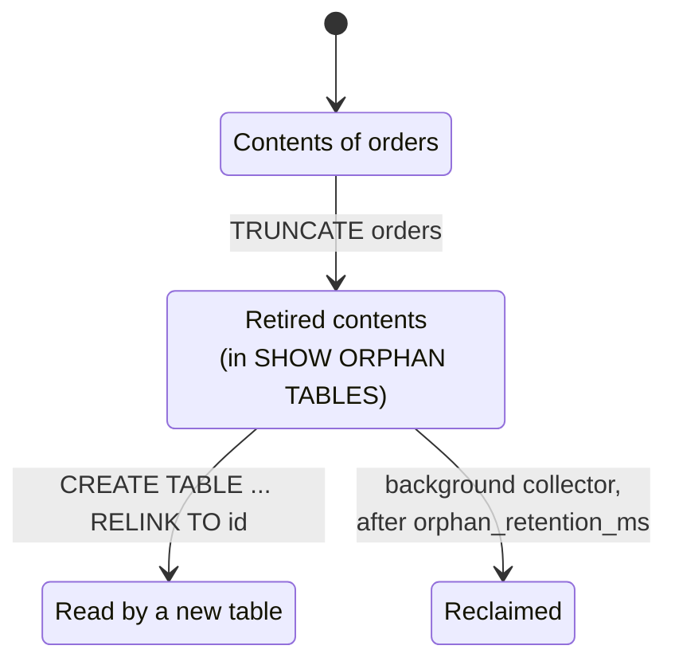

# TRUNCATE TABLE

`TRUNCATE` empties a table in one fast step. Use it in place of
`DELETE FROM orders` to empty a large table, such as a staging table between
loads or a test table between runs.

A `DELETE` removes each row and each index entry. On a large table it is slow,
and in one transaction it exceeds the
[mutation limit](/docs/transaction-limits). `TRUNCATE` reads and deletes no
rows, and its cost doesn't depend on the size of the table.

```camussql
TRUNCATE TABLE orders;
TRUNCATE orders;             -- the TABLE keyword is optional
```

The table itself doesn't change. Its name, columns, indexes, constraints,
settings, comment, and grants stay the same. Only its rows are replaced by an
empty set. CamusDB retains the old rows for a retention period, and you can
[recover them](#recovery-of-the-previous-contents).

## Quick example

```camussql
-- Empty a table of any size.
TRUNCATE TABLE orders;

-- List the old contents, which CamusDB keeps for the retention period.
SHOW ORPHAN TABLES;
```

```text
┌────┬──────────────────┬─────────────┬──────────────────────────┬──────────────────────────┐
│ id │ kind             │ former_name │ dropped_at               │ expires_at               │
├────┼──────────────────┼─────────────┼──────────────────────────┼──────────────────────────┤
│ 1  │ retired contents │ orders      │ 2026-11-19T00:19:38.830Z │ 2026-11-26T00:19:38.830Z │
└────┴──────────────────┴─────────────┴──────────────────────────┴──────────────────────────┘
```

```camussql
-- Recover the old contents as a new table.
CREATE TABLE orders_before_truncate RELINK TO '1';
```

## Syntax

- One base table. A list such as `TRUNCATE a, b` returns a syntax error.
- An optional `TABLE` keyword.
- `RESTART IDENTITY` or `CONTINUE IDENTITY`, which is the default. See
  [Identity sequences](#identity-sequences).

`CASCADE` isn't supported. You can't truncate a table that a foreign key of
another table references, even when that other table is empty. Drop the child
table or the foreign key first. A foreign key from a table to itself doesn't
block `TRUNCATE`.

`TRUNCATE` returns an error for these targets:

| Target | Error | Use instead |
| --- | --- | --- |
| A table that a foreign key of another table references | `CADB0530` `DependentObjectsExist` | Drop the child table, or drop its foreign key. |
| A materialized view | `CADB0525` `ViewNotUpdatable` | `REFRESH MATERIALIZED VIEW ... WITH NO DATA` |
| A view | `CADB0525` `ViewNotUpdatable` | Truncate the base table of the view. |
| A table that doesn't exist | `CADB0011` `TableDoesntExist` | Check the table name. |

## Performance

The cost of the statement doesn't depend on the number of rows or index
entries. A table with a billion rows needs the same work as a table with one
row.

The statement can take some time. It waits for these steps:

1. An exclusive lock on the rows of the table. The lock waits for conflicting
   writers.
2. The schema change, which must commit and replicate to all nodes.
3. A metadata checkpoint. Its cost grows with the number of indexes and stored
   column layouts.

After the retention period, CamusDB reclaims the old rows in the background.
That work is proportional to the number of rows.

## Privileges

`TRUNCATE` needs both the `DELETE` and the `DROP` privilege on the table. The
two privileges can come from separate grants:

```camussql
GRANT DELETE ON shop.orders TO alice;
GRANT DROP   ON shop.orders TO alice;
```

A superuser, a database-wide grant such as `shop.*`, or a global grant also
works. A caller without both privileges gets `CADB0517` `InsufficientPrivilege`.
See [Authentication and authorization](/docs/sql-authentication).

## Transactions

`TRUNCATE` commits a schema change that a `ROLLBACK` can't undo. In an explicit
transaction, the server returns `CADB0538` `StatementNotAllowedInTransaction`:

```camussql
BEGIN;
TRUNCATE TABLE orders;   -- CADB0538
ROLLBACK;
```

Commit or roll back the transaction first, then run `TRUNCATE`.

:::caution camus-cli 0.18.4
`camus-cli` sends `TRUNCATE` outside an open transaction. The table is emptied
at once, and a later `ROLLBACK` doesn't restore the rows. Run `TRUNCATE` only
outside a transaction. If you truncated by mistake, recover the rows with
[`RELINK`](#recovery-of-the-previous-contents).
:::

The truncate takes effect on all nodes when the schema change commits. If a
later step fails, CamusDB logs the failure and the statement returns success,
because the table is already empty.

## Identity sequences

```camussql
TRUNCATE TABLE orders RESTART IDENTITY;
TRUNCATE TABLE orders CONTINUE IDENTITY;
TRUNCATE TABLE orders;                    -- same as CONTINUE IDENTITY
```

`RESTART IDENTITY` restarts only the sequences that columns of the table own,
such as `SERIAL` and `GENERATED ... AS IDENTITY` columns. A sequence created
with `CREATE SEQUENCE` and used in a column default doesn't belong to the
table, and `TRUNCATE` doesn't change it. Other tables can use the same
sequence.

If the restart fails after the table is empty, CamusDB lists the sequences
that it couldn't restart. The table is empty, and those sequences continue
from their current values. Run `ALTER SEQUENCE ... RESTART` on those sequences
to finish the reset.

## Concurrent readers and writers

Before it changes anything, `TRUNCATE` takes an exclusive lock on the rows of
the table. The lock makes the switch to the empty contents atomic for
transactions that use the table:

- A writer that wrote a row to the old contents before the lock is aborted at
  commit. It doesn't get a success for a row that no one can read. This applies
  to optimistic and pessimistic writers.
- A writer that arrives while the lock is held waits, or it is asked to retry.
  Then it writes to the new contents.
- A reader that started before the truncate can finish on its snapshot. A
  statement that starts after the truncate sees the empty table.

Two concurrent truncates of the same table run one after the other through the
schema [leader](/docs/concepts#leader), the node that applies schema changes
for the cluster. Each truncate that succeeds creates a separate set of retired
contents. A truncate that loses the race returns `CADB0534`
`ConcurrentSchemaChange`. CamusDB didn't apply the losing truncate, and you
can retry it. See
[Transactions and isolation](/docs/serializable-transactions) for how to retry
after a conflict.

## Recover the previous contents {#recovery-of-the-previous-contents}

A truncate doesn't delete the old rows. CamusDB retains them as retired contents
until the retention period ends:



`DROP TABLE` uses the same mechanism. See
[Recover dropped objects](/docs/recover-dropped-objects).

```camussql
SHOW ORPHAN TABLES;
```

| Column | Meaning |
| --- | --- |
| `id` | The ID of the retired contents. `RELINK TO` takes this value. |
| `kind` | `retired contents` for a truncate, and `dropped table` for a drop. |
| `former_name` | The table that had the contents. For retired contents, that table exists. |
| `dropped_at` | When the contents were retired. |
| `expires_at` | When the background collector can reclaim them. |

To recover the rows, create a new table from the retired contents:

```camussql
CREATE TABLE orders_before_truncate RELINK TO '1';
```

The new table gets a new ID and the old rows. The original table doesn't
change. It has the rows written after the truncate.

After `orphan_retention_ms` (default 7 days), the background collector deletes
the retired rows, index entries, and metadata. After that, you can't recover
them.

## Time travel

A [time-travel read](/docs/time-travel-reads) of a truncated table, at a
snapshot before the truncate, returns an error:

```camussql
TRUNCATE TABLE orders;
SELECT * FROM orders AS OF SYSTEM TIME '-10s';
```

```text
CADB0537: Cannot read table 'orders' AS OF SYSTEM TIME ...: its contents were
replaced at ..., and the rows it held before that point are no longer reachable
through this table. Read at or after that timestamp, or recover the retired
contents with CREATE TABLE … RELINK TO.
```

The error prevents an empty result that looks like a valid answer for a time
when the table had rows.

- A snapshot exactly at the truncate is valid, and it sees the empty table.
- A snapshot after the truncate works as usual.
- CamusDB records only the latest truncate. After several truncates, all
  snapshots before the latest one return the error.
- Other tables aren't affected.

To read the old rows, recover them with `RELINK` and query the new table.

## Branch databases

In a [branch database](/docs/database-branching), the rows of a table combine
the changes made in the branch with the rows inherited from its ancestors.

| Action | Effect |
| --- | --- |
| Truncate in a branch | The table in the branch becomes empty. The branch's changes and the inherited rows both disappear from that branch. |
| Recover in a branch | `RELINK` restores the full view of the branch from before the truncate, with its changes and the inherited rows, as a new table. |
| Reclamation | Reclamation in a branch doesn't delete the rows of its ancestors. |
| Truncate the source | A truncate of the source table after a fork doesn't change the branch. The branch has its forked contents. |

A truncate in a branch doesn't delete anything immediately. The branch's
changes become retired contents, and the rows of the ancestors don't change.

## Dependent views {#a-dependent-view}

A view stores no rows, and it reads the empty table immediately.

A materialized view has the rows from its last refresh. After a truncate it is
stale, as after an `INSERT`, `UPDATE`, or `DELETE` on its base table. Refresh it
when you want it to match:

```camussql
TRUNCATE TABLE orders;
REFRESH MATERIALIZED VIEW orders_by_day;
```

See [Materialized views](/docs/materialized-views).

## Statistics

After a truncate, `SHOW STATISTICS` and the planner treat the table as
unmeasured. Run `ANALYZE` after you load the table again. See
[SHOW STATISTICS](/docs/show-statistics).

## Row-level TTL

A [row-level TTL](/docs/row-level-ttl) (time to live) job that started before a
truncate stops when the truncate commits. It doesn't delete rows from the
retired contents, which you can recover, or from the new contents. CamusDB
cleans up the records of the stopped job in the background.

## Error codes

| Code | Name | When it occurs |
| --- | --- | --- |
| `CADB0011` | `TableDoesntExist` | The table doesn't exist. |
| `CADB0517` | `InsufficientPrivilege` | The caller doesn't have `DELETE` or `DROP` on the table. |
| `CADB0525` | `ViewNotUpdatable` | The target is a view or a materialized view. |
| `CADB0530` | `DependentObjectsExist` | A foreign key of another table references the table. |
| `CADB0534` | `ConcurrentSchemaChange` | Another change to the contents won the race. You can retry. |
| `CADB0537` | `SnapshotPrecedesContentsGeneration` | A time-travel read used a snapshot from before the latest truncate. |
| `CADB0538` | `StatementNotAllowedInTransaction` | `TRUNCATE` was sent in an explicit transaction. |

`CADB0537` and `CADB0538` return HTTP 400 and the gRPC status
`FAILED_PRECONDITION`. See [Error codes](/docs/error-codes).

## Not supported

- Several tables in one statement, such as `TRUNCATE a, b, c`.
- `CASCADE`. Drop the child table or the foreign key first.
- An automatic refresh of a dependent materialized view. CamusDB doesn't
  invalidate the view either.
- Time-travel reads from before the latest truncate. Use `RELINK`.
