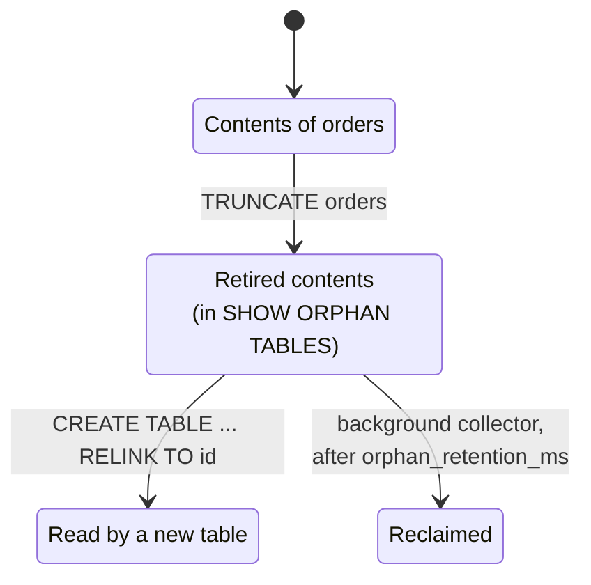

# TRUNCATE TABLE

`TRUNCATE` empties a base table without reading rows or deleting them one at a
time. Instead, it replaces the physical [key
space](/docs/concepts#key-space) (the range of storage keys) that holds the
table's rows and index entries, so the work does not depend on the number of
rows.

Use `TRUNCATE` instead of `DELETE FROM orders` to empty a large table. A
`DELETE` must remove every row and every index entry: on a large table it is
slow, and in one transaction it exceeds the
[mutation limit](/docs/transaction-limits). Typical uses are staging tables
between loads, test tables between runs, and tables of temporary data.

```camussql
TRUNCATE TABLE orders;
TRUNCATE orders;             -- the TABLE keyword is optional
```

The table itself survives. It keeps its name, id, columns, indexes,
constraints, settings, comment, grants, and schema version. Only its contents
generation moves.

A contents generation is one physical key space that holds a table's rows. This
page uses that term throughout.

## Example

```camussql
-- Empty a table of any size.
TRUNCATE TABLE orders;

-- CamusDB retains the previous contents for the retention window.
SHOW ORPHAN TABLES;
```

```text
id | kind             | former_name | dropped_at | expires_at
A0 | retired contents | orders      | ...        | ...
```

```camussql
-- Bring the previous contents back as a separate table.
CREATE TABLE orders_before_truncate RELINK TO 'A0';
```

## What the statement accepts

- The target is exactly one base table. CamusDB does not support several tables
  in one statement.
- The `TABLE` keyword is optional.
- The statement accepts `RESTART IDENTITY` or `CONTINUE IDENTITY`.

`CONTINUE IDENTITY` is the default. `RESTART IDENTITY` restarts only the
sequences owned by identity columns of the truncated table. It does not reset a
free-standing sequence that a column merely defaults from, because other tables
may share that sequence.

`CASCADE` is not supported. You cannot truncate a table that another table's
foreign key references, even when the child table is empty. Drop the child
table or the foreign key first. A foreign key from a table to itself does not
block `TRUNCATE`.

CamusDB refuses `TRUNCATE` on these targets:

| Target | Error | What you use instead |
| --- | --- | --- |
| A table that another table's foreign key references | `CADB0530` `DependentObjectsExist` | Drop the child table, or drop its foreign key. |
| A materialized view | `CADB0525` `ViewNotUpdatable` | `REFRESH MATERIALIZED VIEW ... WITH NO DATA` |
| A plain view | `CADB0525` `ViewNotUpdatable` | Truncate the table below the view |
| A table that does not exist | `CADB0011` `TableDoesntExist` | Nothing applies |

## Performance

The statement's cost is constant in the number of rows and index entries. A
table with one row and a table with a billion rows do the same amount of row
work: none. CamusDB reads no rows, deletes no rows, and touches no index
entries.

Constant work is not the same as constant wall-clock time. The statement still
waits for:

1. The exclusive lock over the table's entire row key space. That lock waits
   for conflicting writers.
2. The schema change to commit, replicate to every node, and be acknowledged by
   every node.
3. The metadata checkpoint, whose cost grows with the table's indexes and
   stored column layouts.

CamusDB reclaims the retired rows in the background. That work is asynchronous,
proportional to the number of rows, and happens long after the statement
returns.

Here is how this strategy compares with the two alternatives CamusDB does not
use:

| Strategy | Work on the data | Atomic | Why CamusDB does not use it |
| --- | --- | --- | --- |
| Swap the contents generation | None | Yes | CamusDB uses this strategy. |
| `DELETE` in chunks | Proportional to the rows and index entries | No | A partial failure leaves the table half empty. |
| `DELETE` in one transaction | Proportional to the rows and index entries | Yes | On any useful table, it exceeds the per-transaction mutation limit. |

See [Transaction Limits](/docs/transaction-limits) for that limit.

## Privileges

`TRUNCATE` needs both the `DELETE` and the `DROP` privilege on the target
table. It removes every row, like a `DELETE`, and it retires a whole key space,
like a `DROP`, so one privilege alone is not enough.

CamusDB checks the two privileges separately, so they can come from separate
grants:

```camussql
GRANT DELETE ON shop.orders TO alice;
GRANT DROP   ON shop.orders TO alice;
```

A superuser, a database-wide grant such as `shop.*`, or a global grant also
satisfies the check.

A caller without both privileges receives `CADB0517` `InsufficientPrivilege`.
See [SQL Authentication](/docs/sql-authentication).

## Transactions

`TRUNCATE` runs in its own internal transaction. CamusDB refuses it inside an
explicit transaction with `CADB0538` `StatementNotAllowedInTransaction`:

```camussql
BEGIN;
TRUNCATE TABLE orders;   -- CADB0538
ROLLBACK;
```

The refusal is about honesty, not caution. `TRUNCATE` commits a schema change
that every node applies, and a `ROLLBACK` of your transaction cannot undo it.
Accepting the statement would promise a rollback the engine cannot deliver.
Commit or roll back first, then run the truncate.

The truncate takes effect across the cluster as soon as the schema entry
commits. A failure after that point does not change the outcome: CamusDB logs
the failure and the statement still reports success. Reporting a rollback would
tell you the table still holds rows that it no longer holds.

## Identity sequences

```camussql
TRUNCATE TABLE orders RESTART IDENTITY;
TRUNCATE TABLE orders CONTINUE IDENTITY;
TRUNCATE TABLE orders;                    -- same as CONTINUE IDENTITY
```

`RESTART IDENTITY` applies only to sequences owned by columns of the truncated
table, such as `SERIAL` or `GENERATED ... AS IDENTITY` columns. A sequence
created with `CREATE SEQUENCE` and referenced by a column default is not owned
by the table, so truncate leaves it alone.

Emptying the table is still a committed schema change. If the identity restart
fails afterwards, CamusDB reports the sequences it could not restart; the table
stays empty and those sequences keep climbing. Run `ALTER SEQUENCE ... RESTART`
on the named sequences to finish the reset.

## Concurrent readers and writers

Before it proposes anything, CamusDB takes an exclusive range lock over the
table's entire row key space. This lock makes the swap atomic with respect to
transactions on the data.

- A writer that staged a row in the old key space before CamusDB took the lock
  is aborted at commit. It never receives a success for a row in a key space
  that nothing reads. This applies to both optimistic and pessimistic writers.
- A writer that arrives while CamusDB holds the lock waits, or CamusDB asks it
  to retry. When it continues, it binds the new key space.
- A reader that bound the old contents before the cut can finish against its
  own snapshot. A statement that binds after the truncate is acknowledged sees
  the new, empty contents.

Two concurrent truncates on the same table serialize through the schema
[leader](/docs/concepts#leader), the node that applies schema changes for the
cluster. Each successful truncate creates its own retired generation. A
truncate that loses the race reports `CADB0534` `ConcurrentSchemaChange`, which
is retryable because CamusDB applied nothing.

See [Serializable Transactions](/docs/serializable-transactions) for how to
retry after a conflict.

## Recover the previous contents {#recovery-of-the-previous-contents}

A truncate destroys nothing. CamusDB keeps the key space the table no longer
reads as retired contents.

The diagram follows the old contents of `orders` after a truncate. The table
itself moves on to a new, empty generation.



This is the same mechanism that makes `DROP TABLE` recoverable. See
[Recover Dropped Objects](/docs/recover-dropped-objects).

```camussql
SHOW ORPHAN TABLES;
```

| Column | Meaning |
| --- | --- |
| `id` | The retired key space's id. `RELINK TO` takes this value. |
| `kind` | `retired contents` for a truncate. `dropped table` for a drop. |
| `former_name` | The table that owned the contents. For retired contents, that table still exists. |
| `dropped_at` | When the contents were retired. |
| `expires_at` | When the background collector can reclaim them. |

Recovery publishes the retained rows as a separate, new table:

```camussql
CREATE TABLE orders_before_truncate RELINK TO 'A0';
```

The recovered table gets a fresh relation id and reads the retired key space.
It must get a fresh id: after a table's first truncate, the id of the
still-live table names the retired key space, so reusing that id would create a
second name for one live relation.

Recovery does not touch the original table. That table keeps its id, its name,
and every row written to it after the truncate.

After the retention window (`orphan_retention_ms`), the background collector
purges the retired rows, index entries, and metadata. Recovery is not possible
after the purge.

## Time travel

CamusDB refuses a time travel read of a truncated table at any snapshot before
the current contents began:

```camussql
TRUNCATE TABLE orders;
SELECT * FROM orders AS OF SYSTEM TIME '-10s';
```

```text
CADB0537: Cannot read table 'orders' AS OF SYSTEM TIME ...: its contents were
replaced at ..., and the rows it held before that point are no longer reachable
through this table.
```

Refusing is the honest answer. The old rows are still on disk, but they live in
a key space the live table can no longer name. The read would scan the new,
empty generation and answer "no rows", which looks exactly like a correct empty
answer for a moment when the table was full.

- A snapshot exactly at the cut is valid. It sees the new, empty contents.
- A snapshot after the cut behaves normally.
- CamusDB knows only the latest cut, so after several truncates it refuses
  every snapshot before that cut.
- Tables that were never truncated are not affected.

To read the old rows, recover them with `RELINK` and query the recovered table.
See [Time Travel Reads](/docs/time-travel-reads).

## Branch databases

In a [branch database](/docs/database-branching), a table's rows are the
branch's overlay merged with its ancestors' rows. Every level uses the same
storage id, so a truncate has a simple, total meaning.

| Action | Effect |
| --- | --- |
| Truncate in a branch | CamusDB gives the branch a new storage id, and the branch's view becomes empty. Both its overlay and the rows it inherits disappear from that branch. |
| Recover in a branch | CamusDB reconstructs the branch's entire merged view from before the truncate, overlay and inherited rows together, under a new table name. |
| Reclamation | CamusDB scopes reclamation to the branch's database id. It never deletes an ancestor's keys. |
| Truncate the source | Truncating the source after a fork does not rewrite the descendant's copied schema. The descendant keeps its forked contents. |

A truncate in a branch deletes nothing immediately. The overlay becomes retired
contents, and CamusDB never touches the ancestor's rows.

## Dependent views {#a-dependent-view}

A plain view stores no rows, so it reads the emptied table immediately.

A materialized view keeps the rows from its last refresh, so it is stale after
a truncate, just as it is after an `INSERT`, `UPDATE`, or `DELETE` on its base
table. Refresh it when you want it to match:

```camussql
TRUNCATE TABLE orders;
REFRESH MATERIALIZED VIEW orders_by_day;
```

See [Materialized Views](/docs/materialized-views).

## Statistics

Optimizer statistics are tied to the table's identity, which a truncate
preserves. CamusDB stamps statistics with the contents generation they
describe.

After a truncate, CamusDB ignores the previous distribution instead of trusting
it. `SHOW STATISTICS` and the planner both treat the new generation as
unmeasured.

Run `ANALYZE` after you refill the table. See
[SHOW STATISTICS](/docs/show-statistics).

## Row-level TTL

A row-level TTL (time to live) run becomes inert as soon as a truncate lands.

Every run records the contents generation of its plan. The scheduler rechecks
that generation, and each worker rechecks it before each
[span](/docs/concepts#ranges-and-spans) (slice of the table) it processes. So no
worker can delete from the retired generation, which is recoverable. No worker
can delete from the new generation either, because its plan never described
that generation.

CamusDB cleans up the stale run's records in the background. See
[Row-Level TTL](/docs/row-level-ttl).

## Error codes

| Code | Name | When it is generated |
| --- | --- | --- |
| `CADB0011` | `TableDoesntExist` | The named table does not exist. |
| `CADB0517` | `InsufficientPrivilege` | The caller lacks `DELETE` or `DROP` on the table. |
| `CADB0525` | `ViewNotUpdatable` | The target is a view or a materialized view. |
| `CADB0530` | `DependentObjectsExist` | Another table's foreign key references the table. |
| `CADB0534` | `ConcurrentSchemaChange` | Another contents change won the race. Retryable. |
| `CADB0537` | `SnapshotPrecedesContentsGeneration` | A time travel read named a point before the current contents began. |
| `CADB0538` | `StatementNotAllowedInTransaction` | A caller issued `TRUNCATE` inside an explicit transaction. |

`CADB0537` and `CADB0538` both map to HTTP 400 and, on gRPC, to
`FAILED_PRECONDITION`. See [Error Codes](/docs/error-codes).

## Not supported

CamusDB does not currently support:

- `TRUNCATE a, b, c`, which names several tables in one statement.
- `CASCADE`. Drop the child table or the foreign key first.
- Automatically refreshing a dependent materialized view. CamusDB does not
  invalidate that view either.
- Reading a snapshot from before the current contents generation.
