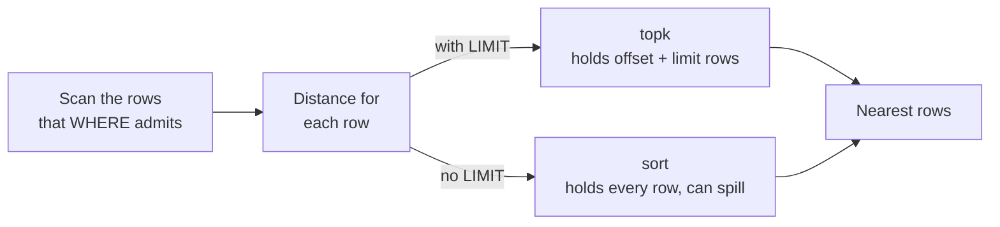

# Vector search

Vector search finds rows that are similar in meaning to a query. Use it for
semantic search ("find articles about refunds" also matches "money back"), for
recommendations ("products similar to this one"), and for retrieval in LLM
applications, where you fetch the most relevant passages for a prompt. The
vectors are in ordinary CamusDB tables, and a search can filter on regular
columns, such as a tenant ID, in the same query.

A vector, also called an embedding, is a list of float32 numbers that a machine
learning model produces for a document, an image, or a sentence. The model puts
related items close together. The distance between two vectors then measures
how similar the items are.

CamusDB stores vectors in `BYTES` columns and ranks them with distance
functions. A nearest-neighbor query is a regular `SELECT` with `ORDER BY` and
`LIMIT`:

```camussql
SELECT id
FROM docs
WHERE tenant_id = @tenant
ORDER BY l2_distance(embedding, @q)
LIMIT 10;
```

The search is exact. CamusDB reads each row that the `WHERE` clause allows and
returns the true nearest rows. There is no approximation and no recall setting
to tune. The cost grows linearly with the number of rows. Read [Cost](#cost)
before you use it on a very large table.

## How a vector is stored

A vector is stored as `BYTES`. Use the .NET or TypeScript vector helper to pack
your embedding, then bind it as a parameter. The driver handles the encoding.
In Python, bind the packed bytes. See
[Send the query vector as a parameter](#send-the-query-vector-as-a-parameter).

<details>
<summary>Binary layout for custom vector producers</summary>

A vector is a `BYTES` value with this layout:

1. The elements are IEEE-754 float32 numbers.
2. Each element is little-endian.
3. The elements are packed together, with no header and no padding.

The dimension is the byte count divided by four. A 768-dimension embedding
uses 3,072 bytes. For example, the float32 value `1.0` is `0x3F800000`, which
is stored as the four bytes `00 00 80 3F`, low byte first.

The schema doesn't record this layout. Clients can read each other's vectors
because they all use it.

</details>

Set the maximum size and the dimension in the schema:

```camussql
CREATE TABLE docs (
  id OID PRIMARY KEY NOT NULL,
  tenant_id INT64,
  embedding BYTES(3072) NOT NULL STORAGE PLAIN,
  CONSTRAINT embedding_is_768d CHECK (vector_dims(embedding) = 768)
);
```

`STORAGE PLAIN` stores each embedding in its row. See
[Storage strategy for embeddings](#storage-strategy-for-embeddings).

### Set the dimension with a CHECK constraint

`BYTES(N)` sets a maximum length. A 767-element embedding fits a `BYTES(3072)`
column. A value longer than `N` bytes returns `CADB0302 ValueTooLong`. The
default maximum for `BYTES` is 10,485,760 bytes. See
[Data types](/docs/data-types).

The `CHECK` constraint sets the exact dimension. A row with a different
dimension returns `CADB0303`. If you omit the check, CamusDB stores a short
vector, and a later query that compares it with a full-length vector returns an
error.

These functions are useful in such a check:

| Function | Returns |
| --- | --- |
| `octet_length(bytes or string)` | The byte count. For a string, this is the UTF-8 byte count: `octet_length('áé')` is 4, and `length('áé')` is 2. |
| `vector_dims(bytes)` | The element count, which is `octet_length / 4`. A byte count that isn't a multiple of four returns `CADB0410`. |

A `NULL` embedding passes `CHECK (vector_dims(embedding) = 768)`, because
`vector_dims(NULL)` is `NULL`, and a check fails only on `false`. Use `NOT NULL`
to require a vector. See [Check constraints](/docs/check-constraints).

### Storage strategy for embeddings

An embedding is a `BYTES` value, and the rules in
[Large values](/docs/storage-layout) apply to it. A 768-dimension embedding is
3,072 bytes. This is above the default threshold of 2,048 bytes, and with the
default strategy, `EXTENDED`, each embedding is stored outside its row.

An exact nearest-neighbor scan reads the embedding of each candidate row.
Values stored outside the row add an extra fetch for each batch. Float32
vectors also rarely compress well. Choose the strategy by the queries that read
the column:

- Use `PLAIN` when nearest-neighbor queries scan the embedding. The value is
  stored in the row and isn't compressed.
- Use `EXTERNAL` when most queries don't read the embedding. The value is
  stored outside the row, and CamusDB doesn't try to compress it.

To change an existing table, set the strategy and rewrite the stored rows:

```camussql
ALTER TABLE docs ALTER COLUMN embedding SET STORAGE PLAIN;
ALTER TABLE docs REWRITE STORAGE;
```

## Distance functions

The three functions take two vectors of the same dimension and return `FLOAT64`.

| Function | Meaning | Nearest is | Sort with |
| --- | --- | --- | --- |
| `l2_distance(a, b)` | Euclidean distance | smaller | `ASC`, the default |
| `cosine_distance(a, b)` | `1 - cosine_similarity` | smaller | `ASC` |
| `inner_product(a, b)` | Dot product | larger | `DESC` |

`inner_product` sorts in the opposite direction from the other two. An
ascending sort on `inner_product` returns the least similar rows. CamusDB
doesn't return an error for this, and the query looks correct.

```camussql
-- Cosine distance: nearest row first.
SELECT id FROM docs ORDER BY cosine_distance(embedding, @q) LIMIT 10;

-- Inner product: most similar row first.
SELECT id FROM docs ORDER BY inner_product(embedding, @q) DESC LIMIT 10;
```

Results of the functions:

- `l2_distance` returns the true distance, with the square root applied.
- `cosine_distance` returns a value from 0, for the same direction, to 2, for
  opposite directions. Rounding can't make it negative.
- CamusDB converts each element to `double` before the calculation. This
  preserves the order of close neighbors at high dimensions.

The functions use SIMD instructions where the hardware supports them. SIMD
applies one operation to several numbers at once. The results and the errors
are the same as without SIMD, but the summation order can change the last bits
of a result. Big-endian hosts, and vectors shorter than one SIMD group, use
the regular loop.

### Return the distance as a column

To also return the distance, sort by an alias:

```camussql
SELECT id, l2_distance(embedding, @q) AS distance
FROM docs
ORDER BY distance
LIMIT 10;
```

For how `ORDER BY` resolves an alias, see
[Sort the rows](/docs/sql-queries#sort-the-rows-and-divide-them-into-pages).

## Send the query vector as a parameter

Send the query vector as a bind parameter. As a hexadecimal literal, a
768-dimension vector adds about 6 KB of text to each statement. Each query then
has a different statement text, and CamusDB can't reuse the plan.

| Driver | Bind an embedding |
| --- | --- |
| [.NET](/docs/dotnet-driver) | `CamusVector.ToBytes(embedding)`, passed as a `ColumnType.Bytes` parameter. Dapper also has `CamusValue.Vector(embedding)`. |
| [TypeScript](/docs/typescript-connector) | `camus.vector(embedding)`, passed in the named parameter object. |
| [Python](/docs/python-driver) | Bind packed float32 bytes as a Python `bytes` value. The Python driver doesn't have a vector helper yet. |

For example, with a TypeScript client and an embedding of the same dimension as
the stored vectors:

```ts
const rows = await client.query(
  'SELECT id FROM docs ORDER BY l2_distance(embedding, @q) LIMIT 10',
  { q: camus.vector(embedding) },
);
```

The statement text doesn't change, and a thousand different query vectors share
one cached plan. The .NET and TypeScript drivers can prepare repeated statements
automatically. See [Parameters and prepared statements](/docs/prepared-statements).

Other notes:

- The server logs the statement text but not the parameter values, and
  embeddings don't appear in log files.
- A 3,072-byte vector is far below the transport limits: 4 MB for a gRPC message
  and 30 MB for a request body, by default.
- `LIMIT` can also be a parameter. CamusDB binds the value before it builds the
  plan, and a parameterized limit bounds the sort in the same way.

## Bounded topk and full sort plans

Use `EXPLAIN` to see how CamusDB ranks a query. With a `LIMIT`, the sort is
bounded, and the plan shows a `topk` node. For example, for a table `v` and a
literal query vector:

```text
physical  limit       10
physical  project
physical  topk        k: 10, l2_distance(emb, [BytesLiteral]) ASC
physical  table-scan  table=v
```

With no `LIMIT`, the plan shows a `sort` node, which ranks all matching rows. A
`sort` node stores its full input and can spill to disk. A `topk` node stores at
most `k` rows and doesn't spill. An exact nearest-neighbor query with a `LIMIT`
therefore uses a fixed amount of memory for any table size.



`EXPLAIN (ANALYZE)` shows the work of each node. The scan node counts each row
it read, and the `topk` node counts only the rows it kept.

### When the bound applies

The bound is `offset + limit` rows. CamusDB must rank the rows that `OFFSET`
skips. CamusDB uses a full sort in these cases:

- The `LIMIT` value is unknown or negative.
- The `OFFSET` value is negative.
- `OFFSET + LIMIT` overflows, or it is larger than the maximum 32-bit integer.
- Spill to disk is enabled, and the bound is larger than the spill threshold.
  See [Spill to disk](/docs/spill-to-disk).
- A node between the sort and the limit changes the row count, such as an
  aggregate. For example, `SELECT count(*) FROM t ORDER BY x LIMIT 1` must count
  all rows.

`LIMIT 0` returns no rows. CamusDB doesn't read the input, and it doesn't
evaluate the sort expression.

### Order of equal keys

The `topk` node and the full sort return the same rows, and they put `NULL`
values in the same position. They can return rows with equal keys in a
different order. SQL doesn't specify that order. Add a second key to
`ORDER BY` when you need a fixed order.

## Errors

| Condition | Error |
| --- | --- |
| The byte count isn't divisible by four | `CADB0410` malformed vector |
| A vector has zero elements | `CADB0410` malformed vector |
| The two vectors have different dimensions | `CADB0411` dimension mismatch, with both dimensions in the message |
| An element is `NaN` or an infinity | `CADB0412` invalid vector value |
| `cosine_distance` gets a vector with zero magnitude | `CADB0412` invalid vector value |

These errors return HTTP 400. See [Error codes](/docs/error-codes).

CamusDB checks for `NaN` and infinity when a vector function reads the value.
The column type doesn't say that the bytes are a vector, and a write to a
`BYTES` column doesn't check for these values.

## Transactions and time travel

A nearest-neighbor query is a regular read, and the usual visibility rules
apply:

- It ranks the uncommitted rows of the current transaction.
- It ignores rows from transactions that rolled back.
- With `AS OF SYSTEM TIME`, it ranks the rows of the past snapshot.

See [Transactions and isolation](/docs/serializable-transactions) and
[Time-travel reads](/docs/time-travel-reads).

## Cluster behavior

Each node ranks the full table, including the
[spans](/docs/concepts#ranges-and-spans) (key ranges) that other nodes
[lead](/docs/concepts#leader). The answer is the same on each node.

The coordinator, the node that received the query, does the ranking. A query
can therefore send all matching rows across the network to that node.
CamusDB doesn't have a distributed top-k operator to limit this traffic. See
[Distributed queries](/docs/distributed-queries).

## Cost

These figures come from an Apple M3 with 10,000 rows, 768 dimensions, and the
SIMD distance functions active:

| Query | Time |
| --- | ---: |
| `ORDER BY l2_distance(...) LIMIT 10` | 12 ms |
| `ORDER BY l2_distance(...)` with no limit | 50 ms |
| `SELECT id FROM docs` with no sort | 6 ms |

The `LIMIT` cuts the time to about a quarter of the full sort. The value of `k`
matters little: a limit of 10 and a limit of 100 take the same time, because
the cost comes from reading and ranking all rows.

One distance calculation on the same hardware costs:

| Dimensions | `l2_distance` | `inner_product` | `cosine_distance` |
| ---: | ---: | ---: | ---: |
| 128 | 53 ns | 50 ns | 67 ns |
| 768 | 240 ns | 214 ns | 320 ns |
| 1536 | 459 ns | 405 ns | 607 ns |

The cost grows linearly with rows times dimensions. From these figures, the
same query over one million rows takes about 1.2 s on the same hardware.

To keep queries fast:

1. Use a `LIMIT` with each vector `ORDER BY`.
2. Reduce the candidate rows with a `WHERE` clause. CamusDB applies the filter
   before the ranking, and a selective filter reduces the rows that it measures.

## Limits

CamusDB doesn't support these features yet:

- An approximate index. There is no HNSW index, no IVF index, and no
  quantization. Each query is an exact scan.
- A vector index type. A regular index can't help a distance sort, because a
  distance doesn't follow the order of the stored bytes.
- A native vector type. The dimension is in a `CHECK` constraint, and the
  catalog doesn't record the element type.
- A distributed top-k. See [Cluster behavior](#cluster-behavior).

## Related pages

- [Data types](/docs/data-types)
- [Check constraints](/docs/check-constraints)
- [Functions](/docs/functions)
- [EXPLAIN](/docs/explain)
- [Parameters and prepared statements](/docs/prepared-statements)
- [Error codes](/docs/error-codes)
