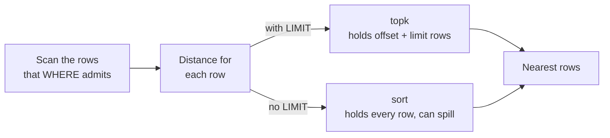

# Vector search

Vector search finds rows by meaning instead of exact matches. Use it for
semantic search ("find articles about refunds" also matches "money back"),
recommendations ("products similar to this one"), and retrieval for LLM
applications, where you fetch the most relevant passages to put in a prompt.
Because the vectors live in ordinary CamusDB tables, a search can filter on
regular columns, such as a tenant id, in the same query.

A vector (also called an embedding) is a list of float32 numbers that a machine
learning model produces for each document, image, or sentence. The model places
related items close together, so the distance between two vectors measures how
similar the items are.

CamusDB stores vectors in `BYTES` columns and ranks them with distance
functions. A nearest neighbor query is an ordinary `SELECT` with an `ORDER BY`
and a `LIMIT`:

```camussql
SELECT id
FROM docs
WHERE tenant_id = @tenant
ORDER BY l2_distance(embedding, @q)
LIMIT 10;
```

The search is exact: CamusDB reads every row the `WHERE` clause admits and
returns the true nearest rows. There is no approximation and no recall parameter
to tune.

The cost grows linearly with the number of rows. Read [Cost](#cost) before you
run this against a very large table.

## How a vector is stored

A vector is a `BYTES` value with this layout:

1. The elements are IEEE-754 float32 numbers.
2. Each element is little-endian.
3. The elements are packed together, with no header and no padding.

The dimension is the byte count divided by four, so a 768-dimension embedding
occupies 3,072 bytes.

This layout is the full contract, and the schema does not record it. A value one
client writes is readable by another only because both follow the same layout.
For example, the float32 value `1.0` is `0x3F800000`, which goes on the wire as
the four bytes `00 00 80 3F`, low byte first.

```camussql
CREATE TABLE docs (
  id OID PRIMARY KEY NOT NULL,
  tenant_id INT64,
  embedding BYTES(3072) NOT NULL STORAGE PLAIN,
  CONSTRAINT embedding_is_768d CHECK (vector_dims(embedding) = 768)
);
```

`STORAGE PLAIN` keeps each embedding inside its row. Without it, a
768-dimension embedding is large enough to move out of the row under the default
large-value strategy. See [Storage strategy for embeddings](#storage-strategy-for-embeddings).

### BYTES(N) is a maximum, not a fixed width

`BYTES(N)` means a value must not exceed `N` bytes, not that it must be exactly
`N` bytes. So a 767-element embedding fits a `BYTES(3072)` column without
complaint.

A value that exceeds the bound fails with `CADB0302 ValueTooLong`. A bare
`BYTES` column uses the default maximum of 10,485,760 bytes. See
[Data types](/docs/data-types) for the full length rules.

The `CHECK` constraint is what fixes the dimension. Without it, CamusDB stores a
short vector and compares it against full-length vectors, and the mismatch shows
up later as an error in some query.

These functions support such a check:

| Function | Returns |
| --- | --- |
| `octet_length(bytes or string)` | The byte count. For a string, this is the UTF-8 byte count. `octet_length('áé')` is 4, but `length('áé')` is 2. |
| `vector_dims(bytes)` | The element count, which is `octet_length / 4`. |

`vector_dims` rejects a byte count that is not a multiple of four rather than
rounding down. Otherwise a 3,070-byte value would report 767 dimensions and
satisfy a check written for 767 dimensions, which is exactly the corruption the
check exists to catch.

A `NULL` embedding passes `CHECK (vector_dims(embedding) = 768)`, because SQL
violates a check only when the condition is `false`, and `vector_dims(NULL)` is
`NULL`. Use `NOT NULL` to forbid missing vectors; the check cannot do it. See
[Check constraints](/docs/check-constraints).

Both functions are deterministic and neither is an aggregate, which is what
makes them legal inside a `CHECK` condition.

### Storage strategy for embeddings

An embedding is a `BYTES` value, so the large-value rules in
[Large Values](/docs/storage-layout) apply to it. A 768-dimension embedding is
3,072 bytes, which is above the default out-of-line threshold of 2,048 bytes.
Under the default strategy, `EXTENDED`, each embedding moves out of its row.

That is good for large values that most queries skip. It is bad for exact KNN
scans (k-nearest-neighbor: find the k rows closest to a query vector), because
the ranking expression reads the embedding for every candidate row, so the scan
pays an extra batched fetch for every batch it ranks. Float32 vectors also
rarely compress enough for LZ4 to help.

Choose the strategy based on the queries that read the column:

- Use `PLAIN` when KNN queries scan the embedding. The value stays inside the
  row and is never compressed.
- Use `EXTERNAL` when most queries skip the embedding and only occasional
  background work reads it. The value moves out of the row without a compression
  attempt.

For an existing table, change the strategy and rewrite the stored rows:

```camussql
ALTER TABLE docs ALTER COLUMN embedding SET STORAGE PLAIN;
ALTER TABLE docs REWRITE STORAGE;
```

## Distance functions

All three functions take two vectors of equal dimension and return
`FLOAT64`.

| Function | Meaning | Nearest is | Sort with |
| --- | --- | --- | --- |
| `l2_distance(a, b)` | Euclidean distance | smaller | `ASC`, the default |
| `cosine_distance(a, b)` | `1 - cosine_similarity` | smaller | `ASC` |
| `inner_product(a, b)` | Dot product | larger | `DESC` |

`inner_product` runs in the opposite direction from the other two: an ascending
sort over `inner_product` returns the least similar rows. CamusDB raises no
error for this, so the mistake looks like a working query.

```camussql
-- Cosine distance: nearest row first.
SELECT id FROM docs ORDER BY cosine_distance(embedding, @q) LIMIT 10;

-- Inner product: most similar row first.
SELECT id FROM docs ORDER BY inner_product(embedding, @q) DESC LIMIT 10;
```

`l2_distance` returns the true distance, with the square root applied. The
squared form gives the same rank order, but it is not a distance, and a
projected column showing 9.4 where the answer is 3.07 reads as a defect.

`cosine_distance` returns 0 for identical directions and 2 for opposite
directions, and never returns a negative value. CamusDB clamps the similarity to
`[-1, 1]` before the subtraction, so rounding cannot push an exact match below
zero and sort it in front of itself.

CamusDB widens every element to `double` before any arithmetic. A `float`
accumulator loses the order between two near neighbors at 768 dimensions, and
can overflow on values that a `double` handles.

### SIMD execution

The three functions use SIMD instructions on hardware that accelerates them.
SIMD is a processor feature that applies one operation to several numbers at
once.

The vectorized loop behaves the same as the plain loop:

1. It widens each element to `double` before any arithmetic.
2. It rejects `NaN` and infinity with the same error.
3. It names the same element in the error message.

Only the summation order differs, which can change the last bits of a result.
Big-endian hosts, and vectors shorter than one SIMD lane group, use the plain
loop.

### Return the distance as a column

Sort by an alias when you also want the distance value:

```camussql
SELECT id, l2_distance(embedding, @q) AS distance
FROM docs
ORDER BY distance
LIMIT 10;
```

See [Sort the rows](/docs/sql-queries#sort-the-rows-and-divide-them-into-pages)
for how `ORDER BY` resolves an alias and which shapes it refuses.

## Send the query vector as a parameter

Send the query vector as a bind parameter. A 768-dimension vector written as a
hexadecimal literal adds about 6 KB of text to every statement, and gives every
query a different statement text, which prevents plan reuse.

| Transport | Encoding |
| --- | --- |
| SQL text | Hexadecimal, with an `X'...'` literal |
| REST (JSON) | Base64, under `bytesValue`, with `type` 7 |
| gRPC | Raw bytes, in `Value.bytes_value` |

```json
{
  "databaseName": "app",
  "sql": "SELECT id FROM docs ORDER BY l2_distance(embedding, @q) LIMIT 10",
  "parameters": {
    "@q": { "type": 7, "bytesValue": "AAAAAAAAgD8=" }
  }
}
```

The value above is the two-element vector `[0.0, 1.0]`. A real 768-dimension
embedding is 4,096 base64 characters.

The statement text never changes, so a thousand different query vectors share
one cached plan. Prepared statements work the same way: prepare the statement
once, then execute it with a different vector each time. See
[Parameters and prepared statements](/docs/prepared-statements).

The server logs the statement text but never the parameter values, so embeddings
do not reach log files.

A 3,072-byte vector is far below both transport limits: the gRPC message default
is 4 MB, and the request body default is 30 MB. Neither limit is narrower for
vectors.

`LIMIT` also accepts a parameter. CamusDB binds the value before it builds the
plan, so a parameterized limit still bounds the sort.

## What the plan shows

Use `EXPLAIN` to see how CamusDB ranks the query. With a `LIMIT`, the sort is
bounded and the plan shows a `topk` node:

```text
topk(k: 10, l2_distance(…) ASC)
```

Without a `LIMIT`, the plan shows a `sort` node instead, which ranks and
materializes every matching row.

The names reflect two different operators. A `sort` node holds the whole input
and can spill to disk. A `topk` node holds at most `k` rows and never spills.
That is what lets an exact nearest neighbor query over a large table finish at
all.



`EXPLAIN (ANALYZE)` reports each node's work. The scan node reports every row
it examined; the `topk` node reports only the rows it retained.

### When the bound applies

CamusDB bounds the sort to `offset + limit` rows, not `limit` rows, because the
rows that `OFFSET` skips must still be ranked before CamusDB can skip them.

CamusDB keeps the full sort in these cases:

- The `LIMIT` value is unknown or negative.
- The `OFFSET` value is negative.
- The sum of `OFFSET` and `LIMIT` overflows or exceeds the maximum 32-bit
  integer.
- Spill to disk is enabled and the bound exceeds the spill threshold. At that
  size, the external sort is the operator designed to hold the rows. See
  [Spill to disk](/docs/spill-to-disk).
- A node between the sort and the limit changes the row count. A projection
  preserves rows, so a bound above it is safe, but an aggregate does not.
  `SELECT count(*) FROM t ORDER BY x LIMIT 1` must count every row; a one-row
  bound would answer with a count of 1.

`LIMIT 0` returns no rows. CamusDB never reads the input, so it never evaluates
the ordering expression.

### Order among equal keys

The `topk` node and the full sort return the same rows and place `NULL` values
in the same position.

They can disagree on the order of rows with equal keys: the `topk` node keeps
the row that arrived first, and SQL leaves this order unspecified. Add a
tie-breaking key to `ORDER BY` when you need a fixed order among equal rows.

## Errors

| Condition | Error |
| --- | --- |
| The byte count is not divisible by four | `CADB0410` malformed vector |
| A vector has zero elements | `CADB0410` malformed vector |
| The two operands have different dimensions | `CADB0411` dimension mismatch, with both dimensions named |
| An element is `NaN` or an infinity | `CADB0412` invalid vector value |
| `cosine_distance` receives a zero-magnitude vector | `CADB0412` invalid vector value |

All of these conditions map to HTTP 400. See [Error codes](/docs/error-codes).

CamusDB refuses a dimension mismatch rather than truncating the longer operand.
Truncation would return a plausible rank order computed from mismatched data.

CamusDB rejects a non-finite element when a vector function reads it, not when
the row is written. The schema cannot tell an embedding from a file, so no write
path may reject a `BYTES` value for a vector rule.

A zero-element vector is a corrupt row, not a distance of zero: every metric
over zero elements is meaningless or degenerate.

## Transactions and time travel

A nearest neighbor query is an ordinary read and follows the ordinary
visibility rules:

- It ranks its own transaction's uncommitted rows.
- It ignores rows from transactions that rolled back.
- Under `AS OF SYSTEM TIME`, it ranks the rows of the past snapshot.

See [Transactions and isolation](/docs/serializable-transactions) and
[Time travel reads](/docs/time-travel-reads).

## Cluster behavior

Every node ranks the whole table, not only the
[spans](/docs/concepts#ranges-and-spans) (key ranges) it is
[leader](/docs/concepts#leader) for, so the answer is the same on every node.

The coordinator (the node that received the query) does the ranking, so a query
can ship every qualifying row across the network to that node. No distributed
top-k operator bounds this traffic. See
[Distributed queries](/docs/distributed-queries).

## Cost

These figures come from an Apple M3 with 10,000 rows, 768 dimensions, and the
SIMD distance kernels active:

| Query | Time |
| --- | ---: |
| `ORDER BY l2_distance(...) LIMIT 10` | 12 ms |
| `ORDER BY l2_distance(...)` with no limit | 50 ms |
| `SELECT id FROM docs` with no sort | 6 ms |

The `LIMIT` cuts the query to about a quarter of the full sort time. The value
of `k` itself matters little: a limit of 10 and a limit of 100 measure the same,
because the cost comes from reading and ranking every row.

A single distance evaluation on the same hardware costs:

| Dimensions | `l2_distance` | `inner_product` | `cosine_distance` |
| ---: | ---: | ---: | ---: |
| 128 | 53 ns | 50 ns | 67 ns |
| 768 | 240 ns | 214 ns | 320 ns |
| 1536 | 459 ns | 405 ns | 607 ns |

The cost grows linearly with rows times dimensions. From the figures above,
the same query over one million rows takes about 1.2 s on the same hardware.

So:

1. Always pair a vector `ORDER BY` with a `LIMIT`.
2. Narrow the candidate rows with a `WHERE` clause where you can. The filter
   runs before ranking, so a selective predicate reduces the rows CamusDB has to
   measure.

## Limits

CamusDB does not support these features yet:

- No approximate index. There is no HNSW index, no IVF index, and no
  quantization, so every query is an exact scan.
- No vector index type. An ordinary index cannot help a distance sort, because
  distance is not an order-preserving function of the stored bytes.
- No native vector type. The dimension lives in a `CHECK` constraint, not in the
  catalog, and the element type is a convention the schema does not record.
- No distributed top-k. See [Cluster behavior](#cluster-behavior) above.

## Related

- [Data types](/docs/data-types)
- [Check constraints](/docs/check-constraints)
- [Functions](/docs/functions)
- [EXPLAIN](/docs/explain)
- [Parameters and prepared statements](/docs/prepared-statements)
- [Error codes](/docs/error-codes)
