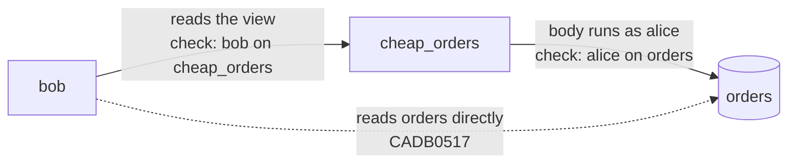

# Views

A view is a saved query that you read like a table. Define a join or a filter
once, and all queries that read the view use the same logic. Views also let
you:

- Give a user access to selected rows and columns of a table. The user doesn't
  need a grant on the table.
- Rename tables and columns. Queries that read the view continue to work.

A view doesn't store rows. Each read executes the view's query against the
current data, and the result is always up to date. To compute a result once and
read it many times, use a [materialized view](/docs/materialized-views).

The syntax follows PostgreSQL. The differences are listed in
[Differences from PostgreSQL](#differences-from-postgresql).

The examples on this page use the following data:

<details>
<summary>Sample data for the examples on this page</summary>

```camussql
CREATE TABLE orders (
  id INT64 PRIMARY KEY NOT NULL,
  customer STRING NOT NULL,
  total FLOAT64 NOT NULL,
  status STRING NOT NULL
);
INSERT INTO orders (id, customer, total, status) VALUES
  (1, 'acme', 1250.00, 'open'),
  (2, 'acme', 300.00, 'open'),
  (3, 'globex', 480.00, 'open'),
  (4, 'globex', 99.00, 'closed'),
  (5, 'initech', 2100.00, 'closed'),
  (6, 'initech', 75.50, 'open');
CREATE TABLE customers (
  name STRING PRIMARY KEY NOT NULL,
  region STRING NOT NULL
);
INSERT INTO customers (name, region) VALUES
  ('acme', 'EU'),
  ('globex', 'US'),
  ('initech', 'APAC');
CREATE TABLE archived_orders (
  id INT64 PRIMARY KEY NOT NULL,
  customer STRING NOT NULL
);
```

</details>

## Quick example

Create a view for open orders and read it like a table:

```camussql
CREATE VIEW open_orders AS
  SELECT id, customer, total
  FROM orders
  WHERE status = 'open';

SELECT customer, SUM(total) AS outstanding
FROM open_orders
GROUP BY customer;
```

```text
┌──────────┬─────────────┐
│ customer │ outstanding │
├──────────┼─────────────┤
│ acme     │ 1550        │
│ globex   │ 480         │
│ initech  │ 75.5        │
└──────────┴─────────────┘
3 rows in set (00:00:00.0264609)
```

You can join a view, and other views can read it:

```camussql
SELECT o.id, c.region
FROM open_orders o
INNER JOIN customers c ON o.customer = c.name;

CREATE VIEW large_open_orders AS
  SELECT id, customer FROM open_orders WHERE total > 1000;
```

To give the view's columns other names, list them after the view name:

```camussql
CREATE VIEW order_summary (order_id, who, amount) AS
  SELECT id, customer, total FROM orders;
```

## How CamusDB reads a view

Before CamusDB plans a statement, it replaces each view reference with the
view's query, as a subquery in the `FROM` clause. A query on a view is planned
and executed like the same query written by hand. It uses the same optimizer
and indexes. It can also [spill to disk](/docs/spill-to-disk) and takes the
same serializable locks on the table ranges it reads.

This affects two diagnostic tools:

- [`EXPLAIN`](/docs/explain) shows the expanded query. A plan doesn't contain a
  view scan node.
- A view doesn't have statistics. Plans use the statistics of the tables that
  the view reads. [`SHOW STATISTICS`](/docs/show-statistics) on a view points
  you to those tables.

A view reference uses the view name as its default alias. An explicit alias
replaces it:

```camussql
SELECT open_orders.customer FROM open_orders;
SELECT o.customer FROM open_orders o;
```

A view can be the source of `CREATE TABLE ... AS` or `INSERT ... SELECT`, and a
materialized view can read it. The destination columns get the output types of
the view's query:

```camussql
CREATE TABLE open_copy AS SELECT id, customer FROM open_orders;

INSERT INTO archived_orders (id, customer)
SELECT id, customer FROM open_orders;
```

For more information, see [Copying query results](/docs/insert-select-and-ctas).

You can also write through a simple view. See
[Write through a view](#write-through-a-view).

## Write through a view

DML statements can target a view whose body reads one table, as in PostgreSQL.
CamusDB rewrites the statement into the same statement on the table. This means
that the write executes in your transaction, with the locks and constraints of
the table:

```camussql
CREATE VIEW acme_orders AS
  SELECT id, customer, total FROM orders WHERE customer = 'acme';

INSERT INTO acme_orders (id, customer, total) VALUES (10, 'acme', 5);
UPDATE acme_orders SET total = total + 1 WHERE TRUE;   -- acme's rows only
DELETE FROM acme_orders WHERE total < 20;              -- acme's rows only
```

An `UPDATE` or `DELETE` changes only the rows that the view shows. The `WHERE`
of the body is added to the statement. On `INSERT`, a column that the
view doesn't expose gets its default. A statement can't name such a column:
`DELETE FROM acme_orders WHERE status = 'closed'` returns `CADB0404`. Otherwise,
the count of affected rows could disclose the values of a hidden column.
`RETURNING` works, with the columns of the view.

If the view doesn't have a check option, an `INSERT` can write a row that the
view doesn't show, for example a row with `customer = 'globex'`. To prevent this, use
[`WITH CHECK OPTION`](#with-check-option).

### Which views you can write through

You can write through a view if its body reads exactly one table, or one view
that you can write through. The body also can't have any of the following:

- Grouping, such as an aggregate or `GROUP BY`. A window function is also not
  allowed.
- `DISTINCT`, `LIMIT`, or `OFFSET`.
- A set operation, such as `UNION`.
- A subquery in its `WHERE`.

A write to another view returns `CADB0525`, and the message names the rule that
the view breaks. CamusDB doesn't have rules or `INSTEAD OF` triggers. This
means that such a view is read-only. A materialized view, and a view over a
materialized view, can't be written either.

An output column that is a column of the table can be written. Another output
column is computed. You can read it, also in a `WHERE`, but a write to it
returns `CADB0526`:

```camussql
CREATE VIEW doubled AS SELECT id, total, total * 2 AS twice FROM orders;
UPDATE doubled SET total = 1 WHERE twice = 60;   -- OK
UPDATE doubled SET twice = 1 WHERE id = 1;       -- CADB0526
```

Upserts, such as `INSERT ... ON CONFLICT`, can't target a view. Joined writes,
such as `UPDATE ... FROM`, can't target a view either. They return `CADB0533`.
Write to the table.

### WITH CHECK OPTION

With a check option, a row written through the view must be a row that the view
shows. Otherwise, the statement returns `CADB0527`, and it doesn't write rows:

```camussql
CREATE VIEW acme_only AS
  SELECT id, customer, total FROM orders WHERE customer = 'acme'
  WITH CHECK OPTION;

INSERT INTO acme_only (id, customer, total) VALUES (11, 'globex', 1);
-- CADB0527: new row violates check option for view "acme_only"
```

A row whose condition is `NULL` isn't shown by the view, and it fails too. Note
that a `CHECK` constraint lets a `NULL` result pass.

| Form | Checks |
| --- | --- |
| `WITH CHECK OPTION` or `WITH CASCADED CHECK OPTION` | The condition of this view, and of each view below it. |
| `WITH LOCAL CHECK OPTION` | The condition of this view. Below it, only the views that have a check option. |

At creation, `WITH CHECK OPTION` checks whether the view's query is updatable.
If the query reads another view, that underlying view is checked at write time.
For example, a write through a view over an aggregate view returns `CADB0525`.
Replacing an underlying view with an aggregate view can cause the same error.

### Privileges for writes

You need the write privilege of the statement on the view, for example `INSERT`.
You don't need a grant on the table. The owner of the view needs that
privilege on the table, and also `SELECT` for `UPDATE` and `DELETE`, as for a
read. If the owner doesn't have it, the write returns `CADB0517`. The message
names the owner. A subquery that you write in the statement reads its
tables with your privileges.

## What a view body can contain

The query in a view definition is called the view body. Subqueries in the
body's `WHERE` clause follow the same rules as in a top-level query. This
includes correlated subqueries and `EXISTS`. Subqueries read their tables with the view owner's privileges, like
the rest of the body.

### Set operations

A body can combine queries with `UNION`, `INTERSECT`, and `EXCEPT`, including
the `ALL` variants:

```camussql
CREATE VIEW order_customers AS
SELECT customer FROM orders
UNION
SELECT customer FROM archived_orders;
```

- The output column names come from the leftmost query.
- `*` in each query is expanded when you create the view.
- The view depends on the tables and columns on both sides.
- A set operation in a subquery of the body must list its columns. `*` isn't
  allowed there.

For naming and grouping rules, see [set operations](/docs/sql-queries#views).

### WITH queries {#cte-bodies}

Views and materialized views accept [`WITH` queries](/docs/sql-queries#with-queries),
also called common table expressions (CTEs). The stored body replaces each CTE
reference with a subquery, and `SHOW CREATE VIEW` shows those subqueries.

Note that each reference to a CTE in a view body is computed separately. The
compute-once reuse of a CTE in a top-level query doesn't apply in a view.

A recursive CTE is stored with its `WITH RECURSIVE` clause, wrapped in a
subquery.
`SHOW CREATE VIEW` prints that form, and the output parses again.

## Checks when you create a view

When you run `CREATE VIEW`, CamusDB resolves each name in the body. A mistake shows up when you create the view, before anyone reads it:

```camussql
CREATE VIEW v AS SELECT id FROM no_such_table;
-- CADB0011: table 'no_such_table' does not exist
```

CamusDB doesn't execute the body at creation. For example,
`CREATE VIEW deferred AS SELECT (SELECT 1 / 0) AS x` succeeds, and the error
appears when you read the view. Unknown names and known type errors fail at
creation.

### Name each output column

Each expression in the select list needs a name:

```camussql
CREATE VIEW v AS SELECT total + 1 FROM orders;
```

```text
CamusException (CADB0400): Column 1 of the view body is an expression with no name; add an alias (AS <name>)
```

```camussql
CREATE VIEW v AS SELECT total + 1 AS total_plus_one FROM orders;  -- OK
```

PostgreSQL names such a column `?column?`. CamusDB requires an alias.

### `SELECT *` is expanded at creation {#select-star}

Like PostgreSQL, CamusDB fixes a view's columns when you create it. A column
added to the base table later doesn't appear in the view:

```camussql
CREATE VIEW all_orders AS SELECT * FROM orders;   -- orders has 4 columns
ALTER TABLE orders ADD COLUMN note STRING(64);

SELECT * FROM all_orders;                          -- still 4 columns
```

```text
┌────┬──────────┬───────┬────────┐
│ id │ customer │ total │ status │
├────┼──────────┼───────┼────────┤
│ 1  │ acme     │ 1250  │ open   │
│ 2  │ acme     │ 300   │ open   │
│ 3  │ globex   │ 480   │ open   │
│ 4  │ globex   │ 99    │ closed │
│ 5  │ initech  │ 2100  │ closed │
│ 6  │ initech  │ 75.5  │ open   │
└────┴──────────┴───────┴────────┘
6 rows in set (00:00:00.0282012)
```

To add the new column, run `CREATE OR REPLACE VIEW` with the same body. The `*`
is expanded again, and `note` becomes the last column of the view.

A body can't combine `*` with other columns, as in `SELECT *, total FROM orders`.
That statement returns error `CADB0400`.

### Not allowed in a view body {#not-allowed-in-a-view-body}

| Not allowed | Reason |
| --- | --- |
| `AS OF SYSTEM TIME` | A fixed timestamp would pin the view to one moment. A relative time such as `'-2h'` would give different results to readers at different times. For a point-in-time copy, use `CREATE TABLE ... AS SELECT ... AS OF SYSTEM TIME`. |
| Index hints | A stored hint can outlive the statistics that justified it. |
| Cache hints | Views can't use the result cache. See [Views and the result cache](#views-and-the-result-cache). |

An index hint on a view reference is also an error, because a view doesn't have
indexes.

## Replace a view

`CREATE OR REPLACE VIEW` can change the body and add columns at the end. It must
keep the names, types, and order of the existing columns:

```camussql
CREATE VIEW v AS SELECT id, customer FROM orders;

CREATE OR REPLACE VIEW v AS SELECT id, customer, total FROM orders;  -- OK
CREATE OR REPLACE VIEW v AS SELECT id FROM orders;                   -- CADB0529
CREATE OR REPLACE VIEW v AS SELECT id, status FROM orders;           -- CADB0529
```

Other views and clients rely on the existing columns. If a replace changed them
silently, those readers could return wrong data and raise no error.

To change the columns, drop the view and create it again. The drop fails while
other views depend on it, and the error lists them.

A change to the body takes effect on the next read:

```camussql
CREATE OR REPLACE VIEW v AS
  SELECT id, customer, total FROM orders WHERE status = 'closed';
```

## Rename a view

```camussql
ALTER VIEW open_orders RENAME TO active_orders;
```

Views that read the renamed view continue to work.

## Schema changes under a view

A view tracks the tables and columns it reads by internal ID. This means that
renames don't affect the view, and a drop that would break the view fails.

### Rename tables and columns {#a-rename-is-transparent}

```camussql
CREATE VIEW open_orders AS
  SELECT id, customer, total FROM orders WHERE status = 'open';

ALTER TABLE orders RENAME TO sales;
ALTER TABLE sales RENAME COLUMN total TO amount;

SELECT id, total FROM open_orders;   -- works, and the column is still called total
```

`SHOW CREATE VIEW` prints the current names:

```camussql
SHOW CREATE VIEW open_orders;
-- CREATE VIEW `open_orders` AS SELECT id, customer, amount AS total FROM sales AS orders WHERE status = 'open'
```

The renamed table appears with its original name as an alias (`sales AS
orders`). Qualified column references in the body use that alias, and it
doesn't change. A renamed column is printed with its output name as an alias
(`amount AS total`). When a name hasn't changed, no alias is printed.

A column rename fails in two cases:

1. The view was created by a CamusDB version that didn't track columns by ID.
2. An `ORDER BY`, `GROUP BY`, or `HAVING` clause in the body uses a name that
   matches one of the view's output columns. These clauses can refer to an
   output column or a base column, and CamusDB doesn't guess which one you
   meant.

### Drop a table, view, or column

A drop fails if a view depends on the object:

```camussql
CREATE VIEW inner_v AS SELECT id, total FROM orders;
CREATE VIEW outer_v AS SELECT id FROM inner_v WHERE total > 10;

DROP VIEW inner_v;
```

```text
CamusException (CADB0530): Cannot drop view 'inner_v' because other objects depend on it: outer_v. Use DROP VIEW ... CASCADE to drop them too.
```

```camussql
DROP VIEW inner_v CASCADE;   -- drops outer_v as well
```

Tables and columns are protected in the same way:

```camussql
DROP TABLE orders;
-- CADB0530: Cannot drop table 'orders' because other objects depend on it: open_orders. Drop them first.

ALTER TABLE orders DROP COLUMN total;
-- CADB0530: Cannot drop column 'total' of table 'orders' because other objects
--           depend on it: open_orders. Drop or replace them first.
```

`DROP TABLE` and `DROP COLUMN` don't support `CASCADE`. Drop or replace the
dependent views first.

A column counts as a dependency even if the body uses it only in a `WHERE`
clause or a subquery. The body of a materialized view protects the columns it
reads at each refresh.

Note that the check can miss a column reference that CamusDB can't link to
exactly one table. A view with such a reference doesn't block the column drop.

### Cycles

A view can't depend on itself. CamusDB checks for cycles when you run
`CREATE VIEW` or `CREATE OR REPLACE VIEW`:

```camussql
CREATE VIEW a AS SELECT id FROM b;
CREATE OR REPLACE VIEW b AS SELECT id FROM a;
-- CADB0528: infinite recursion detected in the definition of view 'b'
```

[`max_view_expansion_depth`](#configuration) also limits how deeply views can
nest.

### Size limits

The nesting depth doesn't limit how much a view expands to. For example, when
each of ten views reads the view below it twice, a read of the top view expands
1024 copies of the bottom view. Several limits bound this work:

- The tables of a view body count against
  [`max_tables_per_statement`](/docs/settings-reference) (default 64). A
  statement over the limit returns `CADB0564`. With the defaults, this limit
  usually stops such a chain first.
- `max_view_expanded_relations` and `max_view_expanded_nodes` limit the
  expansion of one statement. `CREATE VIEW` expands the views in its body with
  the same limits. A write through a view also counts against
  `max_view_expanded_nodes`.
- At `CREATE`, the size of one definition is also limited, for example its
  output columns.

The view limits return `CADB0563`, and the message names the setting. See
[Configuration](#configuration).

### Reserved name prefixes

Names of tables and views, including materialized views, can't start with
`__camus_rel_`.
Column names can't start with `__camus_col_`. CamusDB uses these prefixes in
stored view bodies. The rule applies to `CREATE`, `ALTER`, and `RENAME TO`:

```camussql
CREATE TABLE __camus_rel_7 (id INT64 PRIMARY KEY);
-- CADB0400: table name '__camus_rel_7' starts with '__camus_rel_', which is reserved
```

## Ownership and security

A view reads its tables with the privileges of its owner. A user with access to
the view can read the rows and columns that it exposes, even if the user can't
read the base table:

```camussql
-- as alice, who can read orders
CREATE VIEW cheap_orders AS SELECT id, total FROM orders WHERE total < 25;
GRANT SELECT ON shop.cheap_orders TO bob;

-- as bob, who cannot read orders at all
SELECT * FROM cheap_orders;   -- works: exactly the rows the view exposes
SELECT * FROM orders;         -- CADB0517
```

CamusDB checks the caller's privileges on the view and the owner's privileges
on the tables in the body. A view can give access to part of a table. It can't
give more access than its owner has.



Ownership rules:

- Grant access with `GRANT SELECT ON db.my_view TO someone`. To drop, rename,
  replace, or describe a view, a user also needs a grant on the view.
  `SHOW VIEWS` lists only the views that you can access.
- `ALTER VIEW v OWNER TO u` transfers a view to another user. Only a superuser
  or the current owner can run it. An `ALTER` grant on the view isn't enough.
  The new owner must exist.
- `CREATE OR REPLACE VIEW` doesn't change the owner.
- The owner is stored by ID. If you drop the owner and create a user with the
  same name, the new user isn't the owner. Reads of the view fail until you
  recreate the view or transfer it.
- The owner's privileges apply only to references through the view. If a query
  also reads the base table directly, that reference uses the caller's
  privileges.
- In a chain of views, each view reads with its owner's privileges. Each read
  checks that the owner of a view can read the views in its body. If a grant is
  revoked later, a read of the outer view returns `CADB0517`, and the message
  names the owner.

## Views and the result cache

Queries that read a view aren't served from the
[query result cache](/docs/query-result-cache). The cache tracks changes to
physical tables, and a view isn't a physical table.

A `{cache=name}` hint on a view reference doesn't cause an error. The response
shows the hint as a bypass with the reason `DerivedSource`, and the rows are
read from storage.

Materialized views are physical tables. The cache handles them like any other
table.

## Inspect views

```camussql
SHOW VIEWS;
```

```text
┌───────────────────┬────────────────────┐
│ views             │ comment            │
├───────────────────┼────────────────────┤
│ open_orders       │ Orders not shipped │
│ large_open_orders │ NULL               │
└───────────────────┴────────────────────┘
2 rows in set (00:00:00.0013000)
```

The `comment` column shows the comment of each view. To set one, use
`COMMENT ON VIEW`. `IS NULL` removes it. For a materialized view, use
`COMMENT ON MATERIALIZED VIEW`:

```camussql
COMMENT ON VIEW open_orders IS 'Orders not shipped';
COMMENT ON VIEW open_orders IS NULL;
```

```camussql
SHOW VIEWS LIKE 'open%';
SHOW CREATE VIEW open_orders;
SHOW COLUMNS FROM open_orders;
```

`SHOW TABLES` lists tables only, like `\dt` in PostgreSQL.

`SHOW CREATE VIEW` prints a normalized definition. Like `pg_get_viewdef` in
PostgreSQL, it doesn't return the text you typed:

```camussql
CREATE VIEW v AS SELECT id,total FROM orders WHERE a OR b AND c;

SHOW CREATE VIEW v;
-- CREATE VIEW `v` AS SELECT id, total FROM orders WHERE a OR (b AND c)
```

You can run the output to recreate the view. It parses back into the same
query.

## In a cluster

In a cluster, you can send view DDL to any node. See
[Distributed schema](/docs/distributed-schema#how-a-schema-change-flows).

## Configuration

| Setting | Default | Meaning |
| --- | --- | --- |
| `max_view_expansion_depth` | `32` | The maximum depth of views nested in other views. |
| `max_view_expanded_relations` | `10000` | The view references that the expansion of one statement can add. A view counts each time that it is expanded. |
| `max_view_expanded_nodes` | `2000000` | The syntax-tree nodes that the expansion of one statement can produce. |
| `max_view_definition_bytes` | `1048576` | The bytes of one view body, checked at `CREATE`. |
| `max_view_definition_nodes` | `200000` | The syntax-tree nodes of one view body, checked at `CREATE`. |
| `max_view_output_columns` | `1600` | The output columns of one view, checked at `CREATE`. |
| `max_view_direct_dependencies` | `1000` | The relations that one view body reads directly, checked at `CREATE`. |

These are runtime cluster settings. A value of `0` or less turns off a limit.

For more information, see [Configuration](/docs/configuration) and
[`SHOW VARIABLES`](/docs/show-variables).

## Differences from PostgreSQL

| Area | CamusDB | Notes |
| --- | --- | --- |
| Unnamed expression columns | Not allowed | PostgreSQL names them `?column?`. Add an alias with `AS`. |
| Updatable views | Supported for simple views | A view over one table, with optional `WITH CHECK OPTION`. See [Write through a view](#write-through-a-view). |
| Rules and `INSTEAD OF` triggers | Not supported | A view that you can't write through is read-only. |
| `DROP TABLE ... CASCADE` | Not supported | Drop the dependent views first. |
| `security_invoker` views | Not supported | A view always reads with its owner's privileges. |
| Recursive views | Use `WITH RECURSIVE` in the body | `CREATE RECURSIVE VIEW` is not supported. |
| Cross-database views | Not supported | A view can't read tables from another database. |
| Temporary views | Not supported | CamusDB doesn't have temporary relations. |
| `*` combined with other columns | Not allowed | See [`SELECT *` is expanded at creation](#select-star). |
| `AS OF SYSTEM TIME` in a body | Not allowed | See [Not allowed in a view body](#not-allowed-in-a-view-body). |

## Not implemented yet

- **Column renames in two cases.** See
  [Rename tables and columns](#a-rename-is-transparent).

## Related pages

- [Materialized views](/docs/materialized-views) for stored results.
- [Inspecting the database](/docs/sql-inspection) for the `SHOW` statements.
- [Authentication and authorization](/docs/sql-authentication) for grants.
- [Error codes](/docs/error-codes) for the `CADB05xx` codes on this page.
