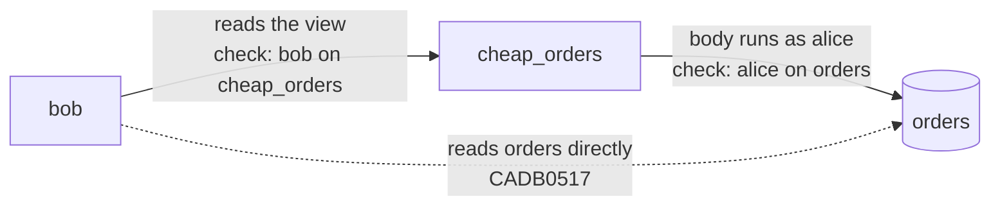

# Views

A view is a named, stored query. Reading the view runs the query, and CamusDB
keeps nothing on disk. The SQL follows PostgreSQL; the end of this page lists
where CamusDB differs by design.

For a view that stores its rows instead of recomputing them, see
[Materialized Views](/docs/materialized-views).

```camussql
CREATE VIEW open_orders AS
  SELECT id, customer, total FROM orders WHERE status = 'open';

SELECT customer, SUM(total) AS spent
FROM open_orders
GROUP BY customer;
```

A view can publish its own column names:

```camussql
CREATE VIEW order_summary (order_id, who, amount) AS
  SELECT id, customer, total FROM orders;
```

## Why use a view

Naming a query is worth more than the typing it saves.

- One definition serves many readers. The join, the filter, and the business
  rule live in one place instead of being copied into every report and
  application that needs them. Fix the definition, and every reader gets the
  fix.
- You can safely grant a slice of a table. A view runs with its owner's
  privileges, so you can give a user exactly the rows and columns the view
  exposes without granting access to the table underneath. See
  [Ownership and security](#ownership-and-security).
- A view is a stable contract over a changing schema. Clients keep the columns
  they were written against while you rename the tables and columns underneath,
  and CamusDB refuses a `DROP` that would strand the view. See
  [Dependencies and schema changes](#dependencies-and-schema-changes).
- Views compose, and CamusDB plans them like subqueries. A view expands before
  planning, so it can join, aggregate, and nest inside another view. It gets the
  same optimizer, index selection, and serializable locks as a query you write
  by hand.
- There is nothing to keep in sync. With no stored copy and no refresh step, a
  view is always as current as the tables it reads. Use a
  [materialized view](/docs/materialized-views) when you would rather pay once
  and read many times.

### Worked example

Start by naming a rule that the rest of the system repeats:

```camussql
CREATE VIEW open_orders AS
  SELECT id, customer, total
  FROM orders
  WHERE status = 'open';
```

Read it like a table. Aggregate over it, join it, and build on it:

```camussql
SELECT customer, SUM(total) AS outstanding
FROM open_orders
GROUP BY customer;

SELECT o.id, c.region
FROM open_orders o
INNER JOIN customers c ON o.customer = c.name;

CREATE VIEW large_open_orders AS
  SELECT id, customer FROM open_orders WHERE total > 1000;
```

Grant it to a user who has no access to `orders` at all:

```camussql
GRANT SELECT ON shop.open_orders TO reporting;
```

Then change the schema underneath the view. Nothing that reads the view needs
to change:

```camussql
ALTER TABLE orders RENAME TO sales_orders;
ALTER TABLE sales_orders RENAME COLUMN total TO amount;

SELECT customer, SUM(total) AS outstanding
FROM open_orders
GROUP BY customer;
-- unchanged: same view, same column names, same rows
```

## Combine query results in a view

A view body can combine queries with `UNION`, `INTERSECT`, or `EXCEPT`, including
`ALL` variants:

```camussql
CREATE VIEW order_customers AS
SELECT customer_id FROM orders
UNION
SELECT customer_id FROM archived_orders;
```

Each operand's `*` is frozen at creation. Output names come from the leftmost
operand, and dependencies cover tables and columns on both sides. Set
operations nested inside a derived table or subquery of a view body must list
columns explicitly; `*` there is refused. See
[set operations](/docs/sql-queries#views) for naming and grouping rules.

## Read through a view

CamusDB expands a view into a derived table before planning, so everything that
works on a subquery works on a view, including:

- Joins.
- Aggregation.
- `DISTINCT`.
- `ORDER BY`.
- Subqueries.
- The cost-based optimizer.
- Spilling to disk.
- Serializable locks on the base table ranges the query reads.

```camussql
SELECT v.id, c.region
FROM open_orders v
INNER JOIN customers c ON v.customer = c.name;
```

[`EXPLAIN`](/docs/explain) has no view scan node. The plan shows the query that
actually runs, which is the expanded form, so a view over an indexed table uses
those indexes. By planning time, there is no view left in the way.

For the same reason, a view stores no statistics of its own. A plan over a view
uses the estimates of the tables its body reads, so
[`SHOW STATISTICS`](/docs/show-statistics) names the view and points you to
those tables instead of reporting numbers that do not exist.

You can reference a view by its name or give it an alias:

```camussql
SELECT open_orders.customer FROM open_orders;   -- the view name is the default alias
SELECT o.customer FROM open_orders o;           -- an explicit alias wins
```

Subqueries in the body's `WHERE`, including within a derived table or a
set-operation operand, run through the same binding rules as a top-level
query. That includes `IN`, `NOT IN`, scalar predicates, and correlated or
uncorrelated `EXISTS`/`NOT EXISTS`. They read their tables with the view owner's
privileges, as the rest of the body does.

## CamusDB checks the body at creation time

CamusDB resolves every table, column, and function in the body when you run
`CREATE VIEW`, so mistakes are reported to the view's author, not to its first
reader:

```camussql
CREATE VIEW v AS SELECT id FROM no_such_table;
-- CADB0011: table 'no_such_table' does not exist
```

### Every output column needs a name

A bare expression has no name to publish, and CamusDB refuses to invent one:

```camussql
CREATE VIEW v AS SELECT total + 1 FROM orders;
-- CADB0400: column 1 of the view body is an expression with no name; add an alias

CREATE VIEW v AS SELECT total + 1 AS total_plus_one FROM orders;  -- OK
```

PostgreSQL names such a column `?column?`. That name would appear in
`SHOW COLUMNS`, in dependent views, and in client column maps, yet nothing can
select it, and its number would change if you reordered the projection list.

### SELECT * expands once

```camussql
CREATE VIEW all_orders AS SELECT * FROM orders;   -- orders has 4 columns
ALTER TABLE orders ADD COLUMN note STRING(64);

SELECT * FROM all_orders;                          -- still 4 columns
```

Like PostgreSQL, CamusDB fixes the view's shape when you create it. Otherwise, a
new base table column would widen every `SELECT *` view over it, changing what
dependent views and clients see without anyone issuing a statement against
them.

A body cannot mix `*` with other projections. The expansion order is not stable
when someone adds a base column, so CamusDB could not keep the shape fixed.

### What a view body cannot contain

| Not allowed in a body | Why |
| --- | --- |
| `AS OF SYSTEM TIME` | An absolute timestamp would pin the view to one instant forever. A relative one, such as `'-2h'`, would mean something different at each reference, so two readers could disagree about the contents and both be correct. Use `CREATE TABLE ... AS SELECT ... AS OF SYSTEM TIME` for a point-in-time copy. |
| Index hints | A hint fixes a plan choice inside the stored definition, where it outlives the statistics that produced it. |
| Cache hints | Same reason. Views are also never cacheable. See [Views and the result cache](#views-and-the-result-cache). |

CamusDB also refuses an index hint on a view reference. A view has no indexes of
its own, so the hint could only apply to a relation the statement does not
name.

## Replace a view

`CREATE OR REPLACE VIEW` can only add columns at the end. It must keep the
existing column names, types, and order:

```camussql
CREATE VIEW v AS SELECT id, customer FROM orders;

CREATE OR REPLACE VIEW v AS SELECT id, customer, total FROM orders;  -- OK
CREATE OR REPLACE VIEW v AS SELECT id FROM orders;                   -- CADB0529
CREATE OR REPLACE VIEW v AS SELECT id, status FROM orders;           -- CADB0529
```

Dependent views bind to column names when they are created, cached plans bind
to column positions, and clients bind to both. Silently changing any of these
would change what those objects mean, and the damage would show up later,
somewhere else, as wrong data rather than as an error.

To change the shape, drop the view and create it again. That forces its
dependents into the open.

The body itself can change freely, and the change takes effect on the next
read:

```camussql
CREATE OR REPLACE VIEW v AS
  SELECT id, customer FROM orders WHERE status = 'closed';
```

## Dependencies and schema changes

A view records what it reads by object id, both the relations and the
individual columns inside them. It never records names.

This has two useful results. Renaming anything a view reads is invisible to the
view. And a `DROP` that would leave a view with nothing to read fails at the
`DROP`, not when the next reader queries the view.

### Renames are transparent {#a-rename-is-transparent}

A stored body names each relation by an immutable id, so a rename changes
nothing about the view. There is no stored text to update:

```camussql
CREATE VIEW open_orders AS
  SELECT id, customer FROM orders WHERE status = 'open';

ALTER TABLE orders RENAME TO sales;

SELECT id FROM open_orders;   -- still works

SHOW CREATE VIEW open_orders;
-- CREATE VIEW `open_orders` AS SELECT id, customer FROM sales AS orders WHERE status = 'open'
```

This works the same way for renaming a table, renaming a view that another view
reads, and renaming a column:

```camussql
ALTER TABLE sales RENAME COLUMN total TO amount;
SELECT id, total FROM open_orders;   -- still works, still called "total"
```

The view's output names do not follow the base column, so a rename underneath
the view is invisible to all its readers.

In two corner cases, where the body would be stranded, a column rename fails
instead of being absorbed:

1. A view created by a CamusDB version that did not yet bind columns by id.
2. A reference in an `ORDER BY`, `GROUP BY`, or `HAVING` clause that matches one
   of the view's own output names. Those clauses may legally name an output
   column instead of a base column, so CamusDB leaves such a reference as you
   wrote it rather than guess what it means.

Names come back only when the definition is displayed. `SHOW CREATE VIEW`
renders each relation and column under its current name.

That output prints a relation's original name as an alias, by design, because
qualified column references inside the body resolve through that alias, so it
must stay fixed for the life of the definition. CamusDB does not print an alias
that would just repeat the relation's current name, so an ordinary view renders
as you wrote it.

### Drop a relation

CamusDB refuses a drop that would leave a dependent with nothing to read:

```camussql
CREATE VIEW inner_v AS SELECT id, total FROM orders;
CREATE VIEW outer_v AS SELECT id FROM inner_v WHERE total > 10;

DROP VIEW inner_v;
-- CADB0530: cannot drop view 'inner_v' because other objects depend on it: outer_v

DROP VIEW inner_v CASCADE;   -- drops outer_v as well
```

The same rule protects tables:

```camussql
DROP TABLE orders;
-- CADB0530: cannot drop table 'orders' because other objects depend on it: open_orders
```

`DROP TABLE` has no `CASCADE` form, so drop the dependent views first. The
alternative would be a table drop that quietly turns every dependent view into
an error for its next reader.

### Drop a column

The same protection covers individual columns:

```camussql
ALTER TABLE orders DROP COLUMN total;
-- CADB0530: cannot drop column 'total' of table 'orders' because other objects
--           depend on it: open_orders
```

A column counts even if the body reads it only in a `WHERE` clause or inside a
subquery. A materialized view's body protects the columns it reads at every
refresh.

`DROP COLUMN` has no `CASCADE` form either. Drop or replace the dependent view
first.

The drop check is a lower bound, not a guarantee. CamusDB does not record a
reference that its analysis cannot attribute to exactly one relation, so a body
with an unusual shape can still allow a column drop.

This errs on the safe side by design. A missed refusal only leaves the behavior
from before the check existed, while a wrong refusal would block changing a
column that nothing depends on.

### Cycles

CamusDB rejects a view that would depend on itself when you run the DDL
statement:

```camussql
CREATE VIEW a AS SELECT id FROM b;
CREATE OR REPLACE VIEW b AS SELECT id FROM a;
-- CADB0528: infinite recursion detected in the definition of view 'b'
```

[`max_view_expansion_depth`](#configuration) also caps the nesting depth as a
backstop.

### Reserved relation and column names

A stored body refers to relations and columns by id, using reserved identifier
prefixes for that purpose, so nothing else may use those prefixes.

Tables, views, and materialized views cannot have names that start with
`__camus_rel_`, and columns cannot have names that start with `__camus_col_`:

```camussql
CREATE TABLE __camus_rel_7 (id INT64 PRIMARY KEY);
-- CADB0400: table name '__camus_rel_7' starts with '__camus_rel_', which is reserved
```

The guard applies to `CREATE`, `ALTER`, and `RENAME TO`.

## Ownership and security

A view runs its body with its owner's privileges, not the caller's. That makes
a view a security boundary, not just a query shorthand:

```camussql
-- as alice, who can read orders
CREATE VIEW cheap_orders AS SELECT id, total FROM orders WHERE total < 25;
GRANT SELECT ON shop.cheap_orders TO bob;

-- as bob, who cannot read orders at all
SELECT * FROM cheap_orders;   -- works: exactly the rows the view exposes
SELECT * FROM orders;         -- CADB0517
```

CamusDB checks the caller's privileges on the view and the owner's privileges
on everything the body reads. A view can widen access to a slice of a table,
and nothing more.



Details:

- CamusDB records the owner by immutable id, not by name. Dropping a user and
  creating one with the same name does not transfer ownership. The view fails
  closed, and reads are refused until you recreate or transfer the view.
- `CREATE OR REPLACE VIEW` does not change the owner. A replacement rewrites the
  body; if it also changed the owner, replacing a view would be a way to take it
  over and run it as yourself.
- `ALTER VIEW v OWNER TO u` transfers the view. Only a superuser or the current
  owner can do this; an `ALTER` grant on the view is not enough, because
  ownership decides whose privileges the body uses. The new owner must already
  exist.
- The privilege switch applies only to the view. If a query names the same
  table twice, once through a view and once directly, it gets the owner's
  rights only for the reference through the view.
- Each view in a chain runs as its own owner.
- A view is a grantable object: `GRANT SELECT ON db.my_view TO someone`.
  Dropping, renaming, replacing, or describing a view all require a grant on the
  view. `SHOW VIEWS` lists only what the caller can reach.

CamusDB does not support `security_invoker`, an option that would run a view as
the caller instead of the owner. See
[Authentication And Authorization](/docs/sql-authentication).

## Views and the result cache

CamusDB never serves a query through a view from the
[query result cache](/docs/query-result-cache). Each cache entry fences the
[key space](/docs/concepts#key-space) (the range of storage keys) of one
physical table, and a view expands to a derived table that has no key space of
its own. The same limit makes joins uncacheable.

CamusDB accepts a `{cache=name}` hint on a view reference rather than rejecting
it. The response reports the hint as a bypass with the reason `DerivedSource`,
so the hint is visible, not silently ignored. The rows still come from live
storage on every read.

Materialized views are not affected. A materialized view is a physical
relation, and the cache treats it exactly like a table.

## Introspection

```camussql
SHOW VIEWS;
SHOW VIEWS LIKE 'open%';
SHOW CREATE VIEW open_orders;
SHOW COLUMNS FROM open_orders;
```

`SHOW TABLES` lists only tables, not views, just like PostgreSQL's `\dt`.
Changing the `SHOW TABLES` output would break existing clients.

`SHOW CREATE VIEW` prints the normalized definition, not the text you typed:

```camussql
CREATE VIEW v AS SELECT id,total FROM orders WHERE a OR b AND c;

SHOW CREATE VIEW v;
-- CREATE VIEW `v` AS SELECT id, total FROM orders WHERE a OR (b AND c)
```

CamusDB stores a view as a re-rendered definition so that references resolve by
id and `CREATE OR REPLACE` has a canonical form to compare against.

PostgreSQL's `pg_get_viewdef` does not return the original text either. The
printed DDL is guaranteed to parse back into the same query, so you can send it
straight back to the server.

## Rename a view

```camussql
ALTER VIEW open_orders RENAME TO active_orders;
```

The rename changes only metadata. The view's id stays the same, so every
dependent keeps resolving.

## Configuration

| Setting | Default | Meaning |
| --- | --- | --- |
| `max_view_expansion_depth` | `32` | A backstop on how deeply views can nest inside other views. |

See [Configuration](/docs/configuration) and
[`SHOW VARIABLES`](/docs/show-variables).

## Differences from PostgreSQL

| Area | CamusDB | Why |
| --- | --- | --- |
| Unnamed expression columns | Refused | PostgreSQL names such a column `?column?`, which nothing can reference. Adding one `AS` produces a usable view. |
| Updatable views | Not implemented | See [Not implemented yet](#not-implemented-yet). |
| Rules and `INSTEAD OF` triggers | Not supported | CamusDB has neither, so there is no way to make a view writable when CamusDB cannot update it on its own. |
| `DROP TABLE ... CASCADE` | No `CASCADE` form | Drop the dependent views explicitly. |
| `security_invoker` views | Not supported | CamusDB implements only the owner's-rights model. |
| `WITH RECURSIVE` views | Not supported | CamusDB has no `WITH RECURSIVE`. |
| Cross-database views | Not supported | This matches the existing single-database restriction on `INSERT ... SELECT`. |
| Temporary views | Not supported | CamusDB has no temporary relations. |
| Mixing `*` with other projections | Refused | See [SELECT * expands once](#select--expands-once). |
| `AS OF SYSTEM TIME` in a body | Refused | See [What a view body cannot contain](#what-a-view-body-cannot-contain). |

## Not implemented yet

These gaps remain. Each item says what CamusDB does today:

- Updatable views: `INSERT`, `UPDATE`, and `DELETE` through a view, the
  automatic updatability rules, and `WITH CHECK OPTION` enforcement. The
  `WITH [LOCAL|CASCADED] CHECK OPTION` clause parses and CamusDB stores it, but
  nothing enforces it yet. Every view is read-only.
- Rechecking nested view grants at read time. A body can read another view, and
  CamusDB checks that inner reference when the view is created, not on every
  read. A grant you revoke later does not break the outer view until you
  replace it. The inner view still runs as its own owner, so this widens
  nothing beyond its author's reach.
- Absorbing column renames in two corner cases. CamusDB refuses the rename
  instead. See [Renames are transparent](#a-rename-is-transparent).

## Related pages

- [Materialized Views](/docs/materialized-views) for stored results.
- [Inspecting The Database](/docs/sql-inspection) for the `SHOW` statements.
- [Authentication And Authorization](/docs/sql-authentication) for grants.
- [Error Codes](/docs/error-codes) for the `CADB05xx` codes above.
