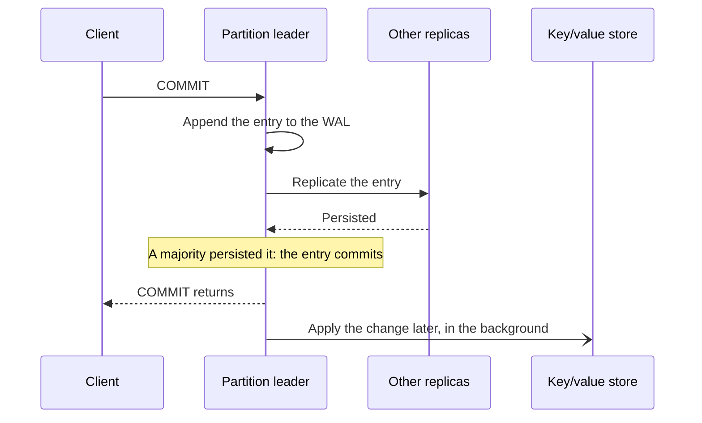
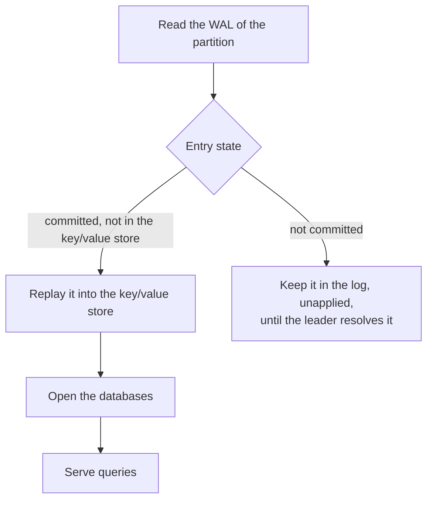

# WAL and recovery

When `COMMIT` returns, the change is recoverable after a process crash, a node
restart, or a [leadership](/docs/concepts#leader) change. CamusDB writes each
change to a [write-ahead log](/docs/concepts#wal) (WAL) before it applies the
change to the stored data. At startup, a node replays the committed log entries
that aren't in the stored data yet. A transaction that didn't commit isn't
applied.

The idea is the same as the WAL in PostgreSQL or the redo log in MySQL.
However, each [partition](/docs/concepts#partition) has a separate log, and
[Raft](/docs/concepts#raft) replicates it. In a cluster, an entry commits when
a [majority](/docs/concepts#majority) of the replicas of the partition have
persisted it. This means that a committed write doesn't depend on one machine.

The WAL doesn't need configuration. Read this page to understand why a
committed write survives a crash, to tune log compaction, or to diagnose a slow
restart.

## The log and the key/value store

A node stores its data in two places under `data_dir`. The WAL is the record of
what committed, and in which order. The key/value store has the current data
that the committed entries produce.

| Store | Directory | Contents | Backend setting |
| --- | --- | --- | --- |
| Raft WAL | `wal` | The log entries of each partition, in commit order | `kahuna.wal_storage` |
| Key/value store | `kv` | The current data, such as rows and index entries | `kahuna.storage` |

Both stores use RocksDB by default. SQLite and
[Solarium](https://solariumdb.github.io/) are alternatives. For the backend
settings, and for `wal_sync_writes`, see
[Storage](/docs/storage#the-rocksdb-backend).

## The write path

A write becomes durable in three steps.

1. The leader of the partition appends the change to its WAL as a Raft log
   entry. With `wal_sync_writes: true`, the default, the entry is synced to
   disk.
2. The entry commits when a majority of the replicas have persisted it.
   `COMMIT` returns after this step. A standalone node has one replica, and it
   is the majority.
3. A background writer applies the committed change to the key/value store.

If the node stops between step 2 and step 3, the key/value store doesn't have
the change yet. The WAL has it, and the restart replays it.

## The recovery path

At startup, each partition restores from its WAL.

- The committed entries that the key/value store doesn't have are replayed into
  it.
- An entry that didn't commit isn't applied. It stays in the log until the
  leader of the partition commits it or replaces it, as Raft requires.

The databases open after all the partitions have finished the restore. This
means that a query reads the replayed data.

Restart time grows with the number of committed entries that the key/value
store didn't have when the node stopped. The node log has a `KeyValueRestorer`
line for each partition at startup. Its `replayed` count shows the size of the
replay.

## Behavior after a failure

| Failure | Result |
| --- | --- |
| Crash before the commit | The change isn't applied, and the transaction isn't reported as committed. Retry it from `BEGIN`. |
| Crash after `COMMIT` returns, before the key/value write | The committed entry is replayed at restart. |
| Lost response to `COMMIT` | The outcome can be unknown. See [Retry an unresolved finalize](/docs/serializable-retries#retry-an-unresolved-finalize). |
| Leader failure | A replica that has all the committed entries becomes the leader. This is a Raft rule. |
| Node restart | The node replays its partitions. Then it rejoins the cluster as a replica or as a leader candidate. |

These results assume that the files on disk are intact. If a replica finds at
restart that it lost entries that it had acknowledged, by default it doesn't
vote or lead until a peer repairs it. A partition with one replica can't be
repaired from a peer. A replay doesn't repair damaged RocksDB or Solarium files.
For the policy and for damaged files, see
[Storage damage and lost log entries](/docs/configuration#storage-damage-and-lost-log-entries).

## Transactions across partitions

A transaction can change keys on several partitions. Its commit decision is
stored in the log of one of them. When that decision has committed, the
transaction finishes on all the partitions, also if the node that coordinated it
stops. If a failure happens before the decision commits, the transaction isn't
committed. For the steps, see
[Commit decision durability](/docs/transactions-locking-internals#the-durability-of-a-commit-decision).

## Checkpoints and compaction

After the background writer has applied the writes of a partition to the
key/value store, the leader of the partition writes a checkpoint entry to the
log. This happens about 30 seconds after the first write since the last
checkpoint. Log entries older than the last checkpoint can then be compacted.
This means that old entries are removed from the WAL. For the compaction
settings, see [Kahuna engine section](/docs/configuration#kahuna-engine-section).

## Related

- [Storage](/docs/storage)
- [Backup and restore](/docs/backup-and-restore), to rebuild a node from a
  backup or to return it to a point in time
- [Distributed transactions and HLC](/docs/distributed-transactions)
- [Kahuna storage overview](https://kahunakv.github.io/docs/storage/overview/)
