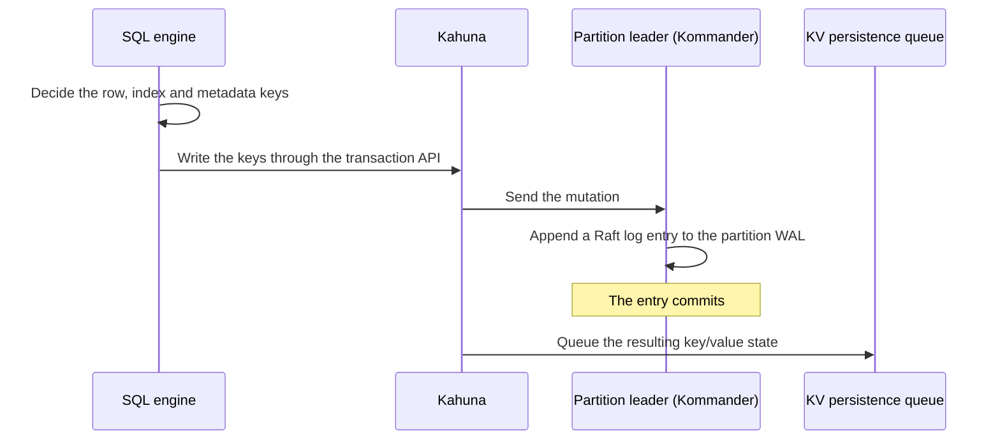
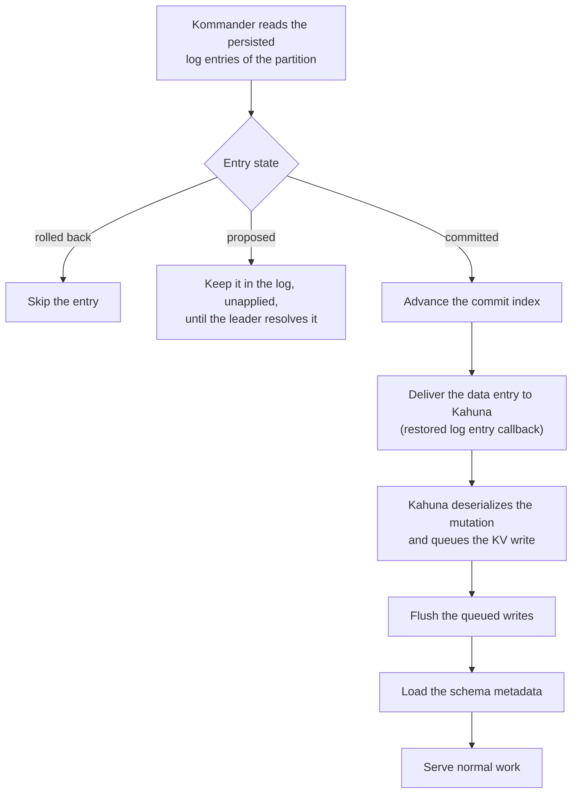
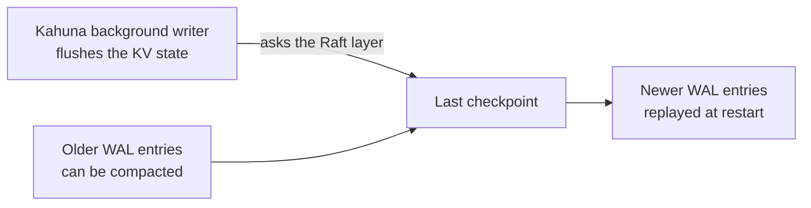

# WAL and recovery

When `COMMIT` returns, you need the change to survive whatever happens next.
CamusDB writes every storage change to a [write-ahead log](/docs/concepts#wal)
(WAL) before it applies it, and replays committed log entries at startup. A
committed change stays recoverable after a crash of the process, a restart of a
node, or a change of [leadership](/docs/concepts#leader). A transaction that
did not commit never comes back as committed.

The idea is the same as the WAL in PostgreSQL or the redo log in MySQL. The
difference is that each [partition](/docs/concepts#partition) keeps its own log,
replicated by [Raft](/docs/concepts#raft). In a cluster, an entry commits only
after a [majority](/docs/concepts#majority) of the partition's replicas persist
it, so a committed write
does not depend on one machine. Checkpoints keep the log, and the time a
restart takes, bounded.

You do not need this page to use CamusDB. The WAL works with no configuration.
Read it when you want to know why a committed write survives a crash, when you
tune the settings of the WAL, or when you diagnose a slow restart.

The WAL is part of the distributed storage layer:
[Kommander](/docs/concepts#kommander) stores the ordered
[Raft](/docs/concepts#raft) log, and [Kahuna](/docs/concepts#kahuna) replays
committed entries into the persistent key/value store. See
[Architecture: storage components](/docs/architecture#storage-components) for
what each component does.

This mechanism is separate from the SQL model. A user writes SQL. The storage
layer records the committed mutations of a row, an index, the schema, a lock,
and a transaction as replicated log entries. Only then are those changes
durable.

## The two durable paths

CamusDB has two related paths for persistence:

| Path | Owner | Purpose |
| --- | --- | --- |
| Raft WAL | Kommander | Stores the Raft log entries of each [partition](/docs/concepts#partition). An entry can be proposed, committed, rolled back, or part of a checkpoint. |
| KV persistence | Kahuna | Stores the materialized key/value state that the committed log entries produce. |

By default both paths use RocksDB, as two separate databases. See
[Storage](/docs/storage#the-rocksdb-backend) for the backend settings.

The difference between the two paths matters. The Raft WAL is the source of the
order during a recovery. It knows which operations committed, and in which
order. The KV persistence is the current durable form of those committed
operations. CamusDB can replay a committed WAL entry when the KV persistence
lags at the time of a restart.

## The write path

A write in CamusDB has this shape:

1. The SQL engine decides which row keys, index keys, and metadata keys must
   change.
2. CamusDB writes those keys through the transaction API of
   [Kahuna](https://kahunakv.github.io/).
3. [Kahuna](https://kahunakv.github.io/) sends the mutation to the partition
   leader.
4. [Kommander](https://kahunakv.github.io/kommander.github.io/) adds the
   mutation to the WAL of that partition, as a Raft log entry.
5. [Kahuna](https://kahunakv.github.io/) puts the resulting key/value state in a
   queue for the persistent storage, after the entry commits.

The scheduler of the WAL writes knows about the partitions. It does four things:

- It keeps the order of arrival inside each partition.
- It groups compatible writes into a batch.
- It lets two different partitions flush at the same time.
- It applies back-pressure to a partition with too many WAL operations that
  wait.

## The recovery path

At startup, each partition restores from its WAL. CamusDB accepts no normal
operation for that partition before the restore finishes.

1. [Kommander](https://kahunakv.github.io/kommander.github.io/) reads the
   persisted log entries of the partition.
2. It skips an entry that rolled back. It keeps an entry that is only proposed
   in the log, but does not apply it. The partition leader later commits that
   entry or replaces it, following the Raft rules.
3. A committed entry advances the commit index of the partition, which is the
   position of the last entry known to be committed.
4. CamusDB delivers each committed data entry to
   [Kahuna](https://kahunakv.github.io/), through the callback for a restored
   log entry.
5. [Kahuna](https://kahunakv.github.io/) deserializes the restored mutation. It
   then puts the resulting key/value write in a queue.
6. CamusDB flushes those queued writes before it loads the schema metadata.

The last step matters, because the databases share one storage node. You create
a database explicitly, and CamusDB gives it a stable opaque database id. The
prefix of that id separates the schema entries, the row entries, the index
entries, and the statistics entries inside the shared KV space.

In standalone mode and in cluster mode, CamusDB starts one shared
[Kahuna](https://kahunakv.github.io/) node. That node has a KV path and a WAL
path, both under the configured `data_dir`. The partitions recover before
CamusDB serves normal work. CamusDB then loads the database metadata from the
recovered KV state.

The recovery of the catalog is deterministic for that reason. CamusDB reads the
schema, the system metadata, the row data, and the index data only after the WAL
replay reaches the KV backend.

## Behavior after a failure

The WAL improves the recovery, because it separates two states. The first state
is "the consensus accepted this entry". The second state is "the KV backend
materialized this entry later".

| Failure | Result of the recovery |
| --- | --- |
| A crash before the commit | CamusDB does not apply the entry at restore. The entry stays in the log until the partition leader commits it or replaces it. |
| A crash after the commit, but before the KV flush | CamusDB replays the committed WAL entry. It puts the entry back in the queue for the KV persistence. |
| A restart of a node | The node restores the committed logs of its partitions. It rebuilds the materialized KV state where that is necessary. It then rejoins the election of a leader, or the replication. |
| A failure of a leader | Another eligible replica can lead the partition. It can do so only from a log state that satisfies the safety rules of Raft. |
| A stale or superseded proposal | CamusDB skips a rolled-back entry during the restore, and it applies no entry that is only proposed. |

For a transaction, CamusDB uses two mechanisms: the transaction protocol of
[Kahuna](https://kahunakv.github.io/), and the order of the committed log from
[Kommander](https://kahunakv.github.io/kommander.github.io/).

A transaction that did not commit never returns as a committed SQL result.
CamusDB can replay a committed transaction into the KV store, when the process
stopped before the background writer finished.

## Recovery of a transaction decision

A distributed transaction adds one more concern for a recovery. A commit can
involve several participant partitions.

Kahuna handles that case with a transaction
[coordinator](/docs/concepts#two-phase-commit). For a durable decision, it also
uses an internal decision record. That record anchors to the first persistent
key that the transaction modified. The partition that holds that key is the
anchor partition.

Five properties hold after the anchor decision commits:

- The transaction must finish as committed.
- CamusDB can retry the commit of a participant. It does not apply the same
  mutation twice.
- A receipt of completion identifies each participant that committed already.
- The leader of the anchor partition can continue the recovery, after a change
  of leader or a restart of a node.
- The recovery work belongs to one partition. Two independent anchor partitions
  therefore make progress without a block on each other.

A response to the commit of a participant can be lost. A retry of the same
commit path can then use the receipt of completion from that participant. It
does not treat the absent [write intent](/docs/concepts#write-intent) in memory
as an abort.

The live coordinator can disappear. A background decision-recovery worker then
scans the durable decisions that remain open, on the partitions that this node
leads. It drives each participant that did not acknowledge, until the decision
completes.

The process can stop before CamusDB installs the durable anchor decision. The
active session of the transaction then never returns as a committed result. That
boundary keeps the recovery conservative. CamusDB recovers a committed decision
and a committed WAL entry. It does not recover speculative work of an
application.

## Checkpoints and compaction

The WAL does not grow forever.
[Kommander](https://kahunakv.github.io/kommander.github.io/) tracks the
committed checkpoint entries. It can compact a log older than the last
checkpoint.

The background writer of [Kahuna](https://kahunakv.github.io/) tracks the
partitions with durable state that is not clean. It asks the Raft layer to
create a checkpoint after the flush of the materialized KV state.

A recovery then reads only the logs that are newer than the last checkpoint. The
KV backend holds the older committed state already. The newer committed entries
stay available for a replay.

## Why this matters

A traditional single-node database often couples three concerns in one primary
storage process: the durability, the availability, and the service of queries.
CamusDB separates those concerns:

- The Raft partitions give an ordered, replicated history of the commits.
- The restore from the WAL rebuilds the committed state after a failure.
- The KV persistence stores the current materialized state, for a fast read.
- A checkpoint keeps the recovery bounded over time.
- Several active CamusDB nodes can accept client traffic. The partition leaders
  meanwhile serialize the writes safely.

A recovery from the WAL restores a node after a crash. To rebuild a node from a
captured image, or to return it to a chosen point in time, see
[Backup And Restore](/docs/backup-and-restore).

For the details of the storage at a lower level, see [Storage](/docs/storage)
and
[the storage overview of Kahuna](https://kahunakv.github.io/docs/storage/overview/).
