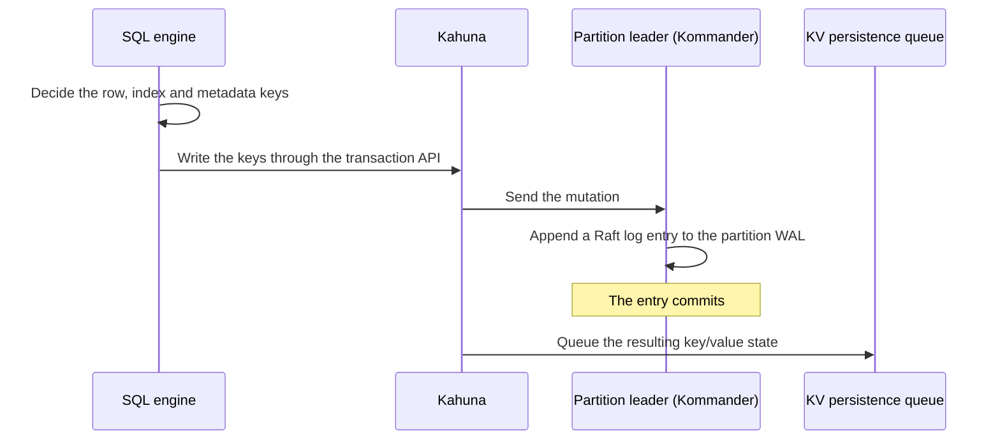
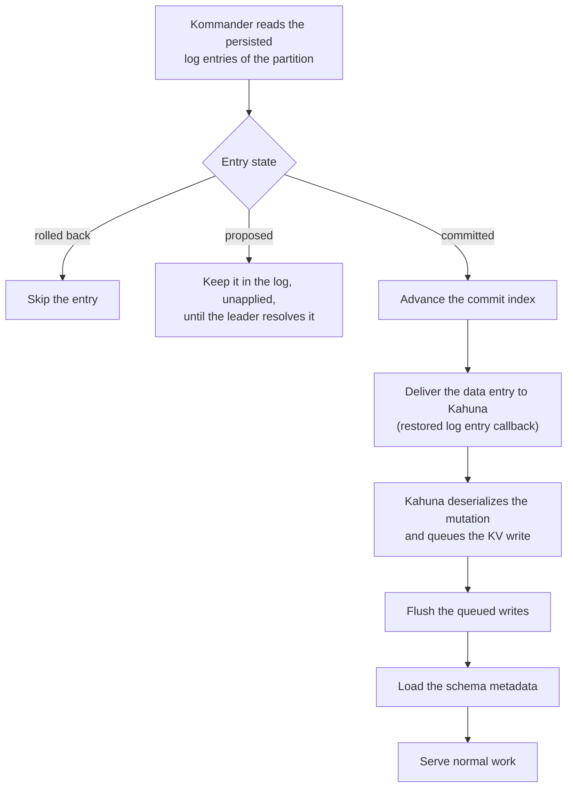
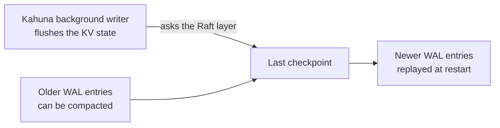

# WAL and recovery

When `COMMIT` returns, you need the change to survive whatever happens next.
CamusDB writes every storage change to a [write-ahead log](/docs/concepts#wal)
(WAL) before it applies it, and replays committed log entries at startup. A
committed change stays recoverable after a process crash, a node restart, or a
[leadership](/docs/concepts#leader) change. A transaction that did not commit
never comes back as committed.

The idea is the same as the WAL in PostgreSQL or the redo log in MySQL. The
difference is that each [partition](/docs/concepts#partition) keeps its own log,
replicated by [Raft](/docs/concepts#raft). In a cluster, an entry commits only
after a [majority](/docs/concepts#majority) of the partition's replicas persist
it, so a committed write does not depend on one machine. Checkpoints keep both
the log size and restart time bounded.

You do not need this page to use CamusDB. The WAL works with no configuration.
Read it when you want to know why a committed write survives a crash, when you
tune WAL settings, or when you diagnose a slow restart.

The WAL is part of the distributed storage layer:
[Kommander](/docs/concepts#kommander) stores the ordered
[Raft](/docs/concepts#raft) log, and [Kahuna](/docs/concepts#kahuna) replays
committed entries into the persistent key/value store. See
[Architecture: storage components](/docs/architecture#storage-components) for
what each component does.

This mechanism is separate from the SQL model. You write SQL, and the storage
layer records the committed row, index, schema, lock, and transaction mutations
as replicated log entries. Only then are those changes durable.

## The two durable paths

CamusDB has two related persistence paths:

| Path | Owner | Purpose |
| --- | --- | --- |
| Raft WAL | Kommander | Stores each [partition](/docs/concepts#partition)'s Raft log entries. An entry can be proposed, committed, rolled back, or part of a checkpoint. |
| KV persistence | Kahuna | Stores the materialized key/value state that the committed log entries produce. |

By default both paths use RocksDB, as two separate databases. SQLite and
[Solarium](https://solariumdb.github.io/) are alternatives for either path. See
[Storage](/docs/storage#the-rocksdb-backend) for the backend settings.

The Raft WAL is the source of ordering during recovery: it knows which
operations committed, and in which order. KV persistence is the current durable
form of those committed operations. If KV persistence lags at restart, CamusDB
can replay committed WAL entries.

## The write path

A write in CamusDB goes through these steps:

1. The SQL engine decides which row, index, and metadata keys must change.
2. CamusDB writes those keys through the
   [Kahuna](https://kahunakv.github.io/) transaction API.
3. [Kahuna](https://kahunakv.github.io/) sends the mutation to the partition
   leader.
4. [Kommander](https://kahunakv.github.io/kommander.github.io/) appends the
   mutation to that partition's WAL as a Raft log entry.
5. After the entry commits, [Kahuna](https://kahunakv.github.io/) queues the
   resulting key/value state for persistent storage.

The WAL write scheduler is partition-aware. It:

- Keeps arrival order within each partition.
- Groups compatible writes into batches.
- Lets different partitions flush at the same time.
- Applies back-pressure to a partition with too many pending WAL operations.

## The recovery path

At startup, each partition restores from its WAL. CamusDB accepts no normal
operations for that partition until the restore finishes.

1. [Kommander](https://kahunakv.github.io/kommander.github.io/) reads the
   partition's persisted log entries.
2. It skips rolled-back entries. It keeps entries that are only proposed in the
   log but does not apply them; the partition leader later commits or replaces
   them, following the Raft rules.
3. Each committed entry advances the partition's commit index, the position of
   the last entry known to be committed.
4. CamusDB delivers each committed data entry to
   [Kahuna](https://kahunakv.github.io/) through the restored log entry
   callback.
5. [Kahuna](https://kahunakv.github.io/) deserializes the restored mutation and
   queues the resulting key/value write.
6. CamusDB flushes those queued writes before it loads the schema metadata.

The last step matters because all databases share one storage node. Each
database you create gets a stable, opaque database id, and that id prefix
separates its schema, row, index, and statistics entries inside the shared KV
space.

In both standalone and cluster mode, CamusDB starts one shared
[Kahuna](https://kahunakv.github.io/) node with a KV path and a WAL path, both
under the configured `data_dir`. The partitions recover before CamusDB serves
normal work, and CamusDB then loads database metadata from the recovered KV
state.

That makes catalog recovery deterministic: CamusDB reads the schema, system
metadata, row data, and index data only after WAL replay reaches the KV
backend.

## Behavior after a failure

The WAL improves recovery because it separates two states: "consensus accepted
this entry" and "the KV backend materialized this entry later".

| Failure | Recovery result |
| --- | --- |
| Crash before commit | CamusDB does not apply the entry at restore. The entry stays in the log until the partition leader commits or replaces it. |
| Crash after commit, but before the KV flush | CamusDB replays the committed WAL entry and queues it again for KV persistence. |
| Node restart | The node restores its partitions' committed logs, rebuilds the materialized KV state where needed, then rejoins leader election or replication. |
| Leader failure | Another eligible replica can lead the partition, but only from a log state that satisfies Raft's safety rules. |
| Stale or superseded proposal | CamusDB skips rolled-back entries during restore, and applies no entry that is only proposed. |

For transactions, CamusDB relies on two mechanisms: the
[Kahuna](https://kahunakv.github.io/) transaction protocol, and the committed
log order from [Kommander](https://kahunakv.github.io/kommander.github.io/).

A transaction that did not commit never returns as a committed SQL result. If
the process stopped before the background writer finished, CamusDB can replay a
committed transaction into the KV store.

## Transaction decision recovery

Distributed transactions add one more recovery concern: a commit can involve
several participant partitions.

Kahuna handles this with a transaction
[coordinator](/docs/concepts#two-phase-commit). For a durable decision, it also
uses an internal decision record anchored to the first persistent key the
transaction modified. The partition that holds that key is the anchor partition.

Once the anchor decision commits:

- The transaction must finish as committed.
- CamusDB can retry a participant's commit without applying the same mutation
  twice.
- A completion receipt identifies each participant that already committed.
- The anchor partition's leader can continue recovery after a leader change or
  a node restart.
- Recovery work belongs to one partition, so independent anchor partitions make
  progress without blocking each other.

If a participant's commit response is lost, a retry of the same commit path can
use that participant's completion receipt. It does not treat the missing
in-memory [write intent](/docs/concepts#write-intent) as an abort.

If the live coordinator disappears, a background decision-recovery worker scans
the open durable decisions on the partitions this node leads, and drives each
participant that did not acknowledge until the decision completes.

If the process stops before CamusDB installs the durable anchor decision, the
transaction's active session never returns as a committed result. That boundary
keeps recovery conservative: CamusDB recovers committed decisions and committed
WAL entries, not speculative application work.

## Checkpoints and compaction

The WAL does not grow forever.
[Kommander](https://kahunakv.github.io/kommander.github.io/) tracks committed
checkpoint entries and can compact log entries older than the last checkpoint.

[Kahuna](https://kahunakv.github.io/)'s background writer tracks partitions with
dirty durable state. After it flushes the materialized KV state, it asks the
Raft layer to create a checkpoint.

Recovery then reads only the log entries newer than the last checkpoint. The KV
backend already holds the older committed state, and the newer committed entries
stay available for replay.

## Why this matters

A traditional single-node database often couples durability, availability, and
query serving in one primary storage process. CamusDB separates them: the Raft
partition logs hold the replicated commit history, KV persistence stores the
current materialized state for fast reads, and several active CamusDB nodes can
accept client traffic while the partition leaders serialize writes safely.

WAL recovery restores a node after a crash. To rebuild a node from a captured
image, or to return it to a chosen point in time, see
[Backup And Restore](/docs/backup-and-restore).

For lower-level storage details, see [Storage](/docs/storage) and
[Kahuna's storage overview](https://kahunakv.github.io/docs/storage/overview/).
