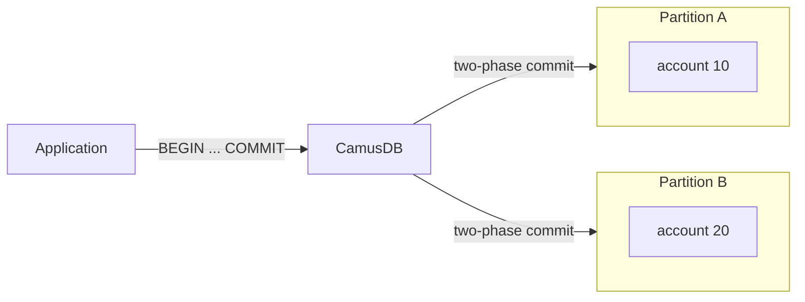
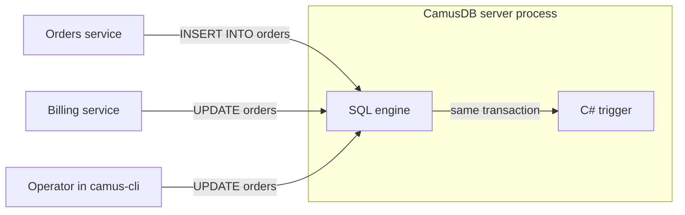

# Why CamusDB?

CamusDB is an open-source distributed SQL database written in modern C#. 
It keeps serving through node failures and upgrades, gives you
serializable transactions across the cluster, runs your .NET business logic
inside the database, and adds branching, drop recovery, and time travel to the
everyday workflow.

Choose it for transactional workloads when  the database holds **authoritative state**: money, inventory,
ownership, reservations, entitlements, workflow state, or quotas. Data where
two conflicting answers are expensive to reconcile later.

<div className="video-embed">
  <iframe
    src="https://www.youtube.com/embed/DvjAD-x-OFE"
    title="Why CamusDB video"
    allow="accelerometer; autoplay; clipboard-write; encrypted-media; gyroscope; picture-in-picture; web-share"
    allowFullScreen
  />
</div>

## What CamusDB adds

Every mature database gives you SQL, indexes, joins, and transactions. CamusDB
has those too. This page is about what it adds on top.

| You need | Common approach | With CamusDB |
| --- | --- | --- |
| Transactions across more than one machine | Shard in the application, or accept weaker isolation | Serializable transactions across replicated partitions, coordinated by the database |
| Keep serving through a node failure, an upgrade, or a traffic spike | Planned downtime, a standby to promote, or a bigger machine | Any node serves requests, replicas elect a new leader, and nodes join or leave one at a time |
| Rules that every writer follows | A copy of the rule in each service, bypassed by operators | C# triggers and procedures that run inside the server, in the same transaction |
| A safe place to test a migration on real data | A full copy of the database | A copy-on-write branch created at a point in time |
| Undo a wrong `DROP TABLE` | Restore a backup | Relink the table during the retention window |
| See the data as it was an hour ago | Restore a backup, or keep audit tables | `AS OF SYSTEM TIME` on any query |
| Run the database on your .NET stack | A separate runtime and toolchain, and a black box | One `dotnet tool install`, ADO.NET, Dapper, and EF Core providers, and C# source you can read and extend |
| A license you can build a business on | Source-available terms, copyleft obligations, or per-core fees that grow with the deployment | MIT license: use, modify, and sell it in commercial products at any size, with no license fee |

## Serializable transactions that scale past one machine

If two requests reserve the last item, spend the same balance, or claim the
same seat, the application needs one authoritative outcome.

CamusDB uses **serializable transactions by default**. Data is split into
[partitions](/docs/concepts#partition), and each partition is replicated by
[consensus](/docs/concepts#raft): its replicas elect
a leader to order writes, and a change commits once a majority of them accept
it. Different parts of the database make progress independently, and your
application never decides which server owns a row.

A transaction that spans partitions commits with two-phase commit:

```camussql
BEGIN;

UPDATE accounts SET balance = balance - 100 WHERE id = 10;
UPDATE accounts SET balance = balance + 100 WHERE id = 20;

INSERT INTO transfers (source, destination, amount)
VALUES (10, 20, 100);

COMMIT;
```

The two accounts can live on different partitions. The transaction stays
atomic.



That lets you enforce invariants against one consistent view of the data:

```text
inventory >= 0
balance >= 0
one seat -> one reservation
one asset -> one owner
```

Typical workloads: balances and ledgers, game inventories and rewards, orders
and limited stock, reservations and ticketing, marketplace ownership, SaaS
quotas and control-plane state, logistics and provisioning.

These guarantees are tested with [Caraxes](/docs/caraxes), a fault-injection
harness that runs bank-transfer workloads and a Jepsen-based transactional
consistency checker while it kills processes, partitions the network, and
fills disks.

See [Transactions and Isolation](/docs/serializable-transactions) and
[Distributed Transactions and HLC](/docs/distributed-transactions).

## Stay up through failures, scale with traffic

A single-node database goes down with its machine, its maintenance window, and
its upgrades. A CamusDB cluster has no single active process.

- **Any node serves requests.** CamusDB routes each write to the partition
  that owns the row.
- **One node can fail.** A three-node cluster keeps committing while a node is
  down. The remaining replicas elect a new leader.
- **Upgrades roll one node at a time**, so the cluster stays available.
- **Capacity follows traffic.** Nodes join and leave one at a time, and the
  [Kubernetes operator](/docs/kubernetes-operator) can autoscale on load.
- **Same SQL on one node or a cluster.** Start standalone and move to a
  cluster without changing queries.

The trade-off: a partition that loses its majority stops committing rather
than accept conflicting writes. CamusDB chooses correctness over availability.

See [Cluster mode](/docs/cluster).

## Business logic inside the database

Some rules belong next to the data: a normalization step every writer must
apply, an audit row that must commit with the change it records, or a transfer
that must move money atomically.

Application code enforces those rules poorly. Microservices that share tables
each carry their own copy of the rule, and the copies drift. An operator with
direct database access bypasses the services entirely.

CamusDB lets you write those rules in C# and load them into the server. The
code runs inside the database process, with no extra service and no network
round trip. Triggers and procedures run in the same transaction as the
statement that invoked them.

| Extension | SQL surface | Typical use |
| --- | --- | --- |
| Scalar function | `SELECT slugify(title) FROM posts` | Calculate or transform one value. |
| Trigger | `CREATE TRIGGER ... EXTERNAL NAME ...` | Validate, normalize, or audit every changed row. |
| Procedure | `CALL transfer('alice', 'bob', 30)` | Run several statements as one operation. |

Attach a C# trigger class to a table with SQL:

```camussql
CREATE TRIGGER audit ON orders
AFTER INSERT, UPDATE, DELETE
EXTERNAL NAME 'MyCompany.Ext.AuditTrigger';
```

From then on, every writer follows the rule: each microservice, each migration
script, an operator in `camus-cli` or the Web Console, and the HTTP and gRPC
write APIs.



Extensions are operator-managed. You copy the DLL to every node and list it in
the server configuration. CamusDB inspects safe assemblies and rejects file,
process, network, and native-code APIs. The code still runs with the database
process's permissions, so deploy only reviewed code. Procedures currently
require a superuser caller.

See [C# extensions](/docs/csharp-extensions).

## Branch a database like code

Create an isolated branch of a database at a point in time:

```camussql
CREATE DATABASE feature_checkout BRANCH FROM prod;
```

The branch shares the source snapshot and diverges as you change it. Writes,
deletes, and schema changes never reach the source.

Use branches for feature work, integration tests, migration rehearsals,
reproducing production problems, and giving coding agents isolated database
state. Pair a Git branch with a database branch, do the work, then discard the
branch.

See [Database Branching](/docs/database-branching).

## Undo a wrong DROP

Someone runs `DROP TABLE orders;` against the wrong database.

CamusDB keeps dropped tables and databases recoverable for a configured
retention window:

```camussql
SHOW ORPHAN TABLES;

CREATE TABLE orders_recovered RELINK TO "A0";
```

No backup restore is needed. Permanent deletion stays explicit with
`DROP ... FORCE`. This does not replace backups, but it covers one of the most
common operational mistakes.

See [Recover Dropped Objects](/docs/recover-dropped-objects).

## Query the past

```camussql
SELECT *
FROM orders
AS OF SYSTEM TIME '2026-08-01T00:00:00Z';
```

Time-travel reads help with audits, incident investigation, comparing state
before and after a deployment, and reports against a previous snapshot.

See [Time Travel Reads](/docs/time-travel-reads).

## Native .NET, from laptop to cluster

CamusDB is written in C# and runs on .NET. For a .NET team, that means one
runtime, one toolchain, and database internals you can read.

It also means you can adapt the database to your needs with the skills you
already have. Add behavior through C# extensions without leaving the
language, debug the server with the tools you use every day, and change the
open-source code itself when a feature does not fit.

Install it as a .NET tool:

```bash
dotnet tool install --global CamusDB.Server
camusdb
```

Run it with Docker, start a multi-node cluster with
`docker compose -f docker/local.yml up --build`, or deploy it with the
[Kubernetes operator](/docs/kubernetes-operator). Every node can expose the
database API.

Clients and tools:

- An **ADO.NET provider**, a **Dapper adapter**, and an **EF Core provider**.
- A **TypeScript connector** for Node.js.
- A **Python driver** with DB-API 2.0 and asyncio interfaces over REST.
- [HTTP](/docs/http-api) and [gRPC](/docs/grpc-api) APIs.
- [`camus-cli`](/docs/camus-cli), a browser [Web Console](/docs/web-console),
  and `camus-dump` for backup and restore.

See [.NET Driver](/docs/dotnet-driver), [Dapper](/docs/dapper),
[EF Core Provider](/docs/ef-core), [TypeScript](/docs/typescript-connector),
and [Python](/docs/python-driver).

## AI next to transactional data

CamusDB includes vector-distance operations, so similarity search runs next to
the relational data it describes. Customers, documents, permissions, and
embeddings can stay in one database instead of a separate vector store.

For AI agents, CamusDB exposes an **MCP server**. The
[CamusDB agent skills](https://github.com/camusdb/camusdb-skills) teach Claude
Code, Codex, and Cursor to write CamusDB SQL instead of guessing from another
database:

```text
/plugin marketplace add camusdb/camusdb-skills
/plugin install camusdb@camusdb
```

See [Vector Search](/docs/vector-search), [MCP Server](/docs/mcp-server), and
[Agent Skills](/docs/agent-skills).

## When to choose CamusDB

CamusDB is a good fit when several of these hold:

- The application owns transactional or authoritative state
- Strong consistency simplifies important business rules
- The application must stay up through machine failures, maintenance, and
  upgrades
- Capacity must grow or shrink with traffic instead of with hardware upgrades
- Several services or operators write to the same tables, and the rules must
  hold for every writer
- The stack is .NET, TypeScript, Python, or anything that can use HTTP or gRPC
- The team works in .NET and wants a database it can read, extend, and adapt
- Branching, historical reads, or recoverable drops simplify development and
  operations

CamusDB is a weaker fit for an analytics warehouse, an object store, a
telemetry pipeline, or a document store where weak consistency and key-based
access are enough. A distributed database has its own costs. It should solve a
real problem.

## Current scope

CamusDB is in production use but still evolving. Some capabilities are recent,
and APIs or storage formats can change between versions.

Beyond the features above, the engine includes the ordinary relational
machinery: a cost-based planner with `EXPLAIN`, secondary and covering
indexes, statistics with automatic analysis, joins, subqueries, aggregates,
views, materialized views, prepared statements, result caching, spill-to-disk
execution, row-level TTL, write-ahead logging, and crash recovery.

Operational tooling, production hardening, and multi-region controls continue
to evolve.

The goal is a database where **applications keep a simple model of their most
important data even when the infrastructure underneath is distributed**.
