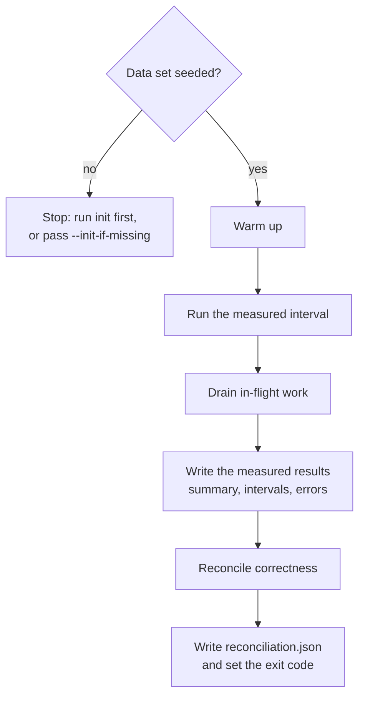

# Workload utility

`CamusDB.Workload` is a utility in the CamusDB source repository. It validates
and measures a CamusDB server with a deterministic mixed workload.

The utility creates a repeatable data set, runs read and write traffic through
the CamusDB client protocol, and verifies the result. It then writes artifacts
that you can compare across two server builds or two configurations.

Use it to:

- Check that a local or test deployment handles concurrent reads and writes.
- Compare gRPC client behavior with REST client behavior.
- Measure the effect of a configuration change, such as a
  [write-ahead log (WAL)](/docs/concepts#wal) or optimizer setting.
- Collect repeatable evidence for performance diagnosis.
- Compare two completed runs only when their invariant settings match, and
  establish a repeatable baseline from several repetitions of the same workload.

To drive the same workload against a Docker cluster while a tool injects a
fault into it, see [Caraxes](/docs/caraxes), the chaos test harness that wraps
this utility.

## Data set

The default workload uses a deterministic table named `workload_accounts`:

```camussql
CREATE TABLE workload_accounts (
  id OID PRIMARY KEY,
  owner INT64 NOT NULL,
  balance INT64 NOT NULL,
  version INT64 NOT NULL,
  payload STRING NOT NULL
);

CREATE INDEX workload_accounts_owner ON workload_accounts (owner);
```

The utility generates the rows, ids, balances, owners, and payloads from three
inputs: the configured seed, the row count, and the payload size. The same
inputs always produce the same data set fingerprint, so `run` can confirm that
it measures the data shape it expects.

Set `--tables` above `1` to spread the dataset across
`workload_accounts_00`, `workload_accounts_01`, and so on. That shape is useful
when you want a workload that touches several key
[ranges](/docs/concepts#ranges-and-spans) or [partitions](/docs/concepts#partition). Use the
same `--tables` value for `init` and `run`.

Setup and reconciliation both happen outside the measured interval.

## Initialize

Run `init` once to create the database, table, index, and seed data:

```bash
dotnet run -c Release --project CamusDB.Workload -- init \
  --endpoint http://127.0.0.1:5096 \
  --database workload \
  --protocol grpc \
  --rows 100000 \
  --payload-bytes 256 \
  --batch 500
```

You can safely run `init` again. If the schema and expected rows already exist,
a second run changes nothing in the measured workload.

Common options:

| Option | Default | Meaning |
| --- | --- | --- |
| `--endpoint` | (required) | Server endpoint. With `--protocol grpc`, use the gRPC port, such as `http://127.0.0.1:5096`. A comma-separated endpoint pool is allowed. |
| `--database` | (required) | Workload database. |
| `--protocol` | `grpc` | Client protocol: `grpc` or `rest`. |
| `--seed` | `1847` | Deterministic seed for ids, payloads, and operation choice. |
| `--rows` | `100000` | Number of rows in `workload_accounts`. |
| `--tables` | `1` | Number of workload tables. More than one spreads rows across `workload_accounts_00`, `workload_accounts_01`, and so on. |
| `--payload-bytes` | `256` | Payload string size for each row. |
| `--no-auto-prepare` | `false` | Add `MaxAutoPrepare=0` to each connection string. |
| `--connection-options` | none | Append extra connection-string pairs verbatim to every setup, read, and write connection, such as `CoalescingDelay=0;ChannelPoolSize=4`. Recorded in `manifest.json`; runs that differ here are not directly comparable. |
| `--routing-mode` | driver default | Learned statement routing mode: `Off`, `Learned`, or `Auto`. When omitted, the driver default is `Auto`. |
| `--routing-nodes` | none | Trust map from server node identities to endpoint pool members, such as `node-a:7070=http://a:5095,node-b:7070=http://b:5095`. |
| `--request-timeout` | client default | Per-request timeout in seconds. |

## Run

`run` goes through the steps below in order. It writes the measured results
before it reconciles, so a reconciliation that cannot finish never discards
them:



Open-loop mode submits a target number of operations per second:

```bash
dotnet run -c Release --project CamusDB.Workload -- run \
  --endpoint http://127.0.0.1:5096 \
  --database workload \
  --protocol grpc \
  --output /tmp/camus-workload-run \
  --mode open \
  --target-ops 800 \
  --workers 64 \
  --connections 8 \
  --duration 5m \
  --warmup 30s \
  --drain 10s
```

Closed-loop mode keeps a fixed number of workers busy, which helps you find the
saturation point:

```bash
dotnet run -c Release --project CamusDB.Workload -- run \
  --endpoint http://127.0.0.1:5096 \
  --database workload \
  --protocol grpc \
  --output /tmp/camus-workload-closed \
  --mode closed \
  --workers 64 \
  --connections 8 \
  --duration 5m \
  --warmup 30s
```

Run options:

| Option | Default | Meaning |
| --- | --- | --- |
| `--output` | (required) | Output directory for the artifacts. It must not already exist. |
| `--mode` | `open` | `open` for load at a target rate, `closed` to saturate the workers. |
| `--target-ops` | `800` | Operations per second that the open loop submits. |
| `--workers` | `64` | Number of concurrent workers. |
| `--concurrency-sweep` | none | Closed-loop comma-separated worker counts, such as `1,8,16,32,64,128`. |
| `--read-percent` | `60` | Percentage of operations that are read-only point reads. |
| `--write-percent` | `40` | Percentage of operations that are write transactions. Reads and writes must add up to `100`. |
| `--writes-per-transaction` | `1` | Row updates in each write transaction. |
| `--duration` | `5m` | Measured interval. |
| `--warmup` | `30s` | Warm-up period before measurement. |
| `--drain` | `10s` | Open-loop drain window after measurement. |
| `--connections` | `8` | Number of read connections, and number of write connections, that the client opens. |
| `--max-in-flight` | `4096` | Open-loop cap on pending plus in-flight operations. Past the cap, the utility counts a schedule drop. |
| `--init-if-missing` | `false` | Create and seed the data set before the run if it is absent. Setup still stays outside the measurement. |
| `--locking` | `optimistic` | Write-transaction locking: `optimistic` or `pessimistic`. |
| `--isolation` | `read_committed` | Write-transaction isolation: `read_committed` or `serializable`. The utility sets it on each write transaction, so its default replaces the server default, which is `serializable`. |
| `--workload` | `accounts` | Write shape: `accounts`, `bank`, `fanout`, or `append`. |
| `--append-keys` | `10` | Append workload only: number of active list keys. Fewer keys create more contention and more dependency edges. |
| `--append-max-writes-per-key` | `64` | Append workload only: rotate to a new key after this many appends, which keeps each list short enough for the checker. |
| `--append-max-txn-length` | `4` | Append workload only: maximum number of read or append steps in one transaction. |
| `--expect-faults` | `false` | Treat conflicts and open-loop pacing shortfalls as validity warnings for chaos runs. |
| `--reconcile-timeout` | `600` | Seconds reconciliation keeps retrying while a cluster settles. |
| `--reconcile-request-timeout` | `120` | Per-request timeout in seconds for setup and reconciliation reads. Separate from `--request-timeout`, which should stay tuned for measured point operations. |
| `--scan-probe-interval` | `off` | Run `SELECT COUNT(*)` against each gateway during the measured window at the given interval, such as `5s`. A low count fails the run, and a failed probe fails unless `--expect-faults` is set. |
| `--scan-probe-timeout` | `60` | Per-request timeout in seconds for scan-probe connections. |
| `--no-row-attribution` | `false` | For transfer workloads, skip per-row balance/version attribution and verify the aggregate sum only. |
| `--metrics-endpoint` | none | Per-node Prometheus endpoints to scrape during the run, as `name=url`, repeatable or comma-separated. Writes `node-metrics.csv` and feeds `bottleneck-report.md`. |
| `--metrics-interval` | `5s` | Scrape interval for `--metrics-endpoint`. |
| `--node-endpoint` | none | Per-node HTTP API bases, as `name=url`, repeatable or comma-separated. Writes `cluster-facts.json` with version, health, configuration, and placement evidence. |
| `--pipeline` | `false` | For gRPC write workloads that support it, send each transaction through the batch-frame pipeline instead of one exchange per statement. Recorded in `manifest.json`; runs that differ here use different client behavior. |

Use `--pipeline` with the `accounts`, `bank`, or `fanout` workloads to measure
the gRPC transaction pipeline. The client sends each write transaction as batch
frames, using the server's `txn_start_ref` and `COMMIT_IF_OK` contract when the
server announces support. On the `bank` shape, the normal six exchanges
(`START`, two reads, two updates, `COMMIT`) can become two exchanges. When the
server or protocol cannot use the pipeline, the client falls back to one
exchange per step. Check `summary.json`'s `exchangesPerWriteTxn` field to see
what the run actually achieved.

The default `accounts` workload divides writers so that no two workers update
the same row. In that baseline, an unexpected conflict counts as evidence
against the run, and the utility does not hide it behind a retry.

Use `--workload bank` for contended transfers inside one dataset. The invariant
is the conserved `SUM(balance)`.

Use `--workload fanout` with `--tables >= 2` for bank-style transfers whose two
legs land in different workload tables. This exercises multi-range and
cross-partition transaction paths.

Use `--workload append` for a list-append history that
[Elle](https://github.com/jepsen-io/elle), the transaction isolation checker
from the Jepsen project, can analyze. The utility creates a
separate `elle_append` table and runs short transactions over a small rotating
set of list keys. A transaction can read a list or append a unique value to a
list. The measured run still validates the seeded workload rows, but the append
operations are recorded separately for an external Elle check.

The append workload is useful when a conserved sum is not enough evidence. A
bank transfer invariant can prove that money was not created or destroyed; an
Elle list-append history can expose dependency cycles such as lost updates,
write skew, read skew, dirty reads, or reads of aborted writes.

`--no-row-attribution` makes transfer reconciliation cheaper by checking the
aggregate sum only. It can miss two opposite leaked writes that cancel each
other out, so use it only when the full before/after row scan is too expensive.

`--metrics-endpoint` and `--node-endpoint` are most useful in cluster runs. The
first records how work and backlogs moved across nodes during the measured
window. The second records what build, configuration, durability fingerprint,
and placement the run actually measured, so later comparisons can reject runs
that look similar but are not the same experiment.

## Output artifacts

A successful run writes these artifacts:

| File | Contents |
| --- | --- |
| `manifest.json` | Tool version, endpoint, protocol, requested routing mode, trust map, connection-string options, pipeline mode, workload shape, runtime, and data set fingerprint. |
| `summary.json` | Machine-readable summary of throughput, latency, errors, `exchangesPerWriteTxn`, and validity. |
| `summary.md` | Human-readable run summary. |
| `intervals.csv` | Per-second samples of offered, started, completed, failed, and in-flight operations, plus latency. |
| `errors.json` | Error counts by code, sampled messages, and message-shape classes for each code. |
| `reconciliation.json` | Correctness verification of committed writes and final row versions. |
| `run-meta.json` | Wall-clock anchor for the measured window, plus warmup, measurement, and drain durations. |
| `client-resources.json` | The load generator's own CPU, memory, and headroom, so you can see a client-side bottleneck. |

When `--scan-probe-interval` is enabled, the run also writes `scan-probe.csv`
with the in-window scan results.

When `--workload append` is enabled, the run also writes `history.edn` and
`elle.json`. `history.edn` is a Jepsen/Elle list-append history. `elle.json`
records the model, the history file name, the isolation and locking modes, the
append key settings, the run tag, and the counts of `ok`, `fail`, and `info`
operations. The workload utility records the history; run the Elle checker as a
separate step.

When `--metrics-endpoint` is set, the run also writes `node-metrics.csv`,
`node-metrics-meta.json`, `bottleneck-report.md`, and the last scrape files used
to build that report. When `--node-endpoint` is set, the run writes
`cluster-facts.json`.

Transfer workloads write `transfer-ledger.csv`. With row attribution enabled,
the reconciliation can also write row-attribution violation details. Those files
explain which rows and transaction attempts caused a balance or version
invariant to fail.

The `classes` section in `errors.json` groups messages that differ only by ids,
counts, revisions, or endpoint details. It helps separate distinct failure
causes that share one CamusDB error code without storing an unbounded set of raw
messages.

The process exits with a code greater than zero when the run is invalid or
reconciliation fails.

With `--concurrency-sweep`, each worker count is a complete run under
`<output>/workers-N`. The top level writes `sweep.csv` and `sweep.md` as the
cross-point summary.

## Bottleneck report

The server can expose Prometheus metrics. A run can collect per-node metrics
itself with `--metrics-endpoint`, which writes `node-metrics.csv` and usually
builds `bottleneck-report.md` automatically. The `report` verb can rebuild that
report later from a single scraped `/metrics` file or a collected
`node-metrics.csv`:

```bash
dotnet run -c Release --project CamusDB.Workload -- report \
  --output /tmp/camus-workload-run \
  --metrics /tmp/server-metrics.txt
```

```bash
dotnet run -c Release --project CamusDB.Workload -- report \
  --output /tmp/camus-workload-run \
  --node-metrics /tmp/camus-workload-run/node-metrics.csv
```

That command writes `bottleneck-report.md` in the run directory.

The report compares client-side throughput and latency with server metrics.
With per-node metrics and cluster facts, it can also show request distribution,
[leader](/docs/concepts#leader) concentration, partition and table placement,
WAL or storage bottlenecks, and backlog growth.

Treat the report as diagnostic evidence: use it to find which measured stage
needs attention before you tune anything.

To collect diagnostics with one command on a local machine, see
[Performance Diagnostics](/docs/performance-diagnostics).

## Compare and baseline

The `compare` verb compares two completed run directories. It refuses the pair
when invariant fields differ, unless you explicitly allow the field under test:

```bash
dotnet run -c Release --project CamusDB.Workload -- compare \
  --baseline /tmp/camus-workload-base \
  --candidate /tmp/camus-workload-candidate \
  --allow workers \
  --require-ratio 1.10 \
  --p99-budget-ms 250 \
  --output /tmp/camus-workload-comparison
```

`--require-ratio`, `--require-ops`, and `--p99-budget-ms` turn the comparison
into a gate. The command exits 0 when the candidate is comparable and passes, 1
when it is comparable but misses the gate, and 3 when the runs should not be
compared.

The `baseline` verb aggregates repeated runs of the same workload. Use it when
you need to know the median result and the spread before judging a later
candidate:

```bash
dotnet run -c Release --project CamusDB.Workload -- baseline \
  --runs /tmp/run-1,/tmp/run-2,/tmp/run-3 \
  --output /tmp/camus-workload-baseline
```

It writes `baseline.md` when `--output` is set. Exit code 3 means the supplied
runs are not one comparable baseline.

## Cleanup

The `cleanup` verb drops only the workload database. You must confirm the name
explicitly:

```bash
dotnet run -c Release --project CamusDB.Workload -- cleanup \
  --endpoint http://127.0.0.1:5096 \
  --database workload \
  --protocol grpc \
  --confirm workload
```

The command refuses an empty database name, the default or system database
name, and any name you did not confirm.
