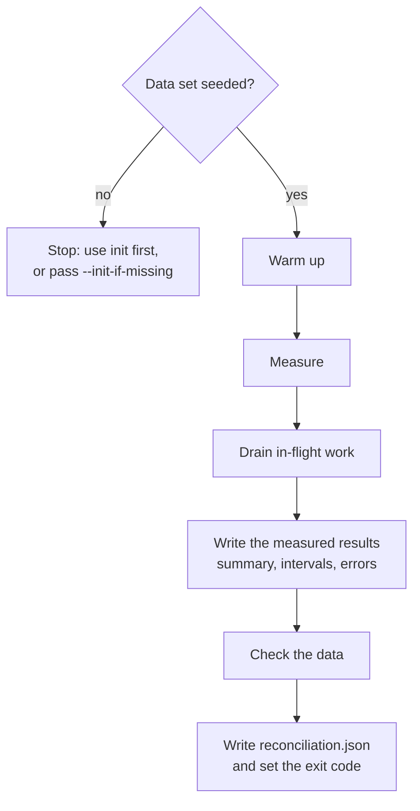

# Workload utility

`CamusDB.Workload` measures and checks a CamusDB server under load. It creates a
repeatable data set, and it sends reads and writes through the CamusDB client.
After the run, it verifies the data. The results are written as files that you
can compare between two server builds or two configurations.

You can use it for the following tasks:

- Check that a deployment handles concurrent reads and writes correctly.
- Measure the effect of a configuration change, such as a
  [write-ahead log (WAL)](/docs/concepts#wal) setting.
- Compare the gRPC client with the REST client.
- Record a baseline from repeated measurements, and test a later build against
  it.

The utility is in the CamusDB source repository. Start it with `dotnet run`
from a checkout. To drive the same workload against a Docker cluster while
faults are injected, see [Caraxes](/docs/caraxes).

## Data set

The default workload uses this table:

```camussql
CREATE TABLE workload_accounts (
  id OID PRIMARY KEY,
  owner INT64 NOT NULL,
  balance INT64 NOT NULL,
  version INT64 NOT NULL,
  payload STRING NOT NULL
);

CREATE INDEX workload_accounts_owner ON workload_accounts (owner);
```

The rows are generated from the seed, the row count, and the payload size. The
same values give the same data set fingerprint. The `run` command uses the
fingerprint to check that the data is what it expects.

With `--tables` above `1`, the rows are spread over `workload_accounts_00`,
`workload_accounts_01`, and so on. This puts data on each
[partition](/docs/concepts#partition), for a workload that touches several key
[ranges](/docs/concepts#ranges-and-spans). Use the same `--tables` value for
`init` and `run`.

Setup and the checks after the run aren't part of the measured interval.

## Initialize

Run `init` once to create the schema and the rows:

```bash
dotnet run -c Release --project CamusDB.Workload -- init \
  --endpoint http://127.0.0.1:5096 \
  --database workload \
  --protocol grpc \
  --rows 100000 \
  --payload-bytes 256 \
  --batch 500
```

You can run `init` again safely. If the schema and the rows exist, the data
doesn't change.

The following options apply to `init` and to the other commands that connect to
a server:

| Option | Default | Meaning |
| --- | --- | --- |
| `--endpoint` | Required | The server endpoint. With `--protocol grpc`, use the gRPC port, such as `http://127.0.0.1:5096`. A comma-separated pool of endpoints is allowed. |
| `--database` | Required | The workload database. |
| `--protocol` | `grpc` | The client protocol: `grpc` or `rest`. |
| `--seed` | `1847` | The seed for the generated data and the choice of operations. |
| `--rows` | `100000` | The number of rows, over all workload tables. |
| `--tables` | `1` | The number of workload tables. It can't be larger than `--rows`. |
| `--payload-bytes` | `256` | The size of the payload string of each row. |
| `--no-auto-prepare` | `false` | Add `MaxAutoPrepare=0` to each connection string. |
| `--connection-options` | None | Extra connection-string pairs for each connection, such as `CoalescingDelay=0;ChannelPoolSize=4`. They're recorded in `manifest.json`. |
| `--routing-mode` | Driver default | Learned statement routing: `Off`, `Learned`, or `Auto`. The driver default is `Auto`, which takes effect when `--routing-nodes` maps two or more different endpoints. |
| `--routing-nodes` | None | A map from server node identities to endpoint pool members, such as `node-a:7070=http://a:5095,node-b:7070=http://b:5095`. |
| `--request-timeout` | Client default | The timeout in seconds for each request. |

`init` also takes `--batch`, the rows in each seeding transaction (default
`500`). With `--workload tpch` or `--workload tpcc`, it also loads the tables of
that workload. See [Analytical workload](#analytical-workload-tpch) and
[Transactional workload](#transactional-workload-tpcc).

## Run

`run` does the following steps in order. It writes the measured results before
the checks start. This means that a check that can't finish doesn't discard the
results.



Open-loop mode sends a target number of operations per second:

```bash
dotnet run -c Release --project CamusDB.Workload -- run \
  --endpoint http://127.0.0.1:5096 \
  --database workload \
  --protocol grpc \
  --output /tmp/camus-workload-run \
  --mode open \
  --target-ops 800 \
  --workers 64 \
  --connections 8 \
  --duration 5m \
  --warmup 30s \
  --drain 10s
```

Closed-loop mode gives each worker one operation at a time. Use it to find the
saturation point:

```bash
dotnet run -c Release --project CamusDB.Workload -- run \
  --endpoint http://127.0.0.1:5096 \
  --database workload \
  --protocol grpc \
  --output /tmp/camus-workload-closed \
  --mode closed \
  --workers 64 \
  --connections 8 \
  --duration 5m \
  --warmup 30s
```

The following options apply to `run`:

| Option | Default | Meaning |
| --- | --- | --- |
| `--output` | Required | The output directory. It must not exist. |
| `--mode` | `open` | `open` for a target rate, `closed` to saturate the workers. |
| `--target-ops` | `800` | Open loop: the operations per second to send. |
| `--workers` | `64` | The number of concurrent workers. |
| `--concurrency-sweep` | None | Closed loop: a comma-separated list of worker counts, such as `1,8,16,32,64,128`. |
| `--read-percent` | `60` | The percentage of operations that are read-only point reads. |
| `--write-percent` | `40` | The percentage of write transactions. The two percentages must add up to `100`. |
| `--writes-per-transaction` | `1` | The row updates in each write transaction. |
| `--duration` | `5m` | The measured interval. |
| `--warmup` | `30s` | The warm-up period before measurement. |
| `--drain` | `10s` | Open loop: the wait for in-flight work after measurement. |
| `--stop-after-completed` | `0` | End the measured interval after this many successful operations, or at `--duration`. `0` uses the full duration. The rates are computed over the measured time. |
| `--connections` | `8` | The number of read connections. The same number of write connections is opened. |
| `--max-in-flight` | `4096` | Open loop: the maximum pending and in-flight operations. Above it, the utility counts a schedule drop. |
| `--init-if-missing` | `false` | Create and seed the data set if it doesn't exist. Setup isn't measured. |
| `--locking` | `optimistic` | The locking of write transactions: `optimistic` or `pessimistic`. |
| `--isolation` | `read_committed` | The isolation of write transactions: `read_committed` or `serializable`. The utility sets it on each write transaction. This means that its default replaces the server default, `serializable`. |
| `--workload` | `accounts` | The workload shape. See [Workloads](#workloads). |
| `--expect-faults` | `false` | For chaos tests. Conflicts and open-loop pacing shortfalls become warnings, and they don't make the run invalid. |
| `--reconcile-timeout` | `600` | The seconds that the checks after the run retry while a cluster settles. |
| `--reconcile-request-timeout` | `120` | The timeout in seconds for each setup and check request. Keep `--request-timeout` for the measured operations. |
| `--scan-probe-interval` | `off` | Count the rows with `SELECT COUNT(*)` on each gateway at this interval, such as `5s`. A count below the row count fails the run. A failed probe also fails it, unless `--expect-faults` is set. |
| `--scan-probe-timeout` | `60` | The timeout in seconds for each scan probe. |
| `--no-row-attribution` | `false` | Transfer workloads: check the total balance only. See [Workloads](#workloads). |
| `--metrics-endpoint` | None | The Prometheus endpoints of the nodes, as `name=url`. Repeat the option, or separate the values with commas. |
| `--metrics-interval` | `5s` | The scrape interval for `--metrics-endpoint`. |
| `--node-endpoint` | None | The HTTP API base of each node, as `name=url`. The run writes `cluster-facts.json` with the version, health, and placement of each node. |
| `--pipeline` | `false` | gRPC: send each write transaction as pipelined frames. See [Pipelined writes](#pipelined-writes). |

`--metrics-endpoint` and `--node-endpoint` are most useful in a cluster. The
first records how the work and the backlogs moved between nodes. The second
records the setup that the run measured, such as the build and the placement.
`compare` uses it to refuse two results that look similar but aren't the same
experiment.

## Workloads

| Workload | What it tests | Check after the run |
| --- | --- | --- |
| `accounts` | Read-modify-write updates. Each worker updates a separate set of rows. | The row count and the row versions. A conflict makes the run invalid. |
| `bank` | Contended transfers between rows. | `SUM(balance)` doesn't change. |
| `fanout` | Transfers whose two legs are in different tables. Needs `--tables` of `2` or more. | `SUM(balance)` doesn't change. |
| `tokens` | Each write deletes a token row and inserts the next one, in one transaction. | Each of the `--tokens` slots (default `2000`) has exactly one row. |
| `append` | List-append transactions for [Elle](#elle-histories). | A history for Elle's `list-append` checker. |
| `rw` | Blind writes and point reads of single-value registers. | A history for Elle's `rw-register` checker. |
| `predicate` | Group reads by a predicate, against inserts and updates. | A history for Elle's `rw-register` checker. |
| `tpch` | 22 analytical queries. | Each answer matches a reference answer. |
| `tpcc` | The five TPC-C transaction types. | The TPC-C consistency conditions. |

In the `accounts` workload, two workers don't write the same row. A conflict is
evidence against the run, and the utility doesn't retry it. Note that on a node
with a small memory profile, such as `--memory-profile dev`, a few `CADB0504`
conflicts can occur when cached rows are evicted. The run is then marked
invalid. Use the default memory profile for measurements.

The transfer workloads (`bank` and `fanout`) also check the balance and the
version of each row. They write `transfer-ledger.csv`, and the row checks can
write violation details that show which rows and attempts broke the invariant.
`--no-row-attribution` checks the total only. It's cheaper, but it can miss two
opposite leaked writes that cancel each other out. Use it if the full row scan
takes too long.

### Pipelined writes

With `--pipeline`, the `accounts`, `bank`, and `fanout` workloads send each
write transaction over gRPC as batch frames. The client uses the server's
`txn_start_ref` and `COMMIT_IF_OK` contract when the server announces support.
On the `bank` workload, the six exchanges (`START`, two reads, two updates,
`COMMIT`) become two.

If the server or the protocol can't use the pipeline, the client sends one
exchange for each step. The `exchangesPerWriteTxn` field in `summary.json`
shows what the run achieved. A result with `--pipeline` and a result without it
measure different client behavior.

### Elle histories

[Elle](https://github.com/jepsen-io/elle) is the transaction isolation checker
of the Jepsen project. A conserved sum can show that no money was created or
lost. However, it can't show dependency cycles, such as lost updates or write
skew. An Elle history can.

The `append`, `rw`, and `predicate` workloads record a history in `history.edn`
and `elle.json`. The utility doesn't check the history. Run the Elle checker
separately.

- `append` uses a separate `elle_append` table. A transaction reads a list or
  appends a unique value to it.
- `rw` writes and reads single-value registers.
- `predicate` reads groups by a predicate. A group read records each key that
  the predicate can match, including keys that don't exist. This lets the
  checker find rows that appear.

For example, change the endpoint and the data set options from the `run`
command above:

```bash
dotnet run -c Release --project CamusDB.Workload -- run \
  --endpoint http://localhost:5096 --protocol grpc --database workload \
  --workload rw --rw-access join --isolation serializable --duration 60s \
  --mode closed --workers 8 --output runs/rw-join
```

| Option | Default | Meaning |
| --- | --- | --- |
| `--txn-mode` | `explicit` | `explicit` uses `BEGIN` and `COMMIT`. `autocommit` makes each statement a transaction. `pipeline` sends the statements as frames, with `BEGIN` in the first frame and the commit in the last. |
| `--elle-key-distribution` | `uniform` for `append`, `exponential` for the others | `uniform` picks each active key with the same chance. `exponential` puts about half the steps on the first key, a quarter on the next, and so on. |
| `--rw-keys`, `--rw-max-writes-per-key`, `--rw-max-txn-length` | `10`, `32`, `4` | The active registers, the writes before a key is replaced, and the maximum steps in a transaction. |
| `--rw-key-type` | `int64` | Also `string` or `numeric`. |
| `--rw-access` | `pk` | `pk`, `secondary` (an unindexed copy of the key), `index`, or `join`. The `pipeline` mode supports `pk` and `join`. |
| `--predicate-groups`, `--predicate-group-size` | `8`, `8` | The active groups, and the possible keys in each group. |
| `--predicate-max-writes-per-group`, `--predicate-max-txn-length` | `12`, `3` | The writes before a group is replaced, and the maximum steps in a transaction. |
| `--predicate-read` | `index` | `index` reads by an indexed group column, `scan` by an unindexed one, and `range` by primary-key bounds. |
| `--append-keys` | `10` | The active lists. Fewer keys give more contention. |
| `--append-max-writes-per-key` | `64` | The appends before a list is replaced. This limits the length of each list for the checker. |
| `--append-max-txn-length` | `4` | The maximum read or append steps in a transaction. |

In `autocommit` mode, each transaction has one step. This means that it can't
test invariants across statements. `--txn-mode` is separate from `--pipeline`.
Compare results that use the same mode.

After the drain, these workloads also read the final state and compare it with
the ledger of attempted writes. The result is in `reconciliation.json`. It
checks for the following problems:

- An acknowledged write that was lost.
- A write that returned an error but became visible.
- A duplicate or unknown value.
- A different answer through a different access path.

A write with an unknown outcome can have either result. A predicate count is
compared with the rows only if both reads used the same transaction snapshot.
Two separate statements in Read Committed or autocommit mode can see a
concurrent change.

### Analytical workload: tpch

`--workload tpch` tests analytical queries, such as joins and grouping, with the
22 TPC-H queries on eight generated tables. Setup records a reference answer for each
query before the measurement. Each execution is checked against it. The loaded
data is also checked against row counts and facts from the generator, for
example for Q1 and Q6.

```bash
dotnet run -c Release --project CamusDB.Workload -- init \
  --endpoint http://127.0.0.1:5096 --database analytics \
  --workload tpch --tpch-scale 0.01 --rows 1000

dotnet run -c Release --project CamusDB.Workload -- run \
  --endpoint http://127.0.0.1:5096 --database analytics \
  --workload tpch --tpch-scale 0.01 --rows 1000 \
  --mode closed --read-percent 100 --write-percent 0 --workers 4 \
  --duration 5m --output /tmp/camus-tpch
```

The scale defaults to `0.01`, about 86,000 rows. At `1`, it's about 8.66
million rows. The tables are added next to the base accounts data set.
`--tpch-load-connections` sets the load concurrency (default `8`). `init` and
`run` must use the same scale and seed.

This workload needs `--mode closed` and `--read-percent 100`. By default, all
22 queries are used. `--tpch-queries 1,3,6` or `--tpch-queries 1-6,14` selects
some of them. Each selected query must complete a verified execution in the
measured interval.

The results are in `tpch.json`, with the latency and the verification of each
query. The reference answers are in `tpch-reference.json`, and the differences
are in `tpch-mismatches.jsonl`. Note that these numbers aren't TPC-H scores.
Published scores use different rules.

### Transactional workload: tpcc

`--workload tpcc` tests order-entry transactions. It uses the standard mix of the five TPC-C transaction types:

| Transaction | Share |
| --- | --- |
| New-Order | 45% |
| Payment | 43% |
| Order-Status | 4% |
| Delivery | 4% |
| Stock-Level | 4% |

```bash
dotnet run -c Release --project CamusDB.Workload -- init \
  --endpoint http://127.0.0.1:5096 --database orders_bench \
  --workload tpcc --tpcc-warehouses 1 --tpcc-scale 0.01 --rows 1000

dotnet run -c Release --project CamusDB.Workload -- run \
  --endpoint http://127.0.0.1:5096 --database orders_bench \
  --workload tpcc --tpcc-warehouses 1 --tpcc-scale 0.01 --rows 1000 \
  --mode closed --read-percent 0 --write-percent 100 --workers 4 \
  --duration 5m --output /tmp/camus-tpcc
```

This workload needs `--write-percent 100`. That value selects the full mix,
including its read-only transactions. The write transactions use `--isolation`
and `--locking`, and a conflict is retried in a new transaction. The read-only
types use Serializable snapshots. Delivery uses one transaction for each
district.

`--tpcc-warehouses` defaults to `1`. One warehouse at `--tpcc-scale 1` is about
500,000 rows. Workers are assigned to warehouses by worker index, modulo the
warehouse count. You should use at least as many workers as warehouses.
`--tpcc-scale` defaults to `1`, and it can be from `0.01` to `1`. It reduces the data
sizes for smaller tests, and it's separate from the warehouse count. `init` and
`run` must use the same warehouse count, scale, and seed.
`--tpcc-load-connections` defaults to `8`.

The consistency conditions are checked before and after the run, and each
transaction records the anomalies that it finds. The run fails in the following
cases:

- An anomaly was found.
- A final check failed.
- A transaction type had no measured commit.

`tpcc.json` has the latency and the throughput of each type, and the
consistency results. `tpcc-anomalies.jsonl` lists the anomalies. The workload
has no keying time and no think time. This means that its New-Order rate can't
be compared with a published tpmC.

## Output files

A successful run writes the following files:

| File | Contents |
| --- | --- |
| `manifest.json` | The settings of the run, such as the tool version, the endpoint, the workload, and the data set fingerprint. |
| `summary.json` | The throughput, latency, errors, `exchangesPerWriteTxn`, and validity, for scripts. |
| `summary.md` | A summary to read. |
| `intervals.csv` | Samples for each second: the operations offered, started, completed, failed, and in flight, and the latency. |
| `errors.json` | The error counts by code, with sample messages. |
| `reconciliation.json` | The checks of the committed writes and the final row versions. |
| `run-meta.json` | The start time of the measured interval, and the durations of the warm-up, measurement, and drain. |
| `client-resources.json` | The CPU and memory use of the load generator, to show a bottleneck on the client. |

Some options and workloads add files:

| File | Written when |
| --- | --- |
| `scan-probe.csv` | `--scan-probe-interval` is set. |
| `history.edn`, `elle.json` | The workload is `append`, `rw`, or `predicate`. |
| `transfer-ledger.csv` | The workload is `bank` or `fanout`. |
| `token-ledger.csv` | The workload is `tokens`. |
| `tpch.json`, `tpch-reference.json`, `tpch-mismatches.jsonl` | The workload is `tpch`. |
| `tpcc.json`, `tpcc-anomalies.jsonl` | The workload is `tpcc`. |
| `node-metrics.csv`, `node-metrics-meta.json`, `bottleneck-report.md` | `--metrics-endpoint` is set. |
| `cluster-facts.json` | `--node-endpoint` is set. |

In `errors.json`, the `classes` section groups messages that differ only in
details such as IDs or counts. This separates different failures that have the
same CamusDB error code.

The process exits with a code above zero when the run is invalid or a check
fails. With `--concurrency-sweep`, each worker count is a complete run in
`<output>/workers-N`. The top level has `sweep.csv` and `sweep.md` with a summary
of all points.

## Bottleneck report

The report compares the throughput and latency on the client with the server
metrics. With metrics and facts from each node, it can also show how requests
and [leaders](/docs/concepts#leader) are spread over the nodes, and where the
storage or the WAL limits the throughput. Use it to find the stage that needs
attention before you tune anything.

The server serves Prometheus metrics when `diagnostics.prometheus_enabled` is
`true`. For more information, see
[Performance diagnostics](/docs/performance-diagnostics). A run with
`--metrics-endpoint` builds `bottleneck-report.md`. The `report` command builds
it later, from one scraped `/metrics` file or from `node-metrics.csv`:

```bash
dotnet run -c Release --project CamusDB.Workload -- report \
  --output /tmp/camus-workload-run \
  --metrics /tmp/server-metrics.txt

dotnet run -c Release --project CamusDB.Workload -- report \
  --output /tmp/camus-workload-run \
  --node-metrics /tmp/camus-workload-run/node-metrics.csv
```

The report is written to the run directory.

## Compare and baseline

`compare` compares two run directories. If a field that defines the experiment
differs, such as the isolation or the build, the pair can't be compared. To test
the effect of one field, waive it with `--allow`:

```bash
dotnet run -c Release --project CamusDB.Workload -- compare \
  --baseline /tmp/camus-workload-base \
  --candidate /tmp/camus-workload-candidate \
  --allow isolation \
  --require-ratio 1.10 \
  --p99-budget-ms 250 \
  --output /tmp/camus-workload-comparison
```

Differences in fields such as `workers` and `connections` are shown, but they
don't make the pair incomparable. `--require-ratio`, `--require-ops`, and
`--p99-budget-ms` make the comparison a gate. With `--output`, the result is
also written to `comparison.md`. The exit code is one of the following values:

| Exit code | Meaning |
| --- | --- |
| `0` | The results are comparable, and the candidate passes. |
| `1` | The results are comparable, and the candidate misses a gate. |
| `3` | The results can't be compared. |

`baseline` summarizes several run directories of the same workload. Use it to know the
median and the variation before you judge a later candidate:

```bash
dotnet run -c Release --project CamusDB.Workload -- baseline \
  --runs /tmp/run-1,/tmp/run-2,/tmp/run-3 \
  --output /tmp/camus-workload-baseline
```

A baseline needs at least three usable results, with a coefficient of variation of
10% or less in the throughput. With `--output`, the result is also written to
`baseline.md`. The exit code is `0` for an established baseline, `1` when it
isn't established, and `3` when the results can't be compared.

## Cleanup

`cleanup` drops the workload database. You must confirm the name:

```bash
dotnet run -c Release --project CamusDB.Workload -- cleanup \
  --endpoint http://127.0.0.1:5096 \
  --database workload \
  --protocol grpc \
  --confirm workload
```

An empty name, the default database name, and a name that doesn't match
`--confirm` return exit code `2`.
